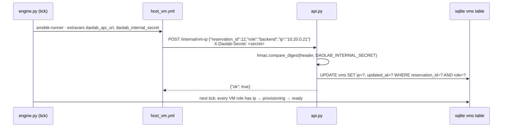

# Backend API service

Part of the daolab implementation plan — see [README.md](README.md) for the doc map.

Scope: `service/api.py` and `service/config.py` — the HTTP surface over the domain model
([01-domain-model.md](01-domain-model.md)) and the pure scheduler ([03-scheduler.md](03-scheduler.md)).
Siblings: lifecycle engine [04-lifecycle-engine.md](04-lifecycle-engine.md), playbooks
[05-provisioning.md](05-provisioning.md), dashboards [06-frontend.md](06-frontend.md),
CLI/env/ops [08-cli-config-ops.md](08-cli-config-ops.md).

## Service structure

`service/api.py` is one FastAPI module, served by `make api` →
`python -m uvicorn service.api:app --host $(DAOLAB_API_HOST) --port $(DAOLAB_API_PORT)`
(default `http://localhost:8080`).

```
service/api.py
├── app = FastAPI()                    # module-level; uvicorn target service.api:app
├── auth dependencies                  # current_user / require_admin / require_internal
├── pydantic request models            # ReservationCreate, VmIpCallback
├── routes (registered before static)  # /health /whoami /usecases /pools /setups
│                                      #   /reservations (+/{id}) /internal/vm-ip
├── serializers                        # reservation_object(), catalog_row(), setup_row()
├── error layer                        # DaolabError + handlers → the §Error model envelope
└── static routes                      # GET /  /user.html  /admin.html ← DAOLAB_DASHBOARD_DIR
```

`service/config.py` loads `.env` via `python-dotenv` once at import and exposes a frozen
settings singleton. Each field maps 1:1 to its env var (`db_path` ↔ `DAOLAB_DB_PATH`, ...)
with the contract defaults listed in [08-cli-config-ops.md](08-cli-config-ops.md):

```python
# service/config.py
@dataclass(frozen=True)
class Settings:
    db_path: str; api_host: str; api_port: int; api_url: str; internal_secret: str
    dashboard_dir: str; hw_class_lead_min: int; provision_lead_min: int
    sched_horizon_hours: int; log_level: str
    @classmethod
    def from_env(cls) -> "Settings": ...   # load_dotenv() + os.environ with defaults
settings = Settings.from_env()
```

Module boundaries (nothing crosses them):

| Module | api.py's use of it | Never done by api.py |
|---|---|---|
| `service/models.py` | `models.connect()` — one sqlite connection per request (`PRAGMA journal_mode=WAL`, `PRAGMA foreign_keys=ON` set there) plus typed row helpers (`user_by_token_hash`, `usecase_by_name`, `insert_reservation`, `set_vm_ip`, ...). JSON-in-TEXT columns are parsed/written only by models.py. | Raw SQL in route bodies; schema DDL. |
| `service/catalog.py` | Nothing at runtime. YAML → DB mirroring is `daolab sync` (CLI); the API reads only the DB. | Reading `usecases/` or `setups/` YAML from a request handler. |
| `service/scheduler.py` | `scheduler.place(db, ...)` on POST /reservations; `scheduler.next_free_at(db, ...)` for catalog availability. Pure functions over the DB handle — full contract in [03-scheduler.md](03-scheduler.md). | Re-implementing slot or lead-time logic in the API layer. |

Route handlers are plain `def` (FastAPI threadpool), keeping `sqlite3` usage synchronous.

## Auth model

Four auth kinds, implemented as three FastAPI dependencies:

- **user** — header `Authorization: Bearer <token>`. Tokens are issued only by
  `daolab add-user <username> <pubkey_path> [--role admin|user]` (`secrets.token_urlsafe(32)`,
  printed once as `token: <token>`); the DB stores only `sha256(token).hexdigest()` in
  `users.token_hash`. `current_user()` hashes the presented token and looks it up; missing or
  unknown → `401 unauthorized`; known but `users.enabled = 0` → `403 forbidden` with
  `detail.reason: "user_disabled"` (admins flip `enabled` via `PATCH /users/{id}`). No expiry;
  rotation = delete row + re-add.
- **admin** — `require_admin()` wraps `current_user()` and checks `users.role == 'admin'`
  (`users.role` ∈ `admin` | `user`). Admin ⊇ user: an admin token passes every user check; a
  user token on an admin endpoint (`GET /pools`, `GET /setups`, `GET /reservations?all=1`) →
  `403 forbidden`.
- **internal** — header `X-Daolab-Secret`, compared to `settings.internal_secret` with
  `hmac.compare_digest`. Used only by `POST /internal/vm-ip`; while `DAOLAB_INTERNAL_SECRET`
  is empty the API refuses the callback (`401`). Deliberately separate from user tokens:
  machine-to-machine, handed to playbooks by the engine as the `daolab_internal_secret`
  extravar, and it grants exactly one write (`vms.ip`) — never reservation or catalog access.
- **none** — `/health` and the three static dashboard routes.

```python
def current_user(authorization: str | None = Header(None)) -> sqlite3.Row: ...   # 401
def require_admin(user: sqlite3.Row = Depends(current_user)) -> sqlite3.Row: ... # 403
def require_internal(x_daolab_secret: str | None = Header(None)) -> None: ...    # 401
```

## Endpoint reference

All bodies JSON. Paths: plural nouns, no version prefix, kebab-case segments.

| Method | Path | Auth | Purpose |
|---|---|---|---|
| GET | `/health` | none | Liveness for monitoring/systemd. |
| GET | `/whoami` | user | Identify the token; dashboards learn `role`. |
| GET | `/usecases` | user | Catalog with computed availability (drives `user.html`). |
| GET | `/pools` | admin | Top of the admin drill-down. |
| GET | `/setups` | admin | Setups + members, links, diagram, hold, queue (drives `admin.html`). |
| GET | `/users` | admin | User list with `enabled` flag and active-reservation counts (admin Users panel). |
| PATCH | `/users/{id}` | admin | Enable/disable a user: body `{"enabled": bool}`. |
| POST | `/reservations` | user | Create — use-case mode or DIY mode. |
| GET | `/reservations` | user | Own reservations, newest first; `?all=1` admin-only. |
| GET | `/reservations/{id}` | user (owner) or admin | One reservation, live state + SSH details. |
| DELETE | `/reservations/{id}` | user (owner) or admin | Cancel (allowed in `queued`, `ready`, `active`). |
| POST | `/internal/vm-ip` | internal | VM-IP callback from `host_vm.yml` / `dpu_prepare.yml`. |

**GET /health** → `200 {"status": "ok"}`

**GET /whoami** → `200 {"id": 1, "username": "hrushi", "role": "user", "created_at": "2026-08-30T09:00:00Z"}`

**GET /usecases** → `200`, array ordered by `usecases.id` (README table order, `diy` included).
Each row also carries the info-modal payload: `doc_url` + `doc_summary` (seeded verbatim from
the DAO docs), parsed `requires` / `hw_class` / `roles`, and `setups` — the capability-matching
setups as `{name, capabilities, members(name,kind,host), links, diagram}` so the (non-admin)
user page can render the testbed without `GET /setups`; `[]` on planned rows:

```json
[{"name": "tls-proxy-nginx", "description": "NGINX TLS termination proxy, RSA/ECDSA offloaded to CPT",
  "variant": "separate-backend", "status": "active", "available": true, "reason": null,
  "missing": [], "next_free_at": "2026-08-30T10:00:00Z"},
 {"name": "virtio-l2fwd", "description": "L2 forwarding between host virtio devices and wire",
  "variant": null, "status": "planned", "available": false, "reason": "no_yaml", "missing": [], "next_free_at": null},
 {"name": "diy", "description": "Bare setup, no DAO app", "variant": null, "status": "active",
  "available": true, "reason": null, "missing": [], "next_free_at": "2026-08-30T10:00:00Z"}]
```

**GET /pools** → `200 [{"id": 1, "name": "lab-1", "setups": ["setup-01"]}]`

**GET /users** → `200 [{"id": 1, "username": "hrushi", "role": "user", "enabled": true,
"created_at": "2026-08-30T09:00:00Z", "active_reservations": 2}]` (`active_reservations` =
reservations not in `released`/`failed`).
**PATCH /users/{id}** — request `{"enabled": false}` → `200` the user object. Unknown id →
`404 not_found`; an admin disabling their own account → `409 invalid_state` (lockout guard);
disabling leaves the user's reservations untouched — cancel them via
`DELETE /reservations/{id}` if the hold must end.

**GET /setups** → `200`, one row per setup; `held_by` = the reservation currently in
`provisioning`/`ready`/`active`/`tearing_down` on the setup or `null`; `queue` = `queued`
reservations ordered by `start_at`; both use the reservation-summary shape
`{"id", "user", "usecase", "state", "start_at", "end_at"}`:

```json
[{"id": 1, "name": "setup-01", "pool": "lab-1", "capabilities": ["e810", "octeon-cn106", "sdp", "wire"],
  "members": [
    {"name": "dpu-01", "kind": "dpu", "capabilities": ["octeon-cn106", "sdp"], "host": "dpu-01-xcp", "hw_class": "sdp-pf1-vf8"},
    {"name": "tg-01", "kind": "nic", "capabilities": ["e810"], "host": "tg-01-xcp", "hw_class": null}],
  "links": [{"a": "dpu-01.eth0", "b": "tg-01.e810p0", "capability": "wire"}],
  "diagram": "graph LR\n  C[client VM · tg-01] -- HTTPS 443 / 25G --> P[NGINX · OCTEON CN106]\n  ...",
  "held_by": {"id": 12, "user": "hrushi", "usecase": "tls-proxy-nginx", "state": "active",
              "start_at": "2026-09-01T10:00:00Z", "end_at": "2026-09-01T12:00:00Z"},
  "queue": []}]
```

**POST /reservations** — request and `201` response: see §Creating reservations.

**GET /reservations** → `200`, array of reservation objects (canonical shape below), own rows
newest first by `created_at`; `?all=1` returns everyone's (admin token, else `403`).
**GET /reservations/{id}** → `200`, one reservation object; non-owner non-admin → `403`;
unknown id → `404`. The canonical reservation object, returned by every endpoint that returns
a reservation:

```json
{"id": 12, "user": "hrushi", "usecase": "tls-proxy-nginx", "setup": "setup-01",
 "state": "ready", "diy": false, "requested_start_at": "2026-09-01T10:00:00Z",
 "start_at": "2026-09-01T10:00:00Z", "end_at": "2026-09-01T12:00:00Z",
 "shifted": false, "failure_reason": null,
 "vms": [
   {"role": "proxy", "host": "dpu-01", "template": null, "name": null, "ip": "10.20.0.10", "ssh": null},
   {"role": "backend", "host": "dpu-01-xcp", "template": "tpl-ubuntu2204-dao", "name": "daolab-r12-backend", "ip": "10.20.0.21", "ssh": "ssh hrushi@10.20.0.21"},
   {"role": "client", "host": "tg-01-xcp", "template": "tpl-ubuntu2204-dao", "name": "daolab-r12-client", "ip": "10.20.0.31", "ssh": "ssh hrushi@10.20.0.31"}],
 "created_at": "2026-08-30T09:00:00Z", "updated_at": "2026-09-01T09:55:00Z"}
```

Serialization rules: `shifted` = (`start_at` != `requested_start_at`); `vms` is `[]` in
`queued` and populated from `provisioning` onward (`ip` possibly `null`); `ssh` =
`"ssh <username>@<ip>"` once `ip` is set and the role has a VM — `null` for `on: dpu` roles.
VM-backed roles also carry credentials fields `username` (the owner) and `auth: "ssh-key"`
(both `null` for `on: dpu` roles). The object further includes `diagram`: a mermaid graph of
the provisioned topology (one node per role with IP/ssh, edges from the roles' `connect` and
`upstream` fields — for DIY, from the setup `links`), generated server-side so the frontend
stays topology-free; `null` while no `vms` rows exist.

**DELETE /reservations/{id}** → `200 {"id": 12, "state": "released"}` when it was `queued`
(nothing ran, nothing to tear down), or `{"id": 12, "state": "tearing_down"}` from
`ready`/`active` (the API changes state only; the engine runs the teardown —
[04-lifecycle-engine.md](04-lifecycle-engine.md)). Cancel in `provisioning`, `tearing_down`,
`released`, `failed` → `409 invalid_state`.

**POST /internal/vm-ip** — request `{"reservation_id": 12, "role": "backend", "ip": "10.20.0.21"}`
→ `200 {"ok": true}`. Unknown `(reservation_id, role)` → `404 not_found`.

## Use-case catalog availability

Computed at request time inside `GET /usecases` — never cached, so `daolab sync` adding a
YAML flips a row to available with no frontend or API change (README: the table renders live).

```python
def catalog_row(db, uc, setups, now) -> dict:
    status = "active" if uc["yaml_path"] else "planned"   # diy: yaml_path='builtin' → active
    if uc["yaml_path"] is None:
        return row(uc, status, available=False, reason="no_yaml")
    candidates = [s for s in setups if set(uc["requires"]) <= set(s["capabilities"])]
    if not candidates:
        missing, closest = smallest_missing(uc["requires"], setups)
        return row(uc, status, available=False, reason="unmet_capability", missing=missing)
    nfa = scheduler.next_free_at(db, candidate_setup_ids=[s["id"] for s in candidates],
                                 hours=1, hw_class=uc["hw_class"], now=now)
    if nfa is None:                    # nothing within DAOLAB_SCHED_HORIZON_HOURS
        return row(uc, status, available=False, reason="no_free_slot")
    return row(uc, status, available=True, next_free_at=nfa)
```

- `available` ⇔ YAML exists **and** some setup's `capabilities ⊇ requires` **and** a free
  slot exists within `DAOLAB_SCHED_HORIZON_HOURS`. Capability match only — never hostnames.
- `next_free_at` = earliest grantable start for a 1-hour slot on any candidate setup, else
  `null`. Free-slot logic is delegated entirely to `scheduler.next_free_at` so catalog and
  `POST /reservations` can never disagree: a setup is busy for `[start_at − lead, end_at]` of
  every reservation not in `released`/`failed`, with `lead` = `DAOLAB_HW_CLASS_LEAD_MIN` when
  the use case's `hw_class` differs from the candidate DPU's current `resources.hw_class`,
  else `DAOLAB_PROVISION_LEAD_MIN` ([03-scheduler.md](03-scheduler.md)).
- `smallest_missing` = per setup, `set(requires) − set(capabilities)`; report the smallest
  set (tie → alphabetically first setup name, surfaced as `closest_setup` in reserve errors).
- **The `diy` pseudo-row**: seeded by `daolab init` with `yaml_path = 'builtin'`,
  `requires = '[]'`, `roles = '{}'` — so `status` is always `"active"`, every setup is a
  candidate, `missing` is always `[]`, and availability reduces to "some setup has a free
  1-hour slot in the horizon". It appears in the array like any other row.

## Creating reservations

`POST /reservations` request shapes:

```json
{"usecase": "tls-proxy-nginx", "start_at": "2026-09-01T10:00:00Z", "hours": 2}
```

```json
{"usecase": "diy", "start_at": "now", "hours": 4, "setup": "setup-01",
 "templates": {"dpu-01-xcp": "tpl-ubuntu2204-dao", "tg-01-xcp": "tpl-ubuntu2204-dao"}}
```

Field rules: `start_at` is ISO-8601 UTC, the literal `"now"`, or `null`/omitted (= now);
`hours` integer ≥ 1, default 1; `setup` and `templates` are **required when `usecase` is
`diy`, forbidden otherwise**; `templates` keys must equal the set of distinct
`resources.host` values of the named setup (every VM host covered).

Validation order and outcomes:

1. Body shape, timestamp, `hours ≥ 1`, no unknown fields, diy-field presence rules, template
   coverage → `422 validation_error`.
2. `usecases` row lookup by name → unknown name `404 not_found`.
3. `yaml_path` NULL (status `planned`) → `409 usecase_unavailable`, `detail: {"reason": "no_yaml"}`.
4. Non-diy: no setup's `capabilities ⊇ requires` → `409 unmet_capability`; message **names
   the missing capability list** (README Phase 2 checkpoint). Diy: named setup must exist
   (`404 not_found`).
5. Placement — inside a single `BEGIN IMMEDIATE` transaction (see §Concurrency stance):

```python
placement = scheduler.place(db, usecase_row=uc, requested_start_at=req_start,
                            hours=body.hours, setup_name=body.setup, now=now)
# Placement(setup_id: int, start_at: str, end_at: str) — pure; no I/O beyond db
rid = models.insert_reservation(db, user_id=user["id"], usecase_id=uc["id"],
                                setup_id=placement.setup_id, state="queued",
                                requested_start_at=req_start,
                                start_at=placement.start_at, end_at=placement.end_at,
                                diy=body.usecase == "diy", diy_templates=body.templates)
```

`scheduler.place` applies FCFS by `created_at`, capability matching (diy: the explicitly
named setup only), the hw_class lead window, and **slot-shift**: a conflict is never an error
— the granted `start_at` is the earliest slot on any candidate setup where the full
`[start − lead, start + hours]` window is free, searched up to `DAOLAB_SCHED_HORIZON_HOURS`.
The one exhaustion case — no free window inside the horizon — maps to `409
usecase_unavailable` with `detail: {"reason": "no_free_slot", "horizon_hours": 168}`
(reusing the catalog `reason` vocabulary). Response: `201` + the canonical reservation object
— `state` `"queued"`, `vms` `[]`, `shifted` true iff the slot moved. The API never
provisions; the engine picks the row up at `start_at − lead` ([04-lifecycle-engine.md](04-lifecycle-engine.md)).

## Internal VM-IP callback

During provisioning, `host_vm.yml` (and `dpu_prepare.yml` for `on: dpu` roles) posts each
VM's IP back to the API. The engine hands playbooks the extravars `daolab_api_url` and
`daolab_internal_secret` ([05-provisioning.md](05-provisioning.md)); for the manual Phase-1
run the README says to start `make api` first or comment the task out.



Handler rules: wrong/missing `X-Daolab-Secret`, or `DAOLAB_INTERNAL_SECRET` unset → `401
unauthorized`; no `vms` row for `(reservation_id, role)` → `404 not_found`; success sets
`vms.ip` only (state transitions belong to the engine) and is idempotent — re-posting the
same IP is a harmless UPDATE, matching the playbook-idempotency invariant.

## Error model

Every non-2xx response has exactly this envelope — a stable machine `code`, a human
`message`, an object `detail` (may be `{}`):

```json
{"error": {"code": "unmet_capability",
           "message": "no setup satisfies requires for tls-proxy-nginx; missing: wire",
           "detail": {"usecase": "tls-proxy-nginx", "missing": ["wire"], "closest_setup": "setup-01"}}}
```

| code | HTTP | When |
|---|---|---|
| `unauthorized` | 401 | Missing/unknown bearer token; wrong or missing `X-Daolab-Secret` on `/internal/vm-ip`. |
| `forbidden` | 403 | Valid token, insufficient role: user token on `/pools`, `/setups`, `?all=1`; non-owner non-admin touching a reservation. |
| `not_found` | 404 | Unknown use-case name, setup name, reservation id, or unknown `(reservation_id, role)` on the callback. |
| `validation_error` | 422 | Malformed body/timestamp, `hours` < 1, unknown fields, diy-field presence violations, template map not covering every VM host. |
| `usecase_unavailable` | 409 | Reserving a `planned` row (`detail.reason: "no_yaml"`); horizon exhausted (`detail.reason: "no_free_slot"`). |
| `unmet_capability` | 409 | No setup's capabilities ⊇ `requires`; message names the missing list. |
| `invalid_state` | 409 | Cancel while `provisioning`/`tearing_down`/`released`/`failed`; `detail: {"state": "..."}`. |
| `internal_error` | 500 | Unhandled exception. |

Further examples (unknown use case, bad token, wrong role):

```json
{"error": {"code": "not_found", "message": "unknown use case: virtio-l2fw",
           "detail": {"usecase": "virtio-l2fw"}}}
{"error": {"code": "unauthorized", "message": "invalid bearer token", "detail": {}}}
{"error": {"code": "forbidden", "message": "admin role required for GET /setups",
           "detail": {"required_role": "admin"}}}
```

Implementation: one `DaolabError(code, http_status, message, detail)` exception + one
`@app.exception_handler(DaolabError)`; FastAPI's `RequestValidationError` handler is
overridden to emit the envelope with `code: "validation_error"`; a catch-all maps everything
else to `internal_error` (stack trace to the log at `DAOLAB_LOG_LEVEL`, never to the client).
Slot conflicts are **never** errors — the scheduler slot-shifts.

## Serving the dashboards

`api.py` serves `dashboard/` (path from `DAOLAB_DASHBOARD_DIR`) as three explicit, auth-none
routes registered **after** all API routes so they can never shadow them: `GET /` →
`dashboard/user.html`, `GET /user.html` → `dashboard/user.html`, `GET /admin.html` →
`dashboard/admin.html`. Each is a `FileResponse` — no directory listing, no wildcard static
mount, nothing else served. The HTML pages are open; every API call they make carries the
pasted bearer token from `localStorage`, and `admin.html` gates itself on `GET /whoami`
returning `role == "admin"` ([06-frontend.md](06-frontend.md)). Dashboards stay pure views
over this API; topology diagrams arrive via the `diagram` field of `GET /setups`, never from
frontend code (design invariant).

## Concurrency stance

- **sqlite in WAL mode** — `models.py` runs `PRAGMA journal_mode=WAL` on every connection, so
  the `api` and `engine` processes share `DAOLAB_DB_PATH` safely: readers never block the one
  writer and vice versa.
- **Single API worker** — `make api` starts uvicorn with no `--workers` flag (one process).
  Handlers are sync `def` on the threadpool with one short-lived connection per request.
- **Placement atomicity** — `POST /reservations` wraps `scheduler.place` + the INSERT in a
  single `BEGIN IMMEDIATE` transaction: the write lock is taken before the placement reads,
  so an engine write (or a second API thread) can never invalidate a placement between read
  and insert. FCFS order is exactly `created_at` insert order.
- **Postgres trigger** — per the root README (Phase 4): *move sqlite → Postgres only if you
  get >1 API worker*. Nothing here assumes it; `models.py` is the only module that changes.

## Test plan

`tests/test_api.py`, pytest + `fastapi.testclient.TestClient`, no hardware, no engine, no
ansible — extending the hardware-free `tests/` suite (`make test`). Fixtures: (1) `db` —
sqlite file in `tmp_path`, apply `service/schema.sql`, seed the 15 catalog rows + `diy` (same
code path as `daolab init`), insert `setup-01` with members `dpu-01` (`kind: dpu`,
`hw_class: sdp-pf1-vf8`) and `tg-01` (`kind: nic`), capabilities union
`["e810", "octeon-cn106", "sdp", "wire"]`, upsert `tls-proxy-nginx` as active (`yaml_path`
set, `requires: [octeon-cn106, e810, wire]`, `hw_class: sdp-pf1-vf8`); (2) `client` —
`TestClient(app)` with settings monkeypatched (`DAOLAB_DB_PATH` → tmp file,
`DAOLAB_INTERNAL_SECRET` → `test-secret`); (3) `user_token` / `admin_token` via the
`add-user` code path (tests keep the raw token, DB holds only the hash).

Cases (each asserts the error envelope shape on every non-2xx):

| # | Case | Expect |
|---|---|---|
| 1 | No/garbage bearer token on `/whoami` | `401 unauthorized` |
| 2 | User token on `/pools`, `/setups`, `/reservations?all=1` | `403 forbidden`; admin token passes all three |
| 3 | `GET /usecases` | `tls-proxy-nginx` `available: true`; a planned row `reason: "no_yaml"`; `diy` row present, `status: "active"` |
| 4 | Delete `setup-01` rows, `GET /usecases` | tls row `reason: "unmet_capability"`, `missing` non-empty |
| 5 | Reserve `tls-proxy-nginx` at T | `201`, `state: "queued"`, `shifted: false`, `vms: []` |
| 6 | Second overlapping reserve (README Phase 2 checkpoint) | `201`, `shifted: true`, `start_at` = first `end_at` (same `hw_class` → `DAOLAB_PROVISION_LEAD_MIN` gap honored) |
| 7 | Reserve a use case whose `requires` no setup meets | `409 unmet_capability`, message names the missing capability |
| 8 | Reserve unknown name / planned row / `hours: 0` / `setup` on non-diy / diy without `templates` / diy templates missing a host | `404` / `409 usecase_unavailable` / `422` / `422` / `422` / `422` |
| 9 | Reserve `diy` with `setup: setup-01` + full template map | `201`, `diy: true` |
| 10 | Owner reads own reservation; other user reads it; admin reads it | `200` / `403` / `200`; list is newest-first |
| 11 | Cancel matrix (states set directly via models helpers) | `queued`→`released`; `ready`→`tearing_down`; `provisioning`→`409 invalid_state` |
| 12 | Callback: wrong secret; secret unset in settings; unknown role; happy path | `401`; `401`; `404`; `{"ok": true}` then reservation object shows `ip` and `ssh: "ssh <user>@<ip>"` |
| 13 | Callback replay with same body | `200` again (idempotent) |
| 14 | `GET /` and `/admin.html` | `200`, HTML bodies from `DAOLAB_DASHBOARD_DIR` |

Scheduler-internal cases (lead windows, horizon exhaustion, FCFS ties) live in
`tests/test_scheduler.py` — see [03-scheduler.md](03-scheduler.md); the API tests prove only
the HTTP wiring around them.
