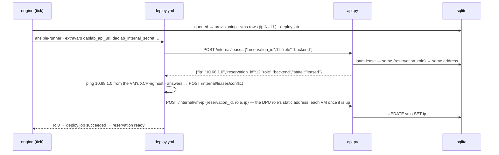

# Backend API service

Part of the daolab implementation plan — see [README.md](README.md) for the doc map.

Scope: `service/api.py` and `service/config.py` — the HTTP surface over the domain model
([01-domain-model.md](01-domain-model.md)), the pure scheduler ([03-scheduler.md](03-scheduler.md))
and the modules the design of [09-backend-system-design.md](09-backend-system-design.md) added
(`ipam.py`, `access.py`, `health.py`). Siblings: lifecycle engine
[04-lifecycle-engine.md](04-lifecycle-engine.md), playbooks [05-provisioning.md](05-provisioning.md),
dashboards [06-frontend.md](06-frontend.md), CLI/env/ops [08-cli-config-ops.md](08-cli-config-ops.md).

The API never runs a playbook. Every procedure (deploy, cleanup, health probe, reconcile) is a
**job** row that the API creates and the engine runs; the API answers `202` with the job and
the dashboard follows it through `GET /jobs/{id}` or the SSE stream.

## Service structure

`service/api.py` is one FastAPI module, served by `make api` →
`python -m uvicorn service.api:app --host $(DAOLAB_API_HOST) --port $(DAOLAB_API_PORT)`
(default `http://localhost:8080`). With `DAOLAB_OTEL_ENDPOINT` set, `otel.setup_tracing(app)`
instruments it (B-61); unset, tracing is a no-op.

```
service/api.py
├── app = FastAPI()                    # module-level; uvicorn target service.api:app
├── error layer                        # DaolabError + handlers → the §Error model envelope
├── auth dependencies                  # current_user / require_admin / require_internal (+ the authz secret check)
├── pydantic request models            # ReservationCreate, VmIpCallback, LeaseRequest, LeaseConflict,
│                                      #   ForceClean, UserPatch — all extra="forbid"
├── access helpers                     # _deploy_access (ssh_pubkey → key or generated password), _access_object
├── serializers                        # reservation_object(), job_object(), reservation_summary(), user_object()
├── routes (registered before static)  # /health /whoami /usecases /pools /setups /availability /users
│                                      #   /reservations (+/{id}, /cleanup, /redeploy, /health, /health/probe, /events)
│                                      #   /jobs/{id}  /admin/setups/{name}/force-clean  /admin/audit
│                                      #   /internal/vm-ip /internal/leases(/conflict) /internal/authz/keys
└── static routes                      # GET /  /user.html  /admin.html ← DAOLAB_DASHBOARD_DIR
```

`service/config.py` loads `.env` via `python-dotenv` once at import and exposes a frozen
settings singleton. Each field maps 1:1 to its env var (`db_path` ↔ `DAOLAB_DB_PATH`, ...)
with the contract defaults listed in [08-cli-config-ops.md](08-cli-config-ops.md) and
`.env.example`:

```python
# service/config.py
@dataclass(frozen=True)
class Settings:
    db_path: str; api_host: str; api_port: int; api_url: str; token: str
    internal_secret: str; authz_secret: str                    # DAOLAB_INTERNAL_SECRET / DAOLAB_AUTHZ_SECRET
    usecases_dir: str; setups_dir: str; inventory: str; playbooks_dir: str; dashboard_dir: str
    artifacts_dir: str                                         # per-job ansible artifacts (B-84)
    hw_class_lead_min: int; provision_lead_min: int; sched_horizon_hours: int
    slot_min: int; cleanup_min: int; default_hours: int        # booking grid, turnaround, default length
    max_live_reservations: int; max_future_reservations: int  # per-user quota (B-15): 1 + 2
    engine_interval_sec: int; max_retries: int; job_timeout_sec: int; reconcile_attempts: int
    runner: str; mock_step_sec: float; mock_fail: str          # DAOLAB_RUNNER = ansible | mock
    allow_destructive: bool; deploy_vms: bool                  # runbook sign-off; create the VMs
    become_password_file: str                                  # sudo password file for the runbooks' account
    deployable: tuple[str, ...]                                # DAOLAB_DEPLOYABLE: use cases a deploy may run
    ip_pool: str                                               # 10.68.1.0-10.68.2.200 (VMs only)
    early_access: bool; health_stale_sec: int
    otel_endpoint: str; otel_agent_endpoint: str; prometheus_url: str
    webhook_url: str; log_level: str
    @classmethod
    def from_env(cls) -> "Settings": ...   # load_dotenv() + os.environ with defaults
settings = Settings.from_env()
```

Module boundaries (nothing crosses them):

| Module | api.py's use of it | Never done by api.py |
|---|---|---|
| `service/models.py` | `models.connect()` — one sqlite connection per request (`PRAGMA journal_mode=WAL`, `PRAGMA foreign_keys=ON` set there) plus typed row helpers (`user_by_token_hash`, `usecase_by_name`, `insert`, `set_vm_ip`, `create_job`, `transition_reservation`, `audit`, `dirty_reservations`, ...). JSON-in-TEXT columns are parsed/written only by models.py. | Raw state writes that bypass the checked transition helper; schema DDL. |
| `service/catalog.py` | Nothing at runtime. YAML → DB mirroring (and the IP pool from `DAOLAB_IP_POOL`, and each member's inventory address) is `daolab sync` (CLI); the API reads only the DB. | Reading `usecases/` or `setups/` YAML from a request handler. |
| `service/scheduler.py` | `scheduler.place(db, req, now, cfg)` on POST /reservations; `scheduler.next_free_at(...)` for catalog availability; `scheduler.busy_windows(...)` for GET /availability; `SchedConfig.from_settings(config.settings)` — full contract in [03-scheduler.md](03-scheduler.md). | Re-implementing slot, grid, turnaround or lead-time logic in the API layer. |
| `service/ipam.py` | `ipam.lease`, `ipam.mark_conflict` (internal lease endpoints), `ipam.clear` (force-clean without verify). | Choosing addresses in a handler. |
| `service/access.py` | `access.keys_for(conn, host, login, now)` for `GET /internal/authz/keys`. | Storing grants: access is derived from reservations + the clock. |
| `service/health.py` | `evaluate_reservation` + `verdict_object` for `GET /reservations/{id}/health`. | Talking to Prometheus outside `health.py`. |

Route handlers are plain `def` (FastAPI threadpool), keeping `sqlite3` usage synchronous. The
one generator route, the SSE stream, polls the DB once a second.

## Auth model

Five auth kinds:

- **user** — header `Authorization: Bearer <token>`. Tokens are issued only by
  `daolab add-user <username> <pubkey_path> [--role admin|user]` (`secrets.token_urlsafe(32)`,
  printed once as `token: <token>`); the DB stores only `sha256(token).hexdigest()` in
  `users.token_hash`. `current_user()` hashes the presented token and looks it up; missing or
  unknown → `401 unauthorized`; known but `users.enabled = 0` → `403 forbidden` with
  `detail.reason: "user_disabled"` (admins flip `enabled` via `PATCH /users/{id}`). No expiry;
  rotation = delete row + re-add.
- **owner** — every `/reservations/{id}/*` route and `GET /jobs/{id}` load the reservation and
  refuse a non-owner non-admin with `403 forbidden` (`_owned_reservation`). Credentials (IPs,
  ssh lines, the access block and its password) only ever reach the owner or an admin (B-54).
- **admin** — `require_admin()` wraps `current_user()` and checks `users.role == 'admin'`
  (`users.role` ∈ `admin` | `user`). Admin ⊇ user: an admin token passes every user and owner
  check; a user token on an admin endpoint (`/pools`, `/setups`, `/users`, `/admin/*`,
  `GET /reservations?all=1`) → `403 forbidden`.
- **internal** — header `X-Daolab-Secret`, compared to `DAOLAB_INTERNAL_SECRET` with
  `hmac.compare_digest` (`require_internal`). Used by the deploy playbook's callbacks:
  `POST /internal/vm-ip`, `POST /internal/leases`, `POST /internal/leases/conflict`. While the
  secret is empty the API refuses them (`401`). Machine-to-machine, handed to playbooks by the
  runner as the `daolab_internal_secret` extravar; it can write `vms.ip` and lease or swap a
  VM's management address for a reservation that is deploying or live — never reservation or
  catalog state.
- **authz** — `GET /internal/authz/keys` accepts `X-Daolab-Secret` equal to
  `DAOLAB_AUTHZ_SECRET` (a read-only secret meant for the DPU's `daolab-keys`, which cannot
  lease or post IPs) or to `DAOLAB_INTERNAL_SECRET` (the superset). A wrong or missing secret is
  `401` with an **empty plain-text body**, not the JSON envelope: the caller is sshd.
- **none** — `GET /health` and the three static dashboard routes.

```python
def current_user(authorization: str | None = Header(None)) -> sqlite3.Row: ...   # 401 / 403
def require_admin(user: sqlite3.Row = Depends(current_user)) -> sqlite3.Row: ... # 403
def require_internal(x_daolab_secret: str | None = Header(None)) -> None: ...    # 401
def _authz_secret_ok(given: str | None) -> bool: ...                              # authz kind
```

## Endpoint reference

All bodies JSON (except the authz keys, plain text). Paths: plural nouns, no version prefix,
kebab-case segments. Unknown body fields are a `422` everywhere.

| Method | Path | Auth | Purpose |
|---|---|---|---|
| GET | `/health` | none | Liveness for monitoring/systemd. |
| GET | `/whoami` | user | Identify the token; dashboards learn `role` and the registered key. |
| GET | `/usecases` | user | Catalog with computed availability and `next_free_at` (drives `user.html`). |
| GET | `/availability?usecase=&from=&to=` | user | Busy windows for the date picker (B-16). |
| GET | `/pools` | admin | Top of the admin drill-down. |
| GET | `/setups` | admin | Setups + members, links, diagram, availability, hold, queue, dirty reservations (drives `admin.html`). |
| GET | `/users` | admin | User list with `enabled` flag and active-reservation counts. |
| PATCH | `/users/{id}` | admin | Enable/disable a user: body `{"enabled": bool}`; audit-logged. |
| POST | `/reservations` | user | One-click deploy (`mode: asap`) or a customised booking (`mode: at`), or DIY. `201`. |
| GET | `/reservations` | user | Own reservations, newest first; `?all=1` admin-only. |
| GET | `/reservations/{id}` | owner | One reservation: state, VMs, IPs, leases, access, health, latest job. |
| DELETE | `/reservations/{id}` | owner | Cancel a `queued` booking → `released`; any other state → `409 invalid_state` (a live slot ends with `POST …/cleanup`). |
| POST | `/reservations/{id}/cleanup` | owner | End a live slot early: `ready`/`active` → `cleaning` + cleanup job, `202` (B-27). |
| POST | `/reservations/{id}/redeploy` | owner | Re-run `deploy.yml` inside the slot: new deploy job, `202` (B-28); `409` outside the slot. |
| GET | `/reservations/{id}/health` | owner | Latest health verdict with every check, 15 s cache (B-66). |
| POST | `/reservations/{id}/health/probe` | owner | On-demand active check: `health_probe` job, `202` (B-66). |
| GET | `/reservations/{id}/events` | owner | SSE stream of state changes and job steps (B-29). |
| GET | `/jobs/{id}` | owner | Job state, steps, `trace_id`, log tail (B-29). |
| GET | `/reservations/{id}/jobs` | owner | Every job of the reservation, oldest first, in the `/jobs/{id}` shape (the admin dashboard's reservation detail). |
| POST | `/admin/setups/{name}/force-clean` | admin | Reconcile + clear a setup's quarantine; `{skip_verify}`; audit-logged, `202` (B-74). |
| GET | `/admin/audit?limit=` | admin | Append-only audit log, newest first (B-55). |
| POST | `/internal/vm-ip` | internal | A deployed role's address, posted by `deploy.yml`. |
| POST | `/internal/leases` | internal | Lease a VM's management address for `{reservation_id, role}` (B-42). |
| POST | `/internal/leases/conflict` | internal | An address answered outside daolab: quarantine it, lease a replacement (B-42). |
| GET | `/internal/authz/keys?host=&login=` | authz | `authorized_keys` lines valid **now** for that host/login, plain text (B-51). |

**GET /health** → `200 {"status": "ok"}`

**GET /whoami** → `200 {"id": 1, "username": "alice", "role": "user", "created_at":
"2026-08-30T09:00:00Z", "ssh_pubkey": "ssh-ed25519 AAAA… alice@laptop"}` — the registered key
pre-fills the Deploy dialog.

**GET /usecases** → `200`, array ordered by `usecases.id` (README table order, `diy` included).
Each row also carries the info-modal payload: `doc_url` + `doc_summary` (seeded verbatim from
the DAO docs), parsed `requires` / `hw_class` / `roles`, and `setups` — the capability-matching
setups as `{name, capabilities, members(name,kind,host,address), links, diagram}` so the
(non-admin) user page can render the testbed without `GET /setups`; `[]` on planned rows. Also
`deployable` (false for a use case `DAOLAB_DEPLOYABLE` does not name; such a row has
`reason: "not_enabled"`, `available: false`, and `POST /reservations` answers it with
`409 usecase_unavailable`) and `dpu_login` (the DPU username a deploy hands out, `lab`; `null`
for `diy`), which the Deploy dialog shows before the user deploys:

```json
[{"name": "tls-proxy-nginx", "description": "NGINX TLS termination proxy, RSA/ECDSA offloaded to CPT",
  "variant": "separate-backend", "status": "active", "available": true, "reason": null,
  "missing": [], "next_free_at": "2026-08-30T10:00:00Z"},
 {"name": "virtio-l2fwd", "description": "L2 forwarding between host virtio devices and wire",
  "variant": null, "status": "planned", "available": false, "reason": "no_yaml", "missing": [], "next_free_at": null},
 {"name": "diy", "description": "Bare setup, no DAO app", "variant": null, "status": "active",
  "available": true, "reason": null, "missing": [], "next_free_at": "2026-08-30T10:00:00Z"}]
```

`next_free_at` is what the **Deploy now** button shows ("starts 14:00"): the start a one-click
`asap` booking of one hour would get right now.

**GET /pools** → `200 [{"id": 1, "name": "lab-1", "setups": ["tb-01"]}]`

**GET /users** → `200 [{"id": 1, "username": "alice", "role": "user", "enabled": true,
"created_at": "2026-08-30T09:00:00Z", "active_reservations": 2}]` (`active_reservations` =
reservations not in `released`/`failed`).
**PATCH /users/{id}** — request `{"enabled": false}` → `200` the user object. Unknown id →
`404 not_found`; an admin disabling their own account → `409 invalid_state` (lockout guard);
disabling leaves the user's reservations untouched — cancel a `queued` one with
`DELETE /reservations/{id}` or end a `ready`/`active` one early with
`POST /reservations/{id}/cleanup` if the hold must end. `GET /internal/authz/keys` stops
answering a disabled owner's keys at once (`access.keys_for` skips disabled users).

**GET /setups** → `200`, one row per setup. `availability` is the B-18 flag
(`available` | `quarantined` | `maintenance`); `held_by` = the reservation currently in
`provisioning`/`ready`/`active`/`cleaning`/`quarantined` on the setup or `null`; `queue` =
`queued` reservations ordered by `start_at`; `dirty` = reservations whose residue is not
cleared (`quarantined`, or `failed` whose last cleanup/reconcile job failed), each with the id
and error of that job — the quarantine banner of `admin.html`. All use the reservation-summary
shape `{"id", "user", "usecase", "state", "start_at", "end_at"}`:

```json
[{"id": 1, "name": "tb-01", "pool": "lab-1", "capabilities": ["e810", "octeon-cn106", "sdp", "wire"],
  "members": [
    {"name": "dpu-01", "kind": "dpu", "capabilities": ["octeon-cn106", "sdp"], "host": "tb-01-xcp", "hw_class": "sdp-pf1-vf8"},
    {"name": "tg-01", "kind": "nic", "capabilities": ["e810"], "host": "tb-01-xcp", "hw_class": null}],
  "links": [{"a": "tg-01.e810p0", "b": "dpu-01.sfp0", "capability": "wire"},
            {"a": "tg-01.e810p1", "b": "dpu-01.sfp1", "capability": "wire"}],
  "diagram": "graph LR\n  C[client VM · tb-01-xcp] -- HTTPS 443 / 25G p0 --> P[DPU · OCTEON CN106]\n  ...",
  "availability": "quarantined",
  "held_by": {"id": 12, "user": "alice", "usecase": "vpp", "state": "quarantined",
              "start_at": "2026-09-01T10:00:00Z", "end_at": "2026-09-01T12:00:00Z"},
  "queue": [],
  "dirty": [{"id": 12, "user": "alice", "usecase": "vpp", "state": "quarantined",
             "start_at": "2026-09-01T10:00:00Z", "end_at": "2026-09-01T12:00:00Z",
             "residue_job": 31, "residue": "residue after cleanup: vm:daolab-r12-sink"}]}]
```

**POST /reservations** — request and `201` response: see §Creating reservations.

**GET /reservations** → `200`, array of reservation objects (canonical shape below), own rows
newest first by `created_at`; `?all=1` returns everyone's (admin token, else `403`).
**GET /reservations/{id}** → `200`, one reservation object; non-owner non-admin → `403`;
unknown id → `404`. The canonical reservation object, returned by every endpoint that returns
a reservation:

```json
{"id": 12, "user": "alice", "usecase": "tls-proxy-nginx", "setup": "tb-01",
 "state": "active", "diy": false, "requested_start_at": "2026-09-01T10:00:00Z",
 "start_at": "2026-09-01T10:00:00Z", "end_at": "2026-09-01T12:00:00Z",
 "shifted": false, "failure_reason": null,
 "vms": [
   {"role": "backend", "host": "tb-01-xcp", "template": "tpl-ubuntu2204-dao", "name": "daolab-r12-backend",
    "ip": "10.68.1.0", "ssh": "ssh alice@10.68.1.0", "username": "alice", "auth": "ssh-key", "password": null},
   {"role": "client", "host": "tb-01-xcp", "template": "tpl-ubuntu2204-dao", "name": "daolab-r12-client",
    "ip": "10.68.1.1", "ssh": "ssh alice@10.68.1.1", "username": "alice", "auth": "ssh-key", "password": null},
   {"role": "proxy", "host": "dpu-01", "template": null, "name": null,
    "ip": "10.68.0.190", "ssh": null, "username": null, "auth": null, "password": null}],
 "diagram": "graph LR\n  n_backend[\"backend VM · tb-01-xcp<br/>…\"]\n  ...",
 "leases": [{"role": "backend", "ip": "10.68.1.0", "state": "leased"},
            {"role": "client", "ip": "10.68.1.1", "state": "leased"}],
 "access": {"login": "lab", "host": "10.68.0.190", "ssh": "ssh lab@10.68.0.190", "live": true,
            "auth": "ssh-key", "password": null, "key": "ssh-ed25519 …alice@laptop"},
 "health": {"verdict": "healthy", "reason": null, "evaluated_at": "2026-09-01T10:41:00Z",
            "changed_at": "2026-09-01T10:02:00Z"},
 "job": {"id": 31, "kind": "deploy", "state": "succeeded", "attempt": 1, "error": null,
         "steps": 14, "last_step": {"name": "verify", "state": "ok", "at": "2026-09-01T09:57:40Z"}},
 "created_at": "2026-08-30T09:00:00Z", "updated_at": "2026-09-01T10:00:00Z"}
```

Serialization rules:

- `shifted` = (`start_at` != `requested_start_at`).
- `vms` is `[]` in `queued` and populated from `provisioning` onward (the engine creates the
  rows before the deploy job runs, [04-lifecycle-engine.md](04-lifecycle-engine.md)); a VM's
  `ip` is `null` until `deploy.yml` posts it. The `on: dpu` role has no VM (`name` null): DPUs
  are static, so its `ip` shows the DPU's inventory address (`resources.address`, synced from
  `ansible_host`) even before anything is posted, and its `ssh`/`username`/`auth` are `null`.
- VM rows carry `ssh = "ssh <owner>@<ip>"` once the IP is set, `username` (the owner) and `auth`
  (`ssh-key` or `password`); `password` is the generated password, shown only while the
  reservation is `ready`/`active`.
- `diagram`: a mermaid graph of the provisioned topology (one node per role with IP/ssh, edges
  from the roles' `connect` and `upstream` fields — for DIY, from the setup `links`), generated
  server-side so the frontend stays topology-free; `null` while no `vms` rows exist.
- `leases`: the reservation's IP leases that are not `released` (`leased` or `quarantined`).
- `access`: how the owner logs into the DPU — the shared `lab` login at the DPU's static address
  (`ssh lab@10.68.0.190`); `auth` is `ssh-key` (`key` = the key's type and comment, never the
  whole key) or `password` (`password` filled only while `ready`/`active`, so `live` is true).
  `null` for DIY reservations and setups without a DPU.
- `health`: the engine's latest stored verdict (B-67), or `null` until it has one.
- `job`: the reservation's newest job (any kind) with its step count and last step, for the
  card's progress line; `null` before the engine has queued anything.

**DELETE /reservations/{id}** → `200 {"id": 12, "state": "released"}` when it was `queued`
(nothing ran, nothing to tear down) — this is the only state DELETE accepts; the state change
and the `cancel` audit row commit in one transaction. Any other state (`provisioning`,
`ready`, `active`, `cleaning`, `quarantined`, `released`, `failed`) → `409 invalid_state` (also
when the engine moves the reservation between the API's read and its write: the state change
is a compare-and-set, `models.transition_reservation`). Ending a live `ready`/`active` slot
early is a **separate** action, `POST /reservations/{id}/cleanup` → `202` +
`{"id", "state": "cleaning"}` and a pending `cleanup` job (the engine runs the teardown —
[04-lifecycle-engine.md](04-lifecycle-engine.md)); plan/09 §4/§10 own these transitions.

## Use-case catalog availability

Computed at request time inside `GET /usecases` — never cached, so `daolab sync` adding a
YAML flips a row to available with no frontend or API change (README: the table renders live).

```python
def catalog_row(db, uc, setups, now) -> dict:
    status = "active" if uc["yaml_path"] else "planned"   # diy: yaml_path='builtin' → active
    if uc["yaml_path"] is None:
        return row(uc, status, available=False, reason="no_yaml")
    candidates = [s for s in setups if set(uc["requires"]) <= set(s["capabilities"])]
    if not candidates:
        missing = smallest_missing(uc["requires"], setups)
        return row(uc, status, available=False, reason="unmet_capability", missing=missing)
    nfa = scheduler.next_free_at(db, uc["name"], now, SchedConfig.from_settings(settings))
    if nfa is None:                    # nothing within DAOLAB_SCHED_HORIZON_HOURS
        return row(uc, status, available=False, reason="no_free_slot")
    return row(uc, status, available=True, next_free_at=nfa)
```

- `available` ⇔ YAML exists **and** some setup's `capabilities ⊇ requires` **and** a free
  slot exists within `DAOLAB_SCHED_HORIZON_HOURS`. Capability match only — never hostnames.
  Setup `availability` (quarantine) does not enter: placement still books a quarantined setup
  (B-18), only provisioning waits.
- `next_free_at` = the start `place()` would grant a 1-hour `asap` booking requested `now`, on
  the `DAOLAB_SLOT_MIN` grid, else `null`. Free-slot logic is delegated entirely to the
  scheduler so catalog and `POST /reservations` can never disagree: a setup is busy for
  `[start_at − lead, end_at + DAOLAB_CLEANUP_MIN)` of every reservation not in
  `released`/`failed`, with `lead` = `DAOLAB_HW_CLASS_LEAD_MIN` when the use case's `hw_class`
  differs from the DPU's projected class, else `DAOLAB_PROVISION_LEAD_MIN`
  ([03-scheduler.md](03-scheduler.md)).
- `smallest_missing` = per setup, `set(requires) − set(capabilities)`; report the smallest
  set (tie → alphabetically first setup name, surfaced as `closest_setup` in reserve errors).
- **The `diy` pseudo-row**: seeded by `daolab init` with `yaml_path = 'builtin'`,
  `requires = '[]'`, `roles = '{}'` — so `status` is always `"active"`, every setup is a
  candidate, `missing` is always `[]`, and availability reduces to "some setup has a free
  1-hour slot in the horizon". It appears in the array like any other row.

**GET /availability?usecase=&from=&to=** (B-16) — the date picker's data. `usecase` is
required; `from` defaults to now and `to` to `from + DAOLAB_SCHED_HORIZON_HOURS`. For every
setup whose capabilities cover the use case, it lists each live reservation whose blocked
interval `[start − lead, end + cleanup)` overlaps `[from, to)` — the same interval `place()`
tests (`scheduler.busy_windows`), so the picker greys exactly the slots the scheduler would
refuse; the gaps between windows are the free time. The owner is shown only to admins;
everyone gets a boolean `mine`.

```json
{"usecase": "vpp", "from": "2026-09-01T08:00:00Z", "to": "2026-09-01T14:00:00Z", "slot_min": 30,
 "windows": [{"setup": "tb-01", "start_at": "2026-09-01T09:00:00Z", "end_at": "2026-09-01T11:00:00Z",
              "blocked_start_at": "2026-09-01T08:55:00Z", "blocked_end_at": "2026-09-01T11:10:00Z",
              "state": "queued", "mine": false}]}
```

Unknown use case → `404 not_found`; missing `usecase`, a bad timestamp, or `to <= from` →
`422 validation_error`.

## Creating reservations

`POST /reservations` request shapes:

```jsonc
// one click: the "Deploy now" button
{"usecase": "vpp"}

// one click with the Deploy dialog's access choice: a key (one per line, at most 5) ...
{"usecase": "vpp", "ssh_pubkey": "ssh-ed25519 AAAAC3Nz… alice@laptop"}
// ... or an empty key = "give me a password"
{"usecase": "vpp", "ssh_pubkey": ""}

// customised booking: exactly this window, or a 409 with alternatives
{"usecase": "tls-proxy-nginx", "mode": "at", "start_at": "2026-10-20T09:00:00Z", "hours": 3}

// DIY: bare VMs on a named setup
{"usecase": "diy", "start_at": "now", "hours": 4, "setup": "tb-01",
 "templates": {"tb-01-xcp": "tpl-ubuntu2204-dao"}}
```

Field rules:

- `mode` ∈ `asap` (default) | `at`; anything else → `422`.
- `start_at` is ISO-8601 UTC, the literal `"now"`, or `null`/omitted (= now).
- `hours` integer ≥ 1, default `DAOLAB_DEFAULT_HOURS` (1).
- `setup` and `templates` are **required when `usecase` is `diy`, forbidden otherwise**;
  `templates` keys must equal the set of distinct `resources.host` values of the named setup
  (every VM host covered).
- `ssh_pubkey` decides how the owner gets in (DPU `lab` login and the VMs):
  - **absent** → the owner's registered key (`users.ssh_pubkey`); the CLI and old clients;
  - **public key lines** → each line must be an OpenSSH public key (`ssh-ed25519`, `ssh-rsa`,
    `ecdsa-sha2-nistp256/384/521`, `sk-…@openssh.com`; base64 body; an optional comment; no
    options such as `command=`), at most 5 lines and 8 KiB → stored on the reservation;
  - **empty** (or only blank lines) → no key; the API generates a 16-character password
    (letters and digits) and stores it on the reservation. It is shown to the owner only while
    the slot is `ready`/`active`, and the engine wipes it once the reservation is
    `released`/`failed`.

Validation order and outcomes:

1. Body shape, unknown fields, `mode`, timestamp, `hours ≥ 1`, diy-field presence rules →
   `422 validation_error`.
2. `usecases` row lookup by name → unknown name `404 not_found`.
3. `yaml_path` NULL (status `planned`) → `409 usecase_unavailable`, `detail: {"reason": "no_yaml"}`.
4. Diy: the named setup must exist (`404 not_found`); the template map must cover exactly its
   VM hosts (`422`).
5. `ssh_pubkey` not a key / too many keys → `422 validation_error` (with a `detail.hint`).
6. Inside a single `BEGIN IMMEDIATE` transaction (see §Concurrency stance):
   1. **Quota** (B-15, non-admins only): at most `DAOLAB_MAX_LIVE_RESERVATIONS` (1) in
      `provisioning`/`ready`/`active` and `DAOLAB_MAX_FUTURE_RESERVATIONS` (2) in `queued` →
      `409 quota_exceeded`, `detail: {"reason": "live" | "future", "limit": 1, "current": 1}`.
      Admins are exempt. This stops one person hoarding the only testbed.
   2. **Placement**: `scheduler.place(db, PlacementRequest(usecase, start, hours, setup, mode), now, cfg)`:
      - `NoSetup` → `409 unmet_capability`; the message **names the missing capability list**
        (README Phase 2 checkpoint), `detail: {"usecase", "missing", "closest_setup"}`.
      - `NoFreeSlot` (mode `asap`, nothing free within the horizon) →
        `409 usecase_unavailable`, `detail: {"reason": "no_free_slot", "horizon_hours": 168}`.
      - `NoFit` (mode `at` only) → `409 slot_conflict`, `detail: {"usecase", "start_at",
        "end_at", "reason": "overlap" | "in_the_past" | "off_grid", "alternatives": [...]}` —
        the next three free grid starts of the same length, which the dashboard shows as
        one-click chips (B-13/B-14).
   3. INSERT the reservation (`state: queued`, `requested_start_at`, granted `start_at`/`end_at`,
      `ssh_pubkey` / `access_password`).

```python
placement = scheduler.place(db, scheduler.PlacementRequest(
    usecase=body.usecase, requested_start_at=start, hours=hours,
    setup=body.setup, mode=body.mode), now, SchedConfig.from_settings(settings))
# Placed(setup_id, setup_name, start_at, end_at, shifted, lead_min) — pure; no I/O beyond db
```

In mode `asap` slot conflicts are **never** errors: `scheduler.place` applies FCFS by
`created_at`, capability matching (diy: the explicitly named setup only), the hw_class lead
window, the turnaround buffer and the slot grid, and the granted `start_at` is the earliest
grid start on any candidate setup where the full `[start − lead, start + hours + cleanup)`
window is free, searched up to `DAOLAB_SCHED_HORIZON_HOURS`. In mode `at` the window is tested
exactly and never shifted. Response: `201` + the canonical reservation object — `state`
`"queued"`, `vms` `[]`, `job` `null`, `shifted` true iff the slot moved. The API never
provisions and queues no job here: the engine picks the row up at `start_at − lead`, creates
its `vms` rows and its `deploy` job ([04-lifecycle-engine.md](04-lifecycle-engine.md)).

## Jobs: cleanup, redeploy, probe, progress

A job is the unit of work the engine runs (kinds `deploy`, `cleanup`, `health_probe`,
`reconcile`; [04-lifecycle-engine.md](04-lifecycle-engine.md)). Every endpoint that starts one
answers `202` with the canonical job object, the same shape as `GET /jobs/{id}`:

```json
{"id": 31, "reservation_id": 12, "kind": "cleanup", "state": "pending", "attempt": 1,
 "trace_id": null, "log_path": null, "log_tail": null, "error": null, "steps": [],
 "started_at": null, "finished_at": null,
 "created_at": "2026-09-01T11:20:00Z", "updated_at": "2026-09-01T11:20:00Z"}
```

`steps` is the list the runner appends while the job runs (`{"name", "state": ok|failed|skipped,
"at", "detail"?}`); `trace_id` opens the job's trace in Jaeger (B-62); `log_path` is the job's
combined playbook log under `DAOLAB_ARTIFACTS_DIR` with the ansible runner (B-84) and
`log_tail` its last 8 KiB.

- **POST /reservations/{id}/cleanup** (B-27, owner) → only from `ready`/`active`: the move to
  `cleaning`, a pending `cleanup` job and the `cleanup` audit row commit together;
  `202 {"id", "state": "cleaning", "job"}`. Any other state → `409 invalid_state`.
- **POST /reservations/{id}/redeploy** (B-28, owner) → re-runs `deploy.yml` (idempotent) for a
  `ready`/`active` reservation inside its slot `[start_at, end_at)`: a new `deploy` job with
  `attempt` = previous deploy attempts + 1, audit-logged; `202 {"id", "state", "job"}`. Outside
  the slot, or in any other state → `409 invalid_state`. A failed redeploy never tears the lab
  down (the engine leaves the reservation as it was).
- **POST /reservations/{id}/health/probe** (B-66, owner) → `ready`/`active` only (else `409`):
  a `health_probe` job, which runs the use case's verify command (`probe.yml`); a probe already
  pending or running is returned instead of queueing another. `202 {"id", "state", "job"}`.
- **GET /jobs/{id}** (B-29) → the job object; owner of its reservation or admin (`403`
  otherwise); unknown id → `404`.
- **GET /reservations/{id}/jobs** → every job of the reservation, oldest first, each in the job
  object shape; owner or admin.
- **GET /reservations/{id}/events** (B-29, owner) → `text/event-stream`. It sends the current
  state first, then every job step of the reservation (those already recorded, then each new
  one as it lands) and every state change, polling the DB every second:

  ```
  event: state
  data: {"id": 12, "state": "provisioning", "start_at": "…", "end_at": "…"}

  event: step
  data: {"job_id": 31, "kind": "deploy", "name": "lease_ip backend", "state": "ok", "at": "…"}
  ```

  The stream ends when the reservation reaches `released`/`failed`, or after 15 minutes so an
  abandoned stream does not pin a connection; the dashboard falls back to polling.

## Health

**GET /reservations/{id}/health** (B-66, owner) → the latest verdict with every check:

```json
{"reservation_id": 12, "state": "active", "trace_id": "4bf92f3577b34da6a3ce929d0e0e4736",
 "verdict": "degraded", "reason": "failing: datapath",
 "evaluated_at": "2026-09-01T10:41:00Z", "last_seen": "2026-09-01T10:40:52Z", "cached": false,
 "checks": [{"name": "vms_up", "state": "pass", "ok": true, "severity": "critical", "expect": "== 1",
             "value": 1.0, "at": "2026-09-01T10:40:52Z", "promql": "min(up{daolab_reservation=\"12\"})", "error": null}],
 "probe": {"job_id": 40, "state": "succeeded", "error": null, "steps": [], "finished_at": "…"}}
```

- `verdict` ∈ `healthy` | `degraded` | `down` | `unknown` from the use case's `health:` rules
  against Prometheus (`health.py`, [09-backend-system-design.md](09-backend-system-design.md) §8);
  each answer is cached for 15 s per reservation (`cached: true` on a hit).
- Not `ready`/`active` → `unknown` with `reason: "reservation is <state>"`, without asking
  Prometheus. Telemetry stack off (`DAOLAB_OTEL_ENDPOINT` unset) → `unknown` with a reason
  pointing at the probe: health is then whatever the last `health_probe` job found (`probe`).
- `trace_id` is the latest deploy job's trace.

The dashboard card's badge reads the engine's stored verdict from the reservation object
(`health`); this endpoint gives the live, per-check answer.

## Admin

**POST /admin/setups/{name}/force-clean** (B-74, admin) — clears a setup's quarantine. Body
optional: `{"skip_verify": false}`. In one transaction:

- default: a `reconcile` job for every dirty reservation on the setup (one already
  pending/running is reused). The engine destroys the leftovers, verifies, and releases them;
  the setup goes back to `available` when the last one verifies clean, so a queued booking
  never starts on a testbed that is still dirty. With nothing dirty, a `quarantined` setup is
  set `available` at once.
- `skip_verify: true`: the admin vouches the testbed is clean — every dirty reservation is
  moved to `released` and all its leases (quarantined ones too) are released now, and the setup
  is set `available`; nothing runs.
- A `maintenance` flag is never touched. Every call writes a `force_clean` audit row.

→ `202 {"setup": "tb-01", "availability": "quarantined", "previous_availability":
"quarantined", "skip_verify": false, "reservations": [12], "jobs": [<job object>]}`. Unknown
setup → `404`; a user token → `403`.

**GET /admin/audit?limit=100** (B-55, admin) → newest first, `limit` clamped to 1..1000:
`[{"id", "actor", "action", "object_type", "object_id", "detail", "trace_id", "created_at"}]`.
Actions: `cancel`, `cleanup`, `redeploy`, `admin_override`, `force_clean` (written by the API)
and `deploy`, `cleanup`, `reconcile`, `orphan_sweep` (written by the engine, with the job's
`trace_id`); the table is append-only.

## Internal callbacks — the deploy playbook and the DPU

During a deploy job, `deploy.yml` leases the VMs' management addresses and posts each role's
address back to the API. The runner hands playbooks the extravars `daolab_api_url` and
`daolab_internal_secret` ([05-provisioning.md](05-provisioning.md)); a manual run uses
`reservation_id=0`, which skips every callback.



**POST /internal/vm-ip** — request `{"reservation_id": 12, "role": "backend", "ip": "10.68.1.0"}`
→ `200 {"ok": true}`. No `vms` row for `(reservation_id, role)` → `404 not_found`; success sets
`vms.ip` only (state transitions belong to the engine) and is idempotent — re-posting the same
IP is a harmless UPDATE, matching the playbook-idempotency invariant.

**POST /internal/leases** (B-42) — request `{"reservation_id": 12, "role": "backend"}` →
`200 {"ip": "10.68.1.0", "reservation_id": 12, "role": "backend", "state": "leased"}`. The
same `(reservation, role)` gets the same address back while its lease is `leased`, so a
replayed playbook never takes a second IP; otherwise the lowest address of `DAOLAB_IP_POOL`
with no live lease. The state check and the lease share one transaction. Errors: unknown
reservation or no `vms` row for the role → `404`; the reservation is not
`provisioning`/`ready`/`active` → `409 invalid_state`; the role is the `on: dpu` role (the DPU
is static, it has no VM) → `422 validation_error`; every address taken → `409 pool_exhausted`;
no pool synced → `409 no_ip_pool`.

**POST /internal/leases/conflict** (B-42) — request `{"ip": "10.68.1.0"}`: something outside
daolab answers on a leased address. The lease is quarantined (that address is never issued
again until an admin or the reconciler clears it) and the same `(reservation, role)` gets a
replacement: `200 {…lease…, "replaced": "10.68.1.0"}`. Not an IP → `422`; not currently leased
→ `404`; the reservation has moved on → the same errors as above and nothing changes.

**GET /internal/authz/keys?host=dpu-01&login=lab** (B-51) → `text/plain`, one
`authorized_keys` line per key, valid **now** (`access.keys_for`): the login must be the shared
`lab` login, `host` a setup member name, and a `ready`/`active` reservation on that setup must
have `start_at ≤ now < end_at` (or be `ready` with `DAOLAB_EARLY_ACCESS` on) and an enabled
owner. The keys are the ones the owner deployed with (the given key, else their registered
key; none in password mode). Empty means no access, and so does every error: a bad secret is
an empty `401`, any exception an empty `200` — fail closed. This is the answer the B-52
`daolab-keys` `AuthorizedKeysCommand` script reads; the deploy playbook currently opens the DPU
with a key file instead (`roles/dpu_access`, [05-provisioning.md](05-provisioning.md)).

Operationally the **API process must be up while the engine deploys** (they are separate
processes sharing the sqlite file via WAL) and `DAOLAB_INTERNAL_SECRET` must be set.

## Error model

Every non-2xx response has exactly this envelope — a stable machine `code`, a human
`message`, an object `detail` (may be `{}`) — except `GET /internal/authz/keys`, which answers
sshd in plain text:

```json
{"error": {"code": "unmet_capability",
           "message": "no setup satisfies requires for tls-proxy-nginx; missing: wire",
           "detail": {"usecase": "tls-proxy-nginx", "missing": ["wire"], "closest_setup": "tb-01"}}}
```

| code | HTTP | When |
|---|---|---|
| `unauthorized` | 401 | Missing/unknown bearer token; wrong or missing `X-Daolab-Secret` (or the secret unset) on `/internal/vm-ip` and `/internal/leases*`. |
| `forbidden` | 403 | Valid token, insufficient role (admin endpoints, `?all=1`); non-owner non-admin touching a reservation or job; a disabled user (`detail.reason: "user_disabled"`). |
| `not_found` | 404 | Unknown use case, setup, reservation, job or user; unknown `(reservation_id, role)` on a callback; a conflict report for an address that is not leased. |
| `validation_error` | 422 | Malformed body/timestamp, unknown fields, unknown `mode`, `hours` < 1, diy-field presence or template coverage, an `ssh_pubkey` that is not a public key or has more than 5 lines, a bad `from`/`to` on `/availability`, a lease asked for the `on: dpu` role. |
| `usecase_unavailable` | 409 | Reserving a `planned` row (`detail.reason: "no_yaml"`); `asap` horizon exhausted (`detail.reason: "no_free_slot"`). |
| `unmet_capability` | 409 | No setup's capabilities ⊇ `requires`; message names the missing list. |
| `slot_conflict` | 409 | Mode `at` window not grantable: `detail.reason` `overlap` / `in_the_past` / `off_grid`, plus `start_at`, `end_at` and `alternatives`. |
| `quota_exceeded` | 409 | The user already has 1 live or 2 future reservations; `detail: {reason, limit, current}`. |
| `invalid_state` | 409 | Cancel (`DELETE`) of anything but a `queued` booking; cleanup, redeploy or probe in a state that does not allow it (`detail.state`); redeploy outside the slot; a lease for a reservation that is not deploying or live; an admin disabling their own account. |
| `pool_exhausted` | 409 | Every address of the IP pool has a live lease. |
| `no_ip_pool` | 409 | No IP pool in the DB (`DAOLAB_IP_POOL` not synced with `daolab sync`). |
| `internal_error` | 500 | Unhandled exception. |

Further examples (an `at` conflict, a bad token, a wrong role):

```json
{"error": {"code": "slot_conflict",
           "message": "tls-proxy-nginx: requested window 2026-09-01T10:00:00Z..2026-09-01T11:00:00Z is not available (overlap)",
           "detail": {"usecase": "tls-proxy-nginx", "start_at": "2026-09-01T10:00:00Z", "end_at": "2026-09-01T11:00:00Z",
                      "reason": "overlap", "alternatives": ["2026-09-01T11:30:00Z", "2026-09-01T12:00:00Z", "2026-09-01T12:30:00Z"]}}}
{"error": {"code": "unauthorized", "message": "invalid bearer token", "detail": {}}}
{"error": {"code": "forbidden", "message": "admin role required for GET /setups",
           "detail": {"required_role": "admin"}}}
```

Implementation: one `DaolabError(code, http_status, message, detail)` exception + one
`@app.exception_handler(DaolabError)`; FastAPI's `RequestValidationError` handler is
overridden to emit the envelope with `code: "validation_error"`; a catch-all maps everything
else to `internal_error` (stack trace to the log at `DAOLAB_LOG_LEVEL`, never to the client).
In mode `asap` a slot conflict is never an error — the scheduler slot-shifts; only mode `at`
reports one.

## Serving the dashboards

`api.py` serves `dashboard/` (path from `DAOLAB_DASHBOARD_DIR`) as three explicit, auth-none
routes registered **after** all API routes so they can never shadow them: `GET /` →
`dashboard/user.html`, `GET /user.html` → `dashboard/user.html`, `GET /admin.html` →
`dashboard/admin.html`. Each is a `FileResponse` — no directory listing, no wildcard static
mount, nothing else served. The HTML pages are open; every API call they make carries the
pasted bearer token from `localStorage`, and `admin.html` gates itself on `GET /whoami`
returning `role == "admin"` ([06-frontend.md](06-frontend.md)). Dashboards stay pure views
over this API; topology diagrams arrive via the `diagram` field of `GET /setups` and of the
reservation object, never from frontend code (design invariant).

## Concurrency stance

- **sqlite in WAL mode** — `models.py` runs `PRAGMA journal_mode=WAL` on every connection, so
  the `api` and `engine` processes share `DAOLAB_DB_PATH` safely: readers never block the one
  writer and vice versa.
- **Single API worker** — `make api` starts uvicorn with no `--workers` flag (one process).
  Handlers are sync `def` on the threadpool with one short-lived connection per request.
- **One write transaction per decision** — every handler that reads state and then writes
  takes `BEGIN IMMEDIATE` first, so the write lock is held before the reads and neither an
  engine write nor a second API thread can slip in between:
  - `POST /reservations`: quota check + `scheduler.place` + INSERT. Two users clicking the same
    `at` window at the same instant serialise here: exactly one gets `201`, the other
    `409 slot_conflict` (B-17, `tests/test_concurrency.py`). FCFS order is exactly `created_at`
    insert order.
  - `DELETE`, `/cleanup`, `/redeploy`, `/health/probe`, force-clean: whatever each writes — the
    state compare-and-set, the job row, the audit row — commits together or not at all.
  - `/internal/leases(/conflict)`: the reservation-state check and the lease; parallel deploys
    never share an IP (B-45, `tests/test_ipam.py`; the unique index on `(pool, ip)` among
    live leases backs it).
- **Postgres trigger** — per the root README (Phase 4): *move sqlite → Postgres only if you
  get >1 API worker*. Nothing here assumes it; `models.py` is the only module that changes,
  and plan/09 §5 adds an exclusion constraint on `(setup_id, time range)` then.

## Test plan

`tests/test_api.py`, pytest + `fastapi.testclient.TestClient`, no hardware, no engine, no
ansible — part of the hardware-free `tests/` suite (`make test`). Fixture `env`: a sqlite file
in `tmp_path` brought to the latest schema by `models.init_db`, the catalog seeded and then
**synced from the repo's own `usecases/`, `setups/` and `inventory/`** (so `tb-01` with
`dpu-01` + `tg-01` and the three active use cases), settings monkeypatched
(`DAOLAB_DB_PATH` → the tmp file, `DAOLAB_INTERNAL_SECRET` → `test-secret`), and users
`hrushi` (user) and `hrushi-admin` (admin) inserted with known tokens (the DB holds only the
hash). Reservations are made a day ahead on the hour.

Cases (each asserts the error envelope shape on every non-2xx):

| # | Case | Expect |
|---|---|---|
| 1 | No/garbage bearer token on `/whoami` | `401 unauthorized` |
| 2 | User token on `/pools`, `/setups`, `/reservations?all=1` | `403 forbidden`; admin token passes all three |
| 3 | `GET /usecases` | `tls-proxy-nginx` `available: true`; a planned row `reason: "no_yaml"`; `diy` row present, `status: "active"` |
| 4 | Delete every setup, `GET /usecases` | tls row `reason: "unmet_capability"`, `missing` non-empty |
| 5 | Reserve `tls-proxy-nginx` at T | `201`, `state: "queued"`, `shifted: false`, `vms: []` |
| 6 | Second overlapping reserve, mode `asap` (README Phase 2 checkpoint) | `201`, `shifted: true`, `start_at` = first `end_at` + `DAOLAB_CLEANUP_MIN` + `DAOLAB_PROVISION_LEAD_MIN`, rounded up to the `DAOLAB_SLOT_MIN` grid; 6b/6c: the cleanup and grid settings reach the scheduler |
| 7 | Reserve a use case whose `requires` no setup meets | `409 unmet_capability`, message names the missing capability |
| 8 | Reserve unknown name / planned row / `hours: 0` / `setup` on non-diy / diy without `templates` / diy templates missing a host | `404` / `409 usecase_unavailable` / `422` / `422` / `422` / `422` |
| 9 | Reserve `diy` with `setup: tb-01` + full template map | `201`, `diy: true` |
| 10 | Owner reads own reservation; other user reads it; admin reads it | `200` / `403` / `200`; list is newest-first |
| 11 | Cancel matrix (`DELETE`, states set via models helpers) | `queued`→`released`; every other state (`provisioning`/`ready`/`active`/`cleaning`/`quarantined`/`released`/`failed`)→`409 invalid_state` |
| 11b | Cleanup matrix (`POST /reservations/{id}/cleanup`) | `ready`/`active`→`202` + `cleaning` job; `queued`/`released`→`409 invalid_state`; non-owner→`403` |
| 12 | Callback: wrong secret; secret unset in settings; unknown role; happy path | `401`; `401`; `404`; `{"ok": true}` then reservation object shows `ip` and `ssh: "ssh <user>@<ip>"` |
| 13 | Callback replay with same body | `200` again (idempotent) |
| 14 | `GET /` and `/admin.html` | `200`, HTML bodies from `DAOLAB_DASHBOARD_DIR` |
| 15–17 | Users list, disable, guards | `active_reservations` counts; a disabled user gets `403` with `user_disabled`, re-enabled works again; self-disable `409`, unknown id `404`, user token `403` |
| 18–19 | Reservation diagram and credentials; owner-only credentials | mermaid `diagram`; another user never sees IPs or ssh lines |
| 20 | `GET /admin/audit` | admin-only, newest first, the cancel row |
| 21–22 | Mode `at` | overlap → `409 slot_conflict` with alternatives `[+2:30, +3:00, +3:30]`; unknown mode `422`; past / off-grid → `slot_conflict` with that `reason` |
| 23–24 | Quota | third future booking → `quota_exceeded {future, 2, 2}`; a live one → `{live, 1, 1}`; admins exempt |
| 25–26 | `/availability` | busy windows with `mine`; usernames only for admins; `404` / `422` cases |
| 27 | `POST …/cleanup` | `403` for another user, `409` when queued, `202` + pending cleanup job, audit row |
| 28 | `POST …/redeploy` | `409` outside the slot, `403` for another user, `202` with attempt 1 then 2, `409` when queued |
| 29 | `GET /jobs/{id}` and `…/events` | job shape with steps; `403`/`404`; SSE has `event: state` and `event: step` |

The other API modules: `tests/test_deploy_access.py` (the `ssh_pubkey` field, the access
block, the password window and wipe, the DPU key window, cancel of a live slot queueing its
cleanup), `tests/test_api_internal.py` (leases, conflicts, authz keys),
`tests/test_api_health.py` (health + probe), `tests/test_force_clean.py`,
`tests/test_concurrency.py` (B-17). Scheduler-internal cases (lead windows, grid, alternatives,
horizon exhaustion, FCFS ties) live in `tests/test_scheduler.py` — see
[03-scheduler.md](03-scheduler.md); the API tests prove only the HTTP wiring around them.
