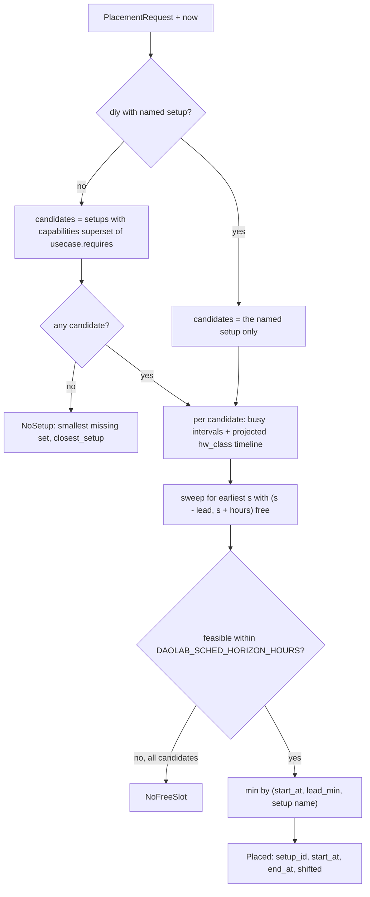

# Scheduler — pure placement logic

Part of the daolab implementation plan — see [README.md](README.md) for the doc map.

Sources: root `README.md` (Phase 2, design invariants), contract §8 (scheduler rules, lead-time rule, state machine) + §12 (env vars), and [09-backend-system-design.md](09-backend-system-design.md) §4–5 (the `asap` / `at` modes, conflict blocking, turnaround buffer, slot grid), which this document implements. Siblings: [01-domain-model.md](01-domain-model.md) for the schema read here, [02-backend-api.md](02-backend-api.md) for the HTTP mapping of results, [04-lifecycle-engine.md](04-lifecycle-engine.md) for the engine's use of the same lead function, [08-cli-config-ops.md](08-cli-config-ops.md) for env-var plumbing.

## Contract: one pure function over a DB handle

`service/scheduler.py` is pure placement. Inputs: the sqlite handle it is given, the reservation request, and `now`. **No other I/O** — no clock reads, no env reads, no network, no filesystem, and no writes (SELECTs only). The caller (`api.py`, transition 1 of the state machine: *(create)* → `queued`) inserts the `reservations` row from the returned placement in the same transaction (`BEGIN IMMEDIATE` — one API worker on sqlite/WAL, so place-then-insert is race-free). This keeps design invariant 2 true verbatim: the scheduler matches capabilities, never hostnames, and has no I/O other than the DB handle it is given → always unit-testable.

```python
# service/scheduler.py — stdlib only: sqlite3, json, dataclasses, datetime, typing.

def place(db: sqlite3.Connection, req: PlacementRequest, now: datetime,
          cfg: SchedConfig = SchedConfig()) -> Placed | NoSetup | NoFreeSlot:
    """Pure placement: FCFS, capability match, slot-shift, hw_class lead time. Read-only."""

def next_free_at(db: sqlite3.Connection, usecase: str, now: datetime,
                 cfg: SchedConfig = SchedConfig()) -> datetime | None:
    """Earliest grantable start for a 1-hour slot (GET /usecases `next_free_at`), or None."""

# read-only helpers for the API and the engine (see "Read-only helpers" below)
def busy_windows(db, setup_id: int, from_dt: datetime, to_dt: datetime,
                 cfg: SchedConfig = SchedConfig()) -> list[tuple[datetime, datetime, int]]: ...  # B-16
def start_lead_min(db, setup_id: int, uc_hw_class: str | None, cfg: SchedConfig) -> int: ...     # engine
def setup_available(db, setup_id: int) -> bool: ...                                              # B-18
def startable_queued(db) -> list[sqlite3.Row]: ...                                               # B-18
```

Callers:

<<<<<<< HEAD
- `POST /reservations` (and therefore `daolab reserve`) — `place()` then INSERT. Slot conflicts are **never** errors: the scheduler slot-shifts and the API returns the granted slot.
- `GET /usecases` — `next_free_at()` per catalog row fills `next_free_at` and distinguishes `reason: "no_free_slot"`.
=======
- `POST /reservations` (and therefore `daolab reserve`) — `place()` then INSERT, inside the transaction that also checks the per-user quota. In mode `asap` (the default) slot conflicts are **never** errors: the scheduler slot-shifts and the API returns the granted slot. In mode `at` a conflict is a `NoFit` result, which the API maps to `409 slot_conflict` with `detail.alternatives` (B-14; alternatives from B-13).
- `GET /usecases` — `next_free_at()` per catalog row fills `next_free_at` (the **Deploy now** label) and distinguishes `reason: "no_free_slot"`.
- `GET /availability` — `busy_windows()` per capable setup (B-16, §Read-only helpers below).
- The engine ([04-lifecycle-engine.md](04-lifecycle-engine.md)) — `startable_queued()` (B-18 gate) and `start_lead_min()` decide when a `queued` booking starts provisioning.
>>>>>>> origin/akshay

How the API maps each result ([02-backend-api.md](02-backend-api.md)):

| Result | HTTP |
|---|---|
| `Placed` | `201` + the reservation (`shifted` = `start_at != requested_start_at`) |
| `NoSetup` | `409 unmet_capability`, message names `missing`, `detail.closest_setup` |
| `NoFreeSlot` | `409 usecase_unavailable`, `detail.reason: "no_free_slot"` (mode `asap` only) |
| `NoFit` | `409 slot_conflict`, `detail: {start_at, end_at, reason, alternatives}` (mode `at` only) |

**Quota is not a scheduler rule.** The per-user cap (B-15: at most `DAOLAB_MAX_LIVE_RESERVATIONS` = 1 reservation in `provisioning`/`ready`/`active` and `DAOLAB_MAX_FUTURE_RESERVATIONS` = 2 in `queued`; admins exempt) is checked by `api.py` in the same `BEGIN IMMEDIATE` transaction, *before* `place()` runs, and answers `409 quota_exceeded`. The scheduler never sees users.

Configuration is passed in, never read: `SchedConfig.from_settings(config.settings)` is the one place `DAOLAB_*` settings become scheduler config, and both the API and the engine call it, so they always use the same leads, buffer and grid. Defaults below mirror `.env.example` exactly.

```python
@dataclass(frozen=True)
class SchedConfig:
    hw_class_lead_min: int = 15   # DAOLAB_HW_CLASS_LEAD_MIN — EBF reflash lead
    provision_lead_min: int = 5   # DAOLAB_PROVISION_LEAD_MIN — normal lead
    horizon_hours: int = 168      # DAOLAB_SCHED_HORIZON_HOURS — search horizon
```

Precondition (enforced by `api.py`, see [02-backend-api.md](02-backend-api.md)): the use case exists and is active (`yaml_path` set, or `'builtin'` for `diy`), `hours >= 1`, and for `diy` the named setup exists. The scheduler may `assert` these, never re-validate them.

## Input and output data shapes

```python
@dataclass(frozen=True)
class PlacementRequest:
    usecase: str                    # natural name, e.g. "tls-proxy-nginx" or "diy"
    requested_start_at: datetime    # UTC-aware; the literal "now" already resolved by api.py
    hours: int                      # >= 1
    setup: str | None = None        # diy only: the explicitly named setup, e.g. "setup-01"

@dataclass(frozen=True)
class Placed:
    setup_id: int                   # -> reservations.setup_id
    setup_name: str
    start_at: datetime              # granted; -> reservations.start_at
    end_at: datetime                # start_at + hours; -> reservations.end_at
    shifted: bool                   # start_at != requested_start_at
    lead_min: int                   # informational; engine re-derives identically

@dataclass(frozen=True)
class NoSetup:                      # -> 409 unmet_capability (message MUST name `missing`)
    missing: list[str]              # smallest per-setup missing capability set, sorted
    closest_setup: str | None       # tie -> alphabetically first setup

@dataclass(frozen=True)
class NoFreeSlot:                   # -> catalog reason "no_free_slot"; POST mapping in 02-backend-api.md
    horizon_hours: int
```

Rows read (all times are UTC ISO-8601 `YYYY-MM-DDTHH:MM:SSZ` TEXT, parsed to aware datetimes by `models.py` helpers):

| Table | Columns read | Used for |
|---|---|---|
| `usecases` | `id`, `name`, `requires`, `hw_class` | `requires` (JSON array) drives the candidate filter; `hw_class` drives lead time. |
| `setups` | `id`, `name`, `capabilities` | Candidate filter: `requires ⊆ capabilities` (JSON array, the sync-computed union). |
| `resources` | `setup_id`, `kind`, `hw_class` | The `kind = 'dpu'` member's current `hw_class` — single source of truth at placement time. |
| `reservations` | `id`, `setup_id`, `state`, `start_at`, `end_at`, `usecase_id` | The setup timeline. |

The one timeline query per candidate setup:

```sql
SELECT r.id, r.start_at, r.end_at, u.hw_class
FROM reservations r JOIN usecases u ON u.id = r.usecase_id
WHERE r.setup_id = ? AND r.state NOT IN ('released', 'failed')
ORDER BY r.start_at, r.id;
```

## Algorithm walkthrough



### Step 1 — candidate setups by capability match

Candidates = setups where `set(usecase.requires) ⊆ set(setup.capabilities)`, iterated `ORDER BY name`. Capability strings only — never hostnames, never `resources.host`. For `diy`, the explicitly named setup is the sole candidate (its `requires` is `[]`, so the filter is moot). If no candidate exists, compute per setup `missing = sorted(set(requires) - set(capabilities))`, pick the setup minimizing `(len(missing), name)`, and return `NoSetup(missing, closest_setup)` — exactly the `unmet_capability` payload of the contract's error model.

### Step 2 — FCFS ordering

FCFS by `created_at` is structural: placement happens once, at creation, and every existing reservation not in `released`/`failed` is immutable input. A new request never displaces or re-packs earlier grants; it takes the earliest slot that remains. Ties in `start_at` order by `id` (creation order). Requests arriving later are placed later — the second of two overlapping requests is the one that shifts (Phase 2 checkpoint).

### Step 3 — busy intervals on the setup timeline

A setup is busy for `[start_at − lead, end_at)` of every reservation not in `released`/`failed` (states `queued`, `provisioning`, `ready`, `active`, `tearing_down`). Intervals are **half-open**: a window may begin exactly at a busy interval's `end_at`. Each existing reservation's `lead` is re-derived deterministically by threading hw_class through the timeline (leads are not stored — scheduler and engine re-derive with the same function).

### Step 4 — hw_class projection and lead time

The DPU keeps its last `hw_class` after cleanup (invariant 5), so the class the DPU *will* have before a future slot is the last one any earlier reservation provisions:

```python
def lead_min(uc_hw_class: str | None, projected: str | None, cfg: SchedConfig, has_dpu: bool) -> int:
    if has_dpu and uc_hw_class is not None and uc_hw_class != projected:
        return cfg.hw_class_lead_min     # EBF reflash takes real time
    return cfg.provision_lead_min        # same class, null class, or no DPU member

def timeline(db, setup, cfg) -> Timeline:
    rows = db.execute(TIMELINE_SQL, (setup.id,)).fetchall()       # ORDER BY start_at, id
    cur = setup.dpu_hw_class          # resources.hw_class of the kind='dpu' member; None if no DPU
    busy, steps = [], []
    for r in rows:
        lead = lead_min(r.hw_class, cur, cfg, setup.has_dpu)
        busy.append((r.start_at - timedelta(minutes=lead), r.end_at))
        if setup.has_dpu and r.hw_class is not None:
            cur = r.hw_class          # null hw_class never changes the projection
        steps.append((r.start_at, cur))
    return Timeline(busy=busy, steps=steps, initial=setup.dpu_hw_class)
    # Timeline.class_at(t): class of the last step with start_at < t, else initial.
```

<<<<<<< HEAD
The lead is used twice, identically: the scheduler requires the setup free for `[start_at − lead, end_at]`, and the engine begins provisioning at `start_at − lead` (transition 2; `dpu_prepare` includes `ebf_set` iff the classes differ — see [04-lifecycle-engine.md](04-lifecycle-engine.md)). Slot-shift therefore automatically inserts the reflash gap between back-to-back reservations with differing `hw_class`. `diy` never declares an `hw_class` → always the short lead, never a reflash.
=======
The lead is used twice, with the same `lead_min` function: the scheduler requires the setup free for `[start_at − lead, end_at + cleanup_min)`, and the engine moves the booking to `provisioning` and queues its deploy job at `start_at − lead` ([04-lifecycle-engine.md](04-lifecycle-engine.md)). The engine's lead (`start_lead_min`) is computed against the DPU's **actual** `resources.hw_class` at tick time rather than the projection, so the long reflash lead is used exactly when the board really needs a reflash; and the engine starts a booking only while no other reservation holds the setup, so a lead that differs from the projected one never overlaps a neighbour. `deploy.yml` runs `ebf_set` first, which checks the board's personality ([05-provisioning.md](05-provisioning.md)). Slot-shift therefore automatically inserts the cleanup and reflash gap between back-to-back reservations with differing `hw_class`. `diy` never declares an `hw_class` → always the short lead, never a reflash.
>>>>>>> origin/akshay

### Step 5 — slot-shift sweep

```python
def sweep(tl, uc_hw_class, base, hours, horizon_end, cfg, has_dpu) -> Slot | None:
    s = base                                            # max(requested_start_at, now)
    while s + timedelta(hours=hours) <= horizon_end:
        lead = lead_min(uc_hw_class, tl.class_at(s), cfg, has_dpu)
        w0, w1 = s - timedelta(minutes=lead), s + timedelta(hours=hours)
        hit = next((b for b in tl.busy if b[0] < w1 and b[1] > w0), None)   # busy sorted by start
        if hit is None:
            return Slot(start=s, lead_min=lead)
        just_after = hit[1] + timedelta(seconds=1)      # class_at is a step function
        s = hit[1] + timedelta(minutes=lead_min(uc_hw_class, tl.class_at(just_after), cfg, has_dpu))
    return None                                          # this candidate has no slot in horizon
```

Each iteration returns or advances `s` past at least one busy interval → guaranteed termination. `place()` runs the sweep per candidate, collects `(start, lead_min, name, id)` tuples, and returns `Placed` from the minimum (tie-break table below) or `NoFreeSlot` if every candidate fails within `now + DAOLAB_SCHED_HORIZON_HOURS`.

<<<<<<< HEAD
=======
### Step 5a — slot grid (B-12)

A granted start is always a multiple of `DAOLAB_SLOT_MIN` minutes after **UTC midnight** (30 → `:00` and `:30`), via `snap_up(t, slot_min)` = the earliest grid point at or after `t`; seconds round up, and `slot_min` must be ≥ 1 (`ValueError` otherwise). `asap` snaps its base and every candidate start the sweep produces, so it returns the earliest *grid* start whose window is free. Consequences with the defaults (cleanup 10, leads 5 / 15, grid 30): the raw earliest start after a booking is 12:15 (same class) or 12:25 (reflash), and both snap to 12:30, so the gap after a booking is a flat 30 minutes; and a "Deploy now" asked for at 09:07 starts at 09:30. A grid that does not divide 24 h evenly (say 50) simply restarts at each UTC midnight.

The grid is also what creates ties between setups (two setups whose raw earliest starts 12:20 and 12:25 both become 12:30). Ties are broken by the existing rule `(start_at, lead_min, setup_name)`, i.e. a setup whose previous booking has the **same `hw_class`** (lead 5, no reflash) beats one that needs a reflash (lead 15). Only equal starts are tie-broken: an earlier start always wins, so FCFS is never broken. The preference looks at the previous booking only; counting the reflash a new booking would force on the *next* booking is not done (decision for B-12).

### Step 5c — alternatives (B-13)

Every `NoFit` — whatever its `reason` — carries `alternatives`: the next `NUM_ALTERNATIVES` (3) free starts for the **same duration**, which B-14 returns as `detail.alternatives` and the dashboard shows as one-click chips (plan/09 §4).

```python
def alternatives(db, req, candidates, uc_hw_class, now, cfg) -> tuple[datetime, ...]:
    out, base = [], max(req.requested_start_at, now)     # forward only; never before now
    for _ in range(NUM_ALTERNATIVES):
        best = earliest(db, candidates, uc_hw_class, base, req.hours, now, cfg)   # the asap search
        if best is None: break                           # horizon exhausted: fewer than 3 (maybe none)
        out.append(best.start)
        base = best.start + timedelta(minutes=cfg.slot_min)    # the next grid point
    return tuple(out)
```

It reuses the `asap` search (`earliest`), so an alternative is free by exactly the same test `at` uses: `place(mode="at")` at any alternative is a `Placed` of that duration. Properties pinned by tests: strictly ascending, grid-aligned, at or after `max(requested, now)`, on any capable setup (one entry per start even if two setups are free then), none of the free starts in between skipped, and the first one equals the `asap` grant. The alternatives are *choices*, not a plan: they may overlap each other (12:30, 13:00, 13:30 for a 2-hour booking), exactly as in the plan/09 sequence diagram. A past start searches from `now`; an off-grid start from the next grid point; `diy` searches its named setup only. The horizon bounds them, so near its end there can be fewer than three, or none (`()`).

### Step 5b — exact window (mode `at`, B-10)

```python
def place_at(db, req, candidates, uc_hw_class, now, cfg) -> Placed | NoFit:
    start, end = req.requested_start_at, req.requested_start_at + timedelta(hours=req.hours)
    if start < now:
        return NoFit(start, end, "in_the_past")          # rejected, never clamped (clamping = shifting)
    if snap_up(start, cfg.slot_min) != start:
        return NoFit(start, end, "off_grid")             # rejected, never snapped (snapping = shifting)
    free = []
    for s in candidates:
        tl = timeline(db, s.id, ...)
        lead = lead_min(uc_hw_class, tl.class_at(start), cfg, has_dpu)
        if conflict(tl, start, req.hours, lead, uc_hw_class, cfg, has_dpu) is None:   # the SAME test the sweep uses
            free.append((lead, s.name, s.id))
    if not free:
        return NoFit(start, end, "overlap")
    lead, name, sid = min(free)
    return Placed(sid, name, start, end, shifted=False, lead_min=lead)
```

`conflict` is the single test shared with the sweep, so the two modes cannot disagree about what a conflict is. Consequence, pinned by a differential test: for any start at or after `now`, `at` is granted exactly when `asap` would grant that same start unshifted (identical `Placed`), and is a `NoFit` exactly when `asap` would have shifted. The lead window before the start counts, so do the cleanup after the booking's own end and a later booking's lead before *its* start, so `at` 12:00–14:00 right after a booking that ends 12:00 conflicts (first free start is 12:15 = 12:00 + 10 cleanup + 5 lead, as in `asap`). An `at` start that is not on the grid is refused as `NoFit(reason="off_grid")` even if the window is free, because snapping it would be shifting; the API returns it as `409 slot_conflict` with `detail.reason: "off_grid"` and grid-aligned alternatives (B-14). The checks run in the order past → off-grid → overlap. `DAOLAB_SCHED_HORIZON_HOURS` bounds the `asap` search only; `at` has no sweep to bound, so it does not enforce the horizon, and the API does not add a check either: an `at` booking may lie beyond the horizon. What limits hoarding today is the per-user quota (two future bookings); whether `at` should also respect the horizon is still an open policy question.

>>>>>>> origin/akshay
Build order for the implementer: 1. dataclasses + `SchedConfig`; 2. loader SQL (`usecases`, `setups` + `resources`, timeline query); 3. `lead_min`; 4. `timeline` / `class_at`; 5. `sweep`; 6. `place` + `next_free_at`; 7. `tests/test_scheduler.py`.

### Read-only helpers for the API and the engine

Same rules as the rest of the module: SELECTs only, no clock, no env.

- **`busy_windows(db, setup_id, from, to, cfg)`** (B-16) — for `GET /availability`: every live reservation on the setup whose blocked interval `[start − lead, end + cleanup)` overlaps `[from, to)`, as `(blocked_start, blocked_end, reservation_id)`. The lead is projected over the *whole* ordered timeline (as in `timeline`), so a reflash lead is right even when the booking before it lies outside the requested range. The picker therefore greys exactly the intervals `place()` treats as busy; the API adds the reservation's own `start_at`/`end_at`, its state, `mine`, and the owner for admins only.
- **`start_lead_min(db, setup_id, uc_hw_class, cfg)`** — the lead the engine applies when it decides whether a `queued` booking is due: `lead_min` against the DPU's current `resources.hw_class` (the DB at tick time), not the projection.
- **`setup_available(db, setup_id)` / `startable_queued(db)`** (B-18) — the availability gate. A setup is `available`, `quarantined` (residue survived a cleanup) or `maintenance` (an admin's flag). **Placement ignores the flag**: bookings keep being granted on a quarantined setup, so users can still queue for the testbed. `startable_queued` returns the `queued` reservations whose setup is `available`, in `(start_at, id)` order — the only candidates the engine considers for `queued → provisioning`, so a booking stays `queued` while its setup is quarantined or in maintenance and starts on the first tick after it is available again.

## Tie-breaking and determinism rules

| Rule | Statement |
|---|---|
| Candidate tie-break | Among candidates, pick min `(start_at, lead_min, setup_name)`. Earliest granted start wins; equal starts prefer the setup needing no EBF reflash (invariant 5: fewer reflashes); still equal → alphabetically first setup name. |
| `closest_setup` tie-break | Smallest per-setup missing set; tie → alphabetically first setup (contract error model, verbatim). |
| Iteration order | Setups `ORDER BY name`; reservations `ORDER BY start_at, id`. |
| Interval convention | Half-open `[start − lead, end)`: a slot may begin exactly at a predecessor's `end_at` (plus its own lead). |
| Past starts | `requested_start_at < now` (including the literal `now`) clamps the sweep base to `now`; `shifted` still compares against the stored `requested_start_at`. |
| Time handling | UTC-aware datetimes only; ISO-8601 UTC strings sort lexicographically = chronologically, so SQL `ORDER BY start_at` is correct. |
| Purity | `now` and `cfg` are parameters; no randomness; no re-placement of existing rows. Same DB state + same request + same `now` → byte-identical result, replayable in tests. |

## Worked examples

<<<<<<< HEAD
All examples: `setup-01` (capabilities `[e810, octeon-cn106, sdp, wire]`, DPU member `dpu-01` with `resources.hw_class = sdp-pf1-vf8`), defaults `DAOLAB_PROVISION_LEAD_MIN=5`, `DAOLAB_HW_CLASS_LEAD_MIN=15`. `tls-proxy-nginx` requires `[octeon-cn106, e810, wire]`, `hw_class: sdp-pf1-vf8`.
=======
Examples 1–3 are shown with the grid off (`DAOLAB_SLOT_MIN=1`) so the raw gaps are visible; example 4 adds the default 30-minute grid. All examples use the test fixture `setup-01` of `tests/test_scheduler.py`, which has the same capabilities and DPU as the real testbed `tb-01`: `setup-01` (capabilities `[e810, octeon-cn106, sdp, wire]`, DPU member `dpu-01` with `resources.hw_class = sdp-pf1-vf8`), defaults `DAOLAB_PROVISION_LEAD_MIN=5`, `DAOLAB_HW_CLASS_LEAD_MIN=15`, `DAOLAB_CLEANUP_MIN=10`. `tls-proxy-nginx` requires `[octeon-cn106, e810, wire]`, `hw_class: sdp-pf1-vf8`.
>>>>>>> origin/akshay

**1 — simple grant.** Empty timeline; reserve `tls-proxy-nginx` at `2026-09-01T10:00:00Z` for 2 h. Use-case `hw_class` equals the DPU's → lead 5. Window `[09:55, 12:00)` is free.

```
setup-01 ────────────────────────────────────────────► t (UTC)
             09:55       10:00                12:00
             |· lead 5m ·|██████ r1 granted ██████|
hw_class: sdp-pf1-vf8 throughout (match → no reflash)
result: start_at=10:00:00Z end_at=12:00:00Z shifted=false
```

**2 — overlap shift (Phase 2 checkpoint).** r1 as above is `queued`. r2 requests the same use case, same start `10:00`, 2 h. r1's busy interval is `[09:55, 12:00)`. Sweep: `s=10:00` conflicts; class after `12:00` is `sdp-pf1-vf8` = r2's class → lead 5 → `s = 12:00 + 5m = 12:05`; window `[12:00, 14:05)` is free.

```
             09:55 10:00               12:00 12:05              14:05
setup-01     |·5m·|██████ r1 ████████████|
r2 request         ▲ 10:00 (requested)
r2 granted                               |·5m·|██████ r2 █████████|
                                         └ back-to-back, same hw_class → 5-min lead only
result: start_at=12:05:00Z end_at=14:05:00Z shifted=true
```

**3 — hw_class lead time.** r1 as in example 1. r2 is test-fixture use case `uc-b` (requires `[octeon-cn106]`, `hw_class: sdp-pf2-vf16`), requested `12:00`, 2 h. Projected class at `12:00` is `sdp-pf1-vf8` (left by r1) → differs → lead 15. Window `[11:45, 14:00)` overlaps r1 → shift to `s = 12:00 + 15m = 12:15`; window `[12:00, 14:15)` is free.

```
             09:55 10:00                12:00      12:15               14:15
setup-01     |·5m·|██ r1 (sdp-pf1-vf8) ██|         |██ r2 (sdp-pf2-vf16) ██|
r2 request                              ▲ 12:00
r2 granted                              |··15m····|
                                        └ EBF reflash gap = DAOLAB_HW_CLASS_LEAD_MIN
engine starts dpu_prepare (incl. ebf_set) at 12:00 = start_at − 15m
result: start_at=12:15:00Z end_at=14:15:00Z shifted=true
```

<<<<<<< HEAD
## Edge cases

- **No satisfying setup** → `NoSetup`; `api.py` returns `409 unmet_capability` whose message **names the missing capability list** (Phase 2 checkpoint), e.g. `requires [octeon-cn106, e810, wire, gpu]` against setup-01 → `missing: ["gpu"]`, `closest_setup: "setup-01"`.
- **Cancellation frees a slot.** `DELETE` of a `queued` reservation → `released` immediately; `released` is excluded from busy, so the slot is free for the *next* request at once. Cancelling `ready`/`active` goes through `tearing_down` (still busy) until `released`. Freed slots are never back-filled retroactively: earlier shifted grants stay where they were placed (FCFS grants are final).
- **Back-to-back same `hw_class`** → no reflash, only `DAOLAB_PROVISION_LEAD_MIN` (example 2). Likewise a use case with `hw_class` null/omitted runs on whatever class the DPU has — never triggers `ebf_set`, never takes the long lead, and never changes the projection.
- **N setups with partial capability overlap.** `requires [octeon-cn106, e810, wire]` with setup-01 `[e810, octeon-cn106, sdp, wire]` and a fixture `setup-02` `[gpu, octeon-cn106, sdp]`: only setup-01 is a candidate — partial overlap is not a match. If *both* satisfy `requires`, each is swept independently and the tie-break table decides; a request that would shift on setup-01 is granted unshifted on a free setup-02.
- **Setup without a DPU member** (pure `nic`/`compute`/`gpu`): `has_dpu` is false, hw_class logic is inert, lead is always `DAOLAB_PROVISION_LEAD_MIN`.
- **`failed` reservations** are excluded from the timeline (contract busy rule, verbatim). A failed *teardown* leaving the setup physically held is an operational condition surfaced via `held_by` and resolved by an admin — engine/ops concern ([04-lifecycle-engine.md](04-lifecycle-engine.md)), not a scheduler input.
=======
**3 — hw_class lead time.** r1 as in example 1. r2 is test-fixture use case `uc-b` (requires `[octeon-cn106]`, `hw_class: sdp-pf2-vf16`), requested `12:00`, 2 h. Projected class at `12:00` is `sdp-pf1-vf8` (left by r1) → differs → lead 15. Window `[11:45, 14:10)` overlaps r1 (busy to 12:10) → shift to `s = 12:10 + 15m = 12:25`; window `[12:10, 14:35)` is free.

```
             09:55 10:00                12:00 12:10          12:25               14:25
setup-01     |·5m·|██ r1 (sdp-pf1-vf8) ██|·10m·|                |██ r2 (sdp-pf2-vf16) ██|
r2 request                              ▲ 12:00  cleanup
r2 granted                                    |······15m······|
                                              └ EBF reflash lead = DAOLAB_HW_CLASS_LEAD_MIN
engine queues r2's deploy job (deploy.yml, ebf_set first) at 12:10 = start_at − 15m, right after r1's cleanup
result: start_at=12:25:00Z end_at=14:25:00Z shifted=true
```

**4 — slot grid (B-12).** Same as example 2 but with the default `DAOLAB_SLOT_MIN=30`. The raw earliest start is 12:15 (12:00 end + 10 cleanup + 5 lead); the sweep rounds it up to the next grid point.

```
             10:00                      12:00 12:10 12:15 12:30                    14:30
setup-01     |███████ r1 █████████████|·10m·|
r2 granted                                          |··snap··|██████ r2 ████████████|
result: start_at=12:30:00Z end_at=14:30:00Z shifted=true   (raw 12:15 -> grid 12:30)
```

If instead r2 had been an `at` request for 12:15, it is refused (`NoFit("off_grid")`); for 12:30 it is granted unshifted.

## Edge cases

- **No satisfying setup** → `NoSetup`; `api.py` returns `409 unmet_capability` whose message **names the missing capability list** (Phase 2 checkpoint), e.g. `requires [octeon-cn106, e810, wire, gpu]` against setup-01 → `missing: ["gpu"]`, `closest_setup: "setup-01"`.
- **Cancellation frees a slot.** `DELETE` of a `queued` reservation → `released` immediately; `released` is excluded from busy, so the slot is free for the *next* request at once. Ending a `ready`/`active` slot early (`POST /reservations/{id}/cleanup`) goes through `cleaning` and a cleanup job (still busy) until the cleanup is verified and it is `released`. Freed slots are never back-filled retroactively: earlier shifted grants stay where they were placed (FCFS grants are final).
- **Back-to-back same `hw_class`** → no reflash: the gap is `DAOLAB_CLEANUP_MIN + DAOLAB_PROVISION_LEAD_MIN` = 15 min (example 2). Likewise a use case with `hw_class` null/omitted runs on whatever class the DPU has — never triggers `ebf_set`, never takes the long lead, and never changes the projection.
- **N setups with partial capability overlap.** `requires [octeon-cn106, e810, wire]` with setup-01 `[e810, octeon-cn106, sdp, wire]` and a fixture `setup-02` `[gpu, octeon-cn106, sdp]`: only setup-01 is a candidate — partial overlap is not a match. If *both* satisfy `requires`, each is swept independently and the tie-break table decides; a request that would shift on setup-01 is granted unshifted on a free setup-02.
- **Setup without a DPU member** (pure `nic`/`compute`/`gpu`): `has_dpu` is false, hw_class logic is inert, lead is always `DAOLAB_PROVISION_LEAD_MIN`; the cleanup buffer still applies.
- **`failed` reservations** are excluded from the timeline (contract busy rule, verbatim). Residue after a cleanup is not a scheduler input either: a cleanup that leaves residue moves the reservation to `quarantined` (a busy state, so it keeps blocking its window until reconcile or force-clean releases it) and flags the *setup* `quarantined`; residue after the cleanup of a `failed` deploy leaves the reservation `failed` and flags the setup the same way. The flag never changes placement — bookings keep being granted on a quarantined setup — it only stops the engine from starting them (B-18, §Read-only helpers; [04-lifecycle-engine.md](04-lifecycle-engine.md)).
- **Deploy now is not instant.** `start_at: "now"` at 09:07 resolves to a start of 09:30 (next grid point), so a one-click deploy can wait up to `DAOLAB_SLOT_MIN` minutes. plan/09 §5 additionally says "at or after `now + provision_lead`"; the scheduler does not add that lead to `now` (open question for the supervisor).
- **A booking placed before an existing one can lengthen that one's lead.** Existing X (class B, 12:00) follows a class-B DPU, so its lead is 5 min. A class-A booking placed before X makes X a reflash (lead 15), so the new window + cleanup must end by `X.start − 15`, not `X.start − 5`. Likewise through bookings with no `hw_class`, which pass the projection on to the next classed booking. A cleanup of `0` restores the pre-B-11 gaps (5 / 15 min).
- **Early release frees the buffer too.** `released`/`failed` reservations are excluded from the timeline, so once a cleanup is verified and the reservation is `released`, its `end_at + cleanup_min` block disappears with it.
- **Mode `at` on a busy window** → `NoFit(reason="overlap")` carrying the requested `start_at`/`end_at`; nothing is shifted and nothing is written. With several capable setups the window is tested on each, and the request is granted on a free one (tie-break above); `NoFit` only when every candidate conflicts. `diy` tests only its named setup.
- **Mode `at` with a start in the past** → `NoFit(reason="in_the_past")`; the API does not pre-validate it, so the user gets `409 slot_conflict` with that reason and alternatives starting at `now`.
>>>>>>> origin/akshay
- **Horizon exhaustion** → `NoFreeSlot(horizon_hours=168)`; surfaces as `reason: "no_free_slot"` / `next_free_at: null` in the catalog.
- **`reservation_id=0`** (manual Phase-1 runs) never exists as a DB row, so it never appears on any timeline.

## Complexity and practical limits

Let S = candidate setups, R = timeline rows per setup (reservations not in `released`/`failed` within the horizon).

- Timeline build: one indexed query per candidate (`idx_reservations_setup` on `(setup_id, start_at, end_at)`), O(R) rows, already ordered.
- Sweep: each shift consumes ≥ 1 busy interval → ≤ R shifts; linear conflict scan → O(R²) worst case per setup, O(S·R²) total, O(R) memory. A `NoFit` runs the `asap` search up to three more times for its alternatives.
- Practical bound: `DAOLAB_SCHED_HORIZON_HOURS=168` and ≥ 1-hour slots cap R at ~168 per setup; with tens of setups the worst case is well under a millisecond in-process on sqlite — no caching, no precomputation, nothing shared between calls. Revisit only alongside the Phase-4 sqlite→Postgres move (>1 API worker), which is when place-then-insert would need `SELECT ... FOR UPDATE` semantics instead of sqlite's single-writer guarantee.

## Unit test plan

`tests/test_scheduler.py`, run by `make test` (`python -m pytest tests/ -q`) — no hardware, no API, no engine. Harness: `sqlite3.connect(":memory:")`, execute `service/schema.sql`, tiny fixture helpers (`mk_setup(name, caps, dpu_hw_class)`, `mk_usecase(name, requires, hw_class)`, `mk_res(setup, usecase, start, end, state)`) inserting rows directly; `now` is a frozen parameter — no clock mocking. Every test calls `place()`/`next_free_at()` with an explicit `SchedConfig(15, 5, 168)`-style config.

| # | Test | Fixture / action | Expected |
|---|---|---|---|
| 1 | `test_simple_grant_exact_slot` | Empty timeline; reserve `tls-proxy-nginx` 10:00 +2h | `Placed`, `start_at=10:00`, `end_at=12:00`, `shifted=False` |
| 2 | `test_overlap_shifts_second` **(Phase 2 checkpoint)** | r1 10:00–12:00 queued; identical second request | `start_at=12:05`, `shifted=True` — second call shifted to the next slot |
| 3 | `test_unmet_capability_names_missing` **(Phase 2 checkpoint)** | `requires` includes `gpu`; no setup offers it | `NoSetup`, `missing == ["gpu"]`, `closest_setup == "setup-01"` |
| 4 | `test_shift_lands_after_end_plus_lead` | As #2 | Granted window starts exactly at `end_at + provision_lead_min` |
| 5 | `test_hw_class_change_pads_lead` | r1 `sdp-pf1-vf8`; r2 use case `sdp-pf2-vf16` at r1's `end_at` | `start_at = end_at + 15m` (worked example 3) |
| 6 | `test_back_to_back_same_hw_class_short_lead` | r2 same `hw_class` as r1, requested at r1's `end_at` | `start_at = end_at + 5m`; `lead_min == 5` |
| 7 | `test_null_hw_class_never_reflashes` | Use case `hw_class=None`, DPU class arbitrary | `lead_min == 5`; projection unchanged for later requests |
| 8 | `test_projection_threads_through_queue` | r1 class A, r2 class B queued; r3 class B after r2 | r3 gets short lead (predecessor projects B, not the DB's A) |
| 9 | `test_released_frees_slot` | r1 10:00–12:00 `released`; request 10:00 | Granted 10:00 unshifted — cancellation freed the slot |
| 10 | `test_failed_excluded_from_timeline` | r1 in `failed` | Timeline ignores it; grant lands at the requested start |
| 11 | `test_all_busy_states_block` | r1 in each of `queued/provisioning/ready/active/tearing_down` | Every one conflicts and shifts the new request |
| 12 | `test_partial_overlap_not_candidate` | setup-02 `[gpu, octeon-cn106, sdp]`; `requires [octeon-cn106, e810, wire]` | Only setup-01 candidate; setup-02 never selected |
| 13 | `test_two_setups_earliest_start_wins` | setup-01 busy, satisfying setup-02 free | Granted on setup-02 at the requested start, `shifted=False` |
| 14 | `test_tie_prefers_no_reflash_then_name` | Two free setups, equal starts, one needs reflash | No-reflash setup wins; with equal leads the alphabetically first name wins |
| 15 | `test_closest_setup_smallest_missing_tie_alpha` | Two setups missing 2 vs 1 caps; then two missing 1 each | Smallest set wins; tie → alphabetically first `closest_setup` |
| 16 | `test_diy_uses_named_setup_only` | `PlacementRequest(usecase="diy", setup="setup-01")`, other setups free | Placed on `setup-01`; short lead (diy has no `hw_class`) |
| 17 | `test_no_free_slot_within_horizon` | Timeline saturated for 168 h | `NoFreeSlot(horizon_hours=168)` |
| 18 | `test_past_start_clamped_to_now` | `requested_start_at` = literal `now` resolved / in the past | Sweep base is `now`; `shifted` computed vs stored request |
| 19 | `test_hours_sets_end_at` | `hours=3` | `end_at == start_at + 3h` |
| 20 | `test_next_free_at_probe` | Busy until 12:00 (same class) | `next_free_at == 12:05`; `None` once the horizon is saturated |
| 21 | `test_determinism_replay` | Run #2 and #5 twice on cloned DBs | Byte-identical `Placed` results both times |
| 22 | `test_read_only` | Any `place()` call | `db.total_changes == 0` — the scheduler never writes |

<<<<<<< HEAD
=======
B-10 adds the mode-`at` cases below (same file, same fixtures; `req(..., mode="at")`):

| # | Test | Fixture / action | Expected |
|---|---|---|---|
| B-10.1 | `test_mode_defaults_to_asap` | `PlacementRequest` without `mode` | `mode == "asap"` |
| B-10.2 | `test_at_free_window_granted_exactly` | Empty timeline; `at` 10:00 +2h | `Placed` 10:00–12:00, `shifted=False` |
| B-10.3 | `test_at_busy_window_is_conflict_but_asap_shifts` **(B-10 done-when)** | r1 10:00–12:00; `at` 11:00 +2h, then the same as `asap` | `NoFit(11:00, 13:00, "overlap")`; `asap` → 12:15, `shifted=True` |
| B-10.4 | `test_at_conflict_names_the_requested_window` | r1 10:00–12:00; `at` 10:30 +3h | `NoFit` with `start_at=10:30`, `end_at=13:30` |
| B-10.5 | `test_at_boundary_after_a_booking_uses_lead` | r1 ends 12:00; `at` 12:14 / 12:15 / 12:16 | 12:14 `NoFit`; 12:15 and 12:16 `Placed` (cleanup + lead) |
| B-10.6 | `test_at_hw_class_change_needs_reflash_lead` | r1 ends 12:00; other `hw_class`; `at` 12:24 / 12:25 | 12:24 `NoFit`; 12:25 `Placed`, `lead_min=15` |
| B-10.7 | `test_at_window_ending_into_a_later_booking` | r1 12:00–14:00; `at` window ending 11:45 / 11:46 | ending 11:45 `Placed`; 11:46 `NoFit` (r1's 5 min lead + our own 10 min cleanup) |
| B-10.8 | `test_at_all_busy_states_block` | r1 in each busy state | `NoFit` every time |
| B-10.9 | `test_at_released_and_failed_free_the_window` | r1 `released` / `failed` | `Placed` |
| B-10.10 | `test_at_start_in_the_past_is_rejected_not_clamped` | `at` 08:00 with `now` 09:00; then `at` == `now` | `NoFit("in_the_past")`; `start == now` → `Placed` |
| B-10.11 | `test_at_picks_the_free_setup` / `test_at_all_capable_setups_busy_is_conflict` | setup-01 busy, setup-02 free; then both busy | granted on setup-02 unshifted; then `NoFit` |
| B-10.12 | `test_at_tie_prefers_no_reflash_then_name` / `test_at_tie_equal_leads_alpha_name_wins` | Two free setups | no-reflash setup wins; equal leads → alphabetical |
| B-10.13 | `test_at_unmet_capability_is_still_nosetup` | `requires` includes `gpu` | `NoSetup`, `missing == ["gpu"]` |
| B-10.14 | `test_at_diy_uses_named_setup_only` | diy, named setup busy, other free | `NoFit` (no fallback); named free → `Placed` |
| B-10.15 | `test_at_is_pure_and_read_only` | Same `at` request twice | equal results; `db.total_changes` unchanged |
| B-10.16 | `test_unknown_mode_is_an_error` | `mode="whenever"` | `ValueError` |
| B-10.17 | `test_at_and_asap_agree_on_random_timelines` | 400 seeded random timelines, 2 setups, 3 use cases | `at == asap` whenever `asap` is unshifted; `NoFit("overlap")` whenever `asap` shifted |

B-11 adds the turnaround-buffer cases (same file; `CFG` now carries `cleanup_min=10`, and the pre-B-11 expectations above moved by +10 min):

| # | Test | Fixture / action | Expected |
|---|---|---|---|
| B-11.1 | `test_gap_constants_match_the_documented_numbers` | — | same-class gap 15, reflash gap 25 |
| B-11.2 | `test_cleanup_min_is_configurable` / `test_cleanup_zero_restores_the_pre_b11_gap` | r1 ends 12:00; `cleanup_min` 0 / 10 / 30 | first start 12:05 / 12:15 / 12:35; with 0, `at` 12:04 `NoFit`, 12:05 `Placed` |
| B-11.3 | `test_setup_without_dpu_still_gets_cleanup` | No DPU member; r1 ends 12:00 | next start 12:15, `lead_min == 5` |
| B-11.4 | `test_cleanup_blocks_every_live_state_until_released` | r1 `cleaning`, then `released` | 12:15 while live; 12:00 once released |
| B-11.5 | `test_new_booking_leaves_room_for_its_own_cleanup` | r1 12:00–14:00 (lead 5); `at` 2 h from 09:50 | `NoFit`; `asap` → 14:15; a 1 h booking from 09:50 fits |
| B-11.6 | `test_later_reflash_booking_needs_the_longer_gap_before_it` | r1 (other class) at 12:00 → lead 15 | window ending 11:35 `Placed`; 11:36 `NoFit` |
| B-11.7 | `test_turnaround_only_adds_time_after_never_before_the_start` | Empty timeline | granted at exactly the requested start |
| B-11.8 | `test_inserting_before_a_booking_can_lengthen_its_lead` | X (class B, 12:00) on a class-B DPU; class-A `at` ending 11:45 / 11:35 | 11:45 `NoFit`; 11:35 `Placed`; class-B booking `Placed`; `asap` for class A → 13:25 |
| B-11.9 | `test_lead_change_propagates_through_bookings_without_hw_class` | X (no class, 12:00–13:00), Z (class B, 13:20); class-A `at` ending 11:45 | `NoFit` via Z; a no-class booking is `Placed` |
| B-11.10 | `test_placements_always_keep_the_turnaround_gap` | 40 seeded runs × 25 random `asap`/`at` requests, 2 setups; each grant inserted | after every insert, consecutive bookings are ≥ `cleanup + lead` apart (lead re-derived independently in the test) |

B-12 adds the slot-grid cases. `CFG` in the test module runs with the grid off (`slot_min=1`) so the older rows keep their exact minutes; `GRID` is the same config with `slot_min=30`:

| # | Test | Fixture / action | Expected |
|---|---|---|---|
| B-12.1 | `test_slot_min_defaults_to_30` | `SchedConfig()` | `slot_min == 30` |
| B-12.2 | `test_snap_up_rounds_to_the_next_grid_point` / `…_rounds_seconds_up_and_converts_to_utc` | table of grid 30 / 45 / 60 / 1, midnight rollover, 10:30:01, an IST-aware time | earliest grid point at or after the input, in UTC |
| B-12.3 | `test_asap_start_snaps_up_to_the_grid` | free setup; asked 10:00 / 10:10 / 10:30 / 10:31 | 10:00 / 10:30 / 10:30 / 11:00; `shifted` only when it moved |
| B-12.4 | `test_deploy_now_waits_for_the_next_grid_point` | `now` 09:07, start = `now` | 09:30; with the grid off, 09:07 |
| B-12.5 | `test_shift_after_a_booking_lands_on_the_grid` / `test_next_free_at_is_on_the_grid` | r1 ends 12:00; same class, reflash, cleanup 30 | 12:30 / 12:30 / 13:00; `next_free_at` 12:30 |
| B-12.6 | `test_at_off_grid_start_is_refused_even_when_free` / `…_reason_precedence_past_then_grid_then_overlap` | `at` 10:10 on an empty timeline; past + off-grid; off-grid + busy; on-grid + busy | `NoFit("off_grid")`; reasons `in_the_past` → `off_grid` → `overlap` in that order |
| B-12.7 | `test_at_on_the_grid_after_a_booking_respects_the_gap` | r1 ends 12:00; `at` 12:00 / 12:30 | 12:00 `NoFit("overlap")`; 12:30 `Placed` |
| B-12.8 | `test_slot_min_below_one_is_an_error` | `slot_min=0` | `ValueError` |
| B-12.9 | `test_sweep_finds_the_earliest_grid_start` | oracle: 150 seeded random timelines × grid 5 and 30; walk every grid point | the sweep returns exactly the first grid point the conflict test clears |
| B-12.10 | `test_same_class_neighbour_wins_a_tie_the_grid_creates` **(B-12 done-when)** | setup-01 previous booking other class (raw 12:20), setup-02 same class (raw 12:25) | grid off: setup-01 at 12:20; grid 30: both 12:30 → setup-02 (lead 5) wins |
| B-12.11 | `test_tie_preference_never_beats_an_earlier_start` | setup-02 same class but its snapped start is 13:00 | setup-01 (reflash) at 12:30 still wins — FCFS not broken |
| B-12.12 | `test_placements_keep_the_gap_and_the_grid` / `test_at_and_asap_agree_on_random_timelines[grid-30]` | the B-11 property test and the B-10 differential test re-run with the 30-minute grid | all grants on the grid; gap rule holds; `at` ≡ `asap` |

B-13 adds the `NoFit.alternatives` cases:

| # | Test | Fixture / action | Expected |
|---|---|---|---|
| B-13.1 | `test_nofit_alternatives_default_to_empty` | a constructed `NoFit` | `alternatives == ()`; `NUM_ALTERNATIVES == 3` |
| B-13.2 | `test_alternatives_match_the_design_doc_example` | alice 09:00–11:00; bob `at` 10:00 for 2 h (grid 30) | `(11:30, 12:00, 12:30)` — plan/09 §4 |
| B-13.3 | `test_alternatives_skip_gaps_that_are_too_small` | r1 10–12, r2 14–15; `at` 11:00 for 1 h / 2 h | `(12:30, 15:30, 16:00)` / `(15:30, 16:00, 16:30)` |
| B-13.4 | `test_alternatives_on_random_timelines` **(B-13 done-when)** | 200 seeded random timelines × grid 5 and 30, 2 setups, 3 use cases | per `NoFit`: 3 alternatives, ascending, on the grid, ≥ `max(asked, now)`, each `Placed` via `at` with the same duration, first == `asap` start, equal to a brute-force walk of every free grid start (no skips) |
| B-13.5 | `test_alternatives_for_a_past_start_begin_at_now` / `…_are_never_in_the_past` | `at` 08:00 with `now` 09:00 | `in_the_past`; alternatives from 09:00, never earlier |
| B-13.6 | `test_alternatives_for_an_off_grid_start_begin_at_the_next_grid_point` | `at` 10:10 | `off_grid`; alternatives from 10:30 |
| B-13.7 | `test_alternatives_never_go_before_the_requested_start` | free morning, r1 14–16, `at` 14:30 | all alternatives after 14:30; none in the morning |
| B-13.8 | `test_alternatives_are_cut_short_by_the_horizon` | horizon 3 h; then saturated | 2 alternatives; then `()` |
| B-13.9 | `test_alternatives_use_every_capable_setup_without_duplicates` | two setups free at different times | ascending, one entry per start, from the setup that frees first |
| B-13.10 | `test_diy_alternatives_come_from_the_named_setup_only` | diy on a busy named setup, another setup free | alternatives from the named setup only |
| B-13.11 | `test_alternatives_are_deterministic_and_read_only` | same `at` request twice | equal results; `db.total_changes` unchanged |

B-18 adds the availability-gate cases:

| # | Test | Fixture / action | Expected |
|---|---|---|---|
| B-18.1 | `test_placement_still_books_a_quarantined_setup` | setup `quarantined`; reserve | `Placed` on it, unshifted |
| B-18.2 | `test_setup_available_predicate` | flag `available` / `quarantined` / `maintenance` | `True` / `False` / `False` |
| B-18.3 | `test_queued_stays_queued_while_quarantined` | a `queued` booking; quarantine, then clear | in `startable_queued`, then not, then again |
| B-18.4 | `test_availability_rejects_unknown_value` | flag `bogus` | `sqlite3.IntegrityError` (CHECK) |

`busy_windows` is exercised through the API (`tests/test_api.py` cases 25–26) and `start_lead_min` through the engine (`tests/test_engine.py::test_start_lead_min_reads_the_live_dpu_class`); the race between two bookings of one `at` window is `tests/test_concurrency.py` (B-17).

>>>>>>> origin/akshay
Tests 2 and 3 are the two Phase 2 checkpoint scenarios from the root README, verbatim: two overlapping reserve calls → the second is shifted to the next slot; reserving a use case whose `requires` no setup meets → rejected naming the missing capability.
