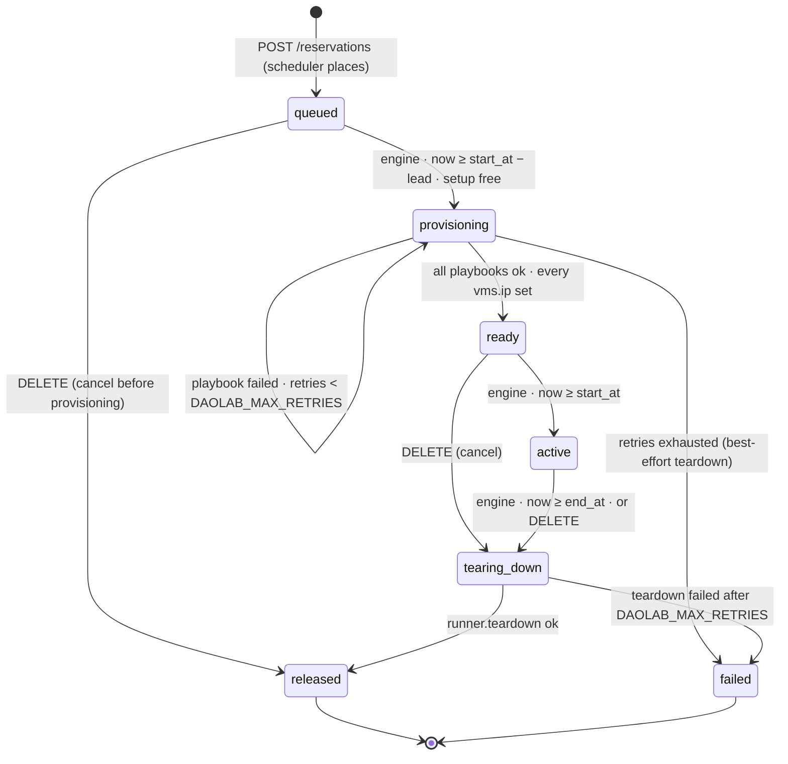

# Lifecycle engine and runner

Part of the daolab implementation plan — see [README.md](README.md) for the doc map.

This document specifies `service/engine.py` and `service/runner.py`. It draws on contract §8
(state machine, engine mechanics, runner contract). Placement itself — capability matching,
FCFS, slot-shift, the lead-time computation — is the scheduler's job
([03-scheduler.md](03-scheduler.md)); playbook internals are [05-provisioning.md](05-provisioning.md);
the cancel endpoint and the `/internal/vm-ip` handler are [02-backend-api.md](02-backend-api.md).

## Reservation state machine

States, exact list: `queued`, `provisioning`, `ready`, `active`, `tearing_down`, `released`,
plus `failed` — the terminal error state the contract adds for failure handling. `released` and
`failed` are terminal. There is no `cancelled` state: cancelling a `queued` reservation goes
straight to `released`; cancelling `ready`/`active` goes through `tearing_down` → `released`.



| From | Trigger | Action | Next state | On failure |
|---|---|---|---|---|
| *(create)* | `POST /reservations` / `daolab reserve` (api) | `scheduler.py` matches capabilities, applies FCFS + slot-shift + lead time, fixes `setup_id`, `start_at`, `end_at` | `queued` | API-side errors only ([02-backend-api.md](02-backend-api.md)) — slot conflicts are never errors |
| `queued` | engine tick (d): `now >= start_at − lead` and the setup is free | one transaction: create `vms` rows for every role, CAS state update | `provisioning` | crash before commit = nothing happened; next tick redoes it |
| `provisioning` | engine tick (e): one full attempt | deploy via `runner.deploy` (backed by `playbooks/deploy.yml` roles: `lease_ip`, `dpu_app`/roles, `host_vm`, `verify`, etc.) | `ready` when all succeed and every VM role has an `ip`/lease as required; update `resources.hw_class` after a reflash; fire webhook if `DAOLAB_WEBHOOK_URL` set | `retries += 1`, stay `provisioning` while `retries < DAOLAB_MAX_RETRIES` (idempotent replay next tick) |
| `provisioning` | a failure brings `retries` to `DAOLAB_MAX_RETRIES` | best-effort `runner.cleanup` / cleanup flow; set `failure_reason` | `failed` | cleanup here is best-effort — its failure is logged, state is `failed` either way; failed reservations hold setup until cleanup verified (B-94) |
| `ready` | engine tick (a): `now >= start_at` | none | `active` | — |
| `ready` | `DELETE /reservations/{id}` (api) | state change + `retries = 0`; engine drives the teardown | `tearing_down` | — |
| `active` | engine tick (b): `now >= end_at`, or `DELETE /reservations/{id}` | `retries = 0` on entry | `tearing_down` | — |
| `cleaning` | engine tick (c): `runner.cleanup` then `runner.verify_clean` | if clean → release leases/setup → `released`; if residue → reconcile/quarantine → `quarantined`; **`resources.hw_class` is left untouched** | `released`/`quarantined`/`failed` | retries as needed; on failure/quarantine setup held until resolved (admin force-clean) |
| `queued` | `DELETE /reservations/{id}` before provisioning began (api) | no playbooks ran; nothing to tear down | `released` | — |

Cancel while `provisioning` or `tearing_down` → `409 invalid_state` (retry once `ready`) — the
engine never has to interrupt a running playbook.

## Engine loop — one tick, every minute

`service/engine.py` is a plain script, not a daemon framework. `python -m service.engine` runs
**one tick and exits** (systemd-timer friendly); `make engine` runs
`python -m service.engine --loop`, ticking every `DAOLAB_ENGINE_INTERVAL_SEC` (default `60`).

```python
# service/engine.py — no state outside the DB
import argparse, sqlite3, time
from datetime import datetime, timezone
from service import config, models, runner, scheduler

def tick(db: sqlite3.Connection, now: datetime) -> int:
    """One pass over the reservations table. Returns transitions performed."""
    n  = _promote_ready_to_active(db, now)   # (a) ready -> active, start_at due
    n += _expire_active(db, now)             # (b) active -> tearing_down, end_at passed
    n += _drive_teardowns(db, now)           # (c) run cleanup per due reservation (deploy.yml/cleanup.yml)
    n += _start_due_provisioning(db, now)    # (d) queued -> provisioning, create vms rows
    n += _drive_provisioning(db, now)        # (e) one full provisioning attempt per setup
    return n

def main(argv: list[str] | None = None) -> int:
    args = argparse.ArgumentParser(prog="python -m service.engine")
    args.add_argument("--loop", action="store_true")
    opts = args.parse_args(argv)
    db = models.connect(config.DAOLAB_DB_PATH)   # applies WAL + foreign_keys pragmas
    if not opts.loop:
        tick(db, datetime.now(timezone.utc)); return 0
    while True:
        tick(db, datetime.now(timezone.utc))
        time.sleep(config.DAOLAB_ENGINE_INTERVAL_SEC)
```

Tick order is fixed — (a) through (e) exactly as above — so releases and expiries free a setup
*before* the same tick considers starting the next reservation on it. Rules:

- **Stateless.** Every decision derives from reservation rows, `vms` rows, `resources.hw_class`,
  the clock, and `config.py`. The engine keeps nothing in memory across ticks; killing it at any
  instant loses no information (see the crash walkthrough below).
- **Single-flight per setup.** At most one reservation per setup is in `provisioning` or
  `tearing_down` at a time; steps (c)/(d)/(e) skip a setup that already has one.
- **Compare-and-set transitions.** Every state write is guarded so a duplicate engine process
  cannot double-fire a transition:

  ```sql
  UPDATE reservations SET state = 'active', updated_at = :now
   WHERE id = :id AND state = 'ready' AND start_at <= :now;
  -- rowcount 0 => someone else already moved it; skip silently
  ```

  Because every timestamp is `YYYY-MM-DDTHH:MM:SSZ`, lexicographic string comparison equals time
  comparison — plain SQL `<=` works.
- **Lead time.** Step (d) starts a reservation at `start_at − lead`, where `lead` is
  `DAOLAB_HW_CLASS_LEAD_MIN` minutes if the use case declares an `hw_class` different from the
  DPU's current `resources.hw_class`, else `DAOLAB_PROVISION_LEAD_MIN` minutes. The engine calls
  the same pure lead helper the scheduler uses (defined in [03-scheduler.md](03-scheduler.md)),
  so scheduler and engine can never disagree — the contract requires the lead be "used twice,
  identically". `resources.hw_class` in the DB is the single source of truth at tick time.
- **Blocking is fine.** Steps (c) and (e) run ansible-runner synchronously; a provisioning tick
  can take minutes. Ticks are serialized (one process), so a long tick simply delays the next.
- **`vms` row creation in step (d)**, inside the same transaction as the state CAS: one row per
  role. `on: dpu` roles → `host` = the DPU member name (e.g. `dpu-01`), `template` and `name`
  NULL. `dpu_host`/`tg_host` roles → resolved XCP-ng `host`, `template` = the role's `vm`,
  `name` = `daolab-r<reservation_id>-<role>`. DIY → one row per VM host from `diy_templates`,
  with the host name as `role`. Rows exist *before* any playbook runs, so the VM-IP callback
  always finds its `(reservation_id, role)` target.

## runner.py — one function per transition

`service/runner.py` is a thin ansible-runner wrapper. Each function runs the same-named playbook
from `DAOLAB_PLAYBOOKS_DIR` against `DAOLAB_INVENTORY` (`inventory/hosts.yml`) and returns
success/failure plus the runner event stream for logging.

```python
# service/runner.py
from dataclasses import dataclass, field
import ansible_runner
from service import config

@dataclass
class RunResult:
    ok: bool                 # status == "successful" and rc == 0
    rc: int
    playbook: str            # "dpu_prepare" | "host_vm" | "verify" | "teardown"
    duration_s: float
    events: list[dict] = field(default_factory=list)   # ansible-runner event stream

def dpu_prepare(ctx: dict) -> RunResult: return _run("dpu_prepare", ctx)
def host_vm(ctx: dict)     -> RunResult: return _run("host_vm", ctx)
def verify(ctx: dict)      -> RunResult: return _run("verify", ctx)
def teardown(ctx: dict)    -> RunResult: return _run("teardown", ctx)

def _run(playbook: str, ctx: dict) -> RunResult:
    r = ansible_runner.run(
        private_data_dir=...,                       # per-run tmp dir under the scratch area
        playbook=f"{config.DAOLAB_PLAYBOOKS_DIR}/{playbook}.yml",
        inventory=config.DAOLAB_INVENTORY,
        extravars=ctx)
    return RunResult(ok=(r.status == "successful"), rc=r.rc, playbook=playbook, ...)
```

`ctx` is assembled once per attempt by `models.reservation_context(db, reservation_id) -> dict`
(a join of `reservations` × `users` × `usecases` × `setups`), with exactly the contract's
extravar names: `reservation_id`, `usecase`, `setup`, `user`, `ssh_pubkey`, `hw_class`, `diy`
(bool), `templates` (JSON object, DIY only), `daolab_api_url`, `daolab_internal_secret`. The
last two carry `DAOLAB_API_URL` and `DAOLAB_INTERNAL_SECRET` so playbooks can post VM IPs. This
is the same variable set as the README's manual Phase-1 run (`-e reservation_id=0 …`), so a
hand-run playbook and an engine-run playbook are indistinguishable to Ansible.

| Runner function | Playbook | Runs during | Skipped when |
|---|---|---|---|
| `dpu_prepare(ctx)` | `playbooks/dpu_prepare.yml` | `provisioning`, step 1 — includes `roles/ebf_set` iff `usecase.hw_class` is set and differs from the DPU's `resources.hw_class` | `diy` |
| `host_vm(ctx)` | `playbooks/host_vm.yml` | `provisioning`, step 2 — clones VMs, installs role software, posts IPs | never |
| `verify(ctx)` | `playbooks/verify.yml` | `provisioning`, step 3 — runs the use case's `verify` block | `diy` |
| `teardown(ctx)` | `playbooks/teardown.yml` | `tearing_down`; also once, best-effort, on `provisioning` → `failed` | never |

Immediately after a `dpu_prepare` success that included a reflash, the engine writes
`resources.hw_class = usecase.hw_class` — before `host_vm` runs. This keeps the DB truthful even
if the engine dies mid-sequence, and makes the replayed `ebf_set` a no-op (values now equal).

## Retry and failure policy

**The retry mechanism is idempotent replay.** Every playbook is idempotent (design invariant),
so retry = run again. There is no per-playbook progress column: each provisioning attempt
replays the full ordered sequence (`dpu_prepare` → `host_vm` → `verify`; `host_vm` only for
DIY). Already-converged playbooks are fast no-ops, so replay-from-start is equivalent to
re-running the failed playbook — and keeps the engine fully stateless.

- An attempt runs only while `retries < DAOLAB_MAX_RETRIES` (default `3`). Each *observed*
  playbook failure does `retries += 1` in the same transaction; a crash mid-run increments
  nothing (no result was observed). Net effect: at most `DAOLAB_MAX_RETRIES` attempts per phase.
- `retries` is a per-phase budget: it starts at `0` (schema default) for provisioning and is
  reset to `0` on every entry into `tearing_down` — by engine step (b) and by the API cancel
  path ([02-backend-api.md](02-backend-api.md)).
- A sequence that succeeds but leaves some `vms.ip` NULL counts as a failed attempt (the
  callback should have landed during the playbook run); the replayed `host_vm` re-posts IPs.
- **Provisioning exhausted** → `failed`: the engine runs one best-effort `runner.teardown` (so
  half-built VMs don't squat the hosts), sets `failure_reason` to the failed playbook name plus
  the last error event summary, and stops. Because the scheduler treats a setup as busy only for
  reservations *not* in `released`/`failed`, the setup is schedulable again.
- **Teardown exhausted** → `failed` with `failure_reason`; hardware state is unknown, so this is
  the one case where the setup stays held and surfaces under `held_by` on `admin.html` until an
  admin intervenes manually.
- **Operator recovery path** (no special CLI verb — `failed` is terminal): read
  `failure_reason` via `GET /reservations/{id}` or `admin.html`, fix the hardware, then run the
  playbook by hand exactly as in README Phase 1 but with the real id, e.g.
  `ansible-playbook -i inventory/hosts.yml playbooks/teardown.yml -e reservation_id=12
  -e usecase=tls-proxy-nginx -e setup=setup-01 -e user=hrushi -e ssh_pubkey="$(cat …)"`.
  Idempotency makes the manual run safe regardless of how far the engine got. The user
  re-reserves; the failed row remains as history.

## Teardown semantics — the DPU keeps its hw_class

`teardown.yml` destroys the reservation's VMs (`daolab-r<id>-<role>`), stops the DAO app on the
DPU, and returns the setup to a reservable state. Three things it deliberately does **not** do:

1. **Never resets `hw_class`.** Transition `tearing_down` → `released` leaves
   `resources.hw_class` untouched. The DPU keeps its last provisioned personality (e.g.
   `sdp-pf1-vf8`) after `released`. Only the *next* use case declaring a **different**
   `hw_class` triggers `ebf_set` — inside its own `dpu_prepare`, with the longer
   `DAOLAB_HW_CLASS_LEAD_MIN` lead. A next use case with the same `hw_class`, or with
   `hw_class: null`, provisions with the short `DAOLAB_PROVISION_LEAD_MIN` lead and no reflash.
   Back-to-back runs of the same use case therefore never touch EBF.
2. **Never touches pciback.** Passthrough prep lives in `/etc/modprobe.d/pciback.conf`, done
   once in dom0 (design invariant) — teardown releases VFs by destroying VMs, nothing more.
3. **Never deletes `vms` rows.** They remain as history under the released reservation
   (`ON DELETE CASCADE` applies only if the reservation row itself is deleted).

DIY reservations provision with `host_vm` only, so they can never change `hw_class`; their
teardown is the same `teardown.yml` (there are VMs to destroy).

## Webhook on ready

If `DAOLAB_WEBHOOK_URL` is set, entering `ready` fires exactly one call from the engine:

```python
httpx.post(config.DAOLAB_WEBHOOK_URL, json=reservation_object, timeout=10)
```

The payload is the **canonical reservation object** of the contract — byte-for-byte the shape
`GET /reservations/{id}` returns: `id`, `user`, `usecase`, `setup`, `state` (`"ready"`), `diy`,
`requested_start_at`, `start_at`, `end_at`, `shifted`, `failure_reason`, the full `vms` array
with `role`/`host`/`template`/`name`/`ip`/`ssh`, `created_at`, `updated_at`. External automation
gets SSH targets without polling.

Semantics are **at-most-once**: the engine commits the `ready` transition first, then posts. A
non-2xx response or network error is logged at WARNING and never retried, never blocks the
state machine, and a crash between commit and post loses that one webhook. Anything stronger
would need a delivery column the contract does not define. Unset `DAOLAB_WEBHOOK_URL` (the
default) skips the call entirely.

## The VM-IP callback during provisioning

The engine never learns IPs directly — the loop is closed through the API and the DB:

1. Step (d) creates the `vms` rows (ip NULL) before any playbook runs.
2. The engine passes `daolab_api_url` and `daolab_internal_secret` as extravars.
3. `host_vm.yml` (and `dpu_prepare.yml` for `on: dpu` roles) POSTs
   `{"reservation_id": …, "role": …, "ip": …}` to `POST /internal/vm-ip` with header
   `X-Daolab-Secret`; the API validates the secret and sets `vms.ip`
   ([02-backend-api.md](02-backend-api.md)). Unknown `(reservation_id, role)` → `404 not_found`,
   which fails that playbook task — surfacing a role-mismatch bug immediately.
4. After the sequence succeeds, step (e) reads `vms` back: every row must have `ip` before the
   `ready` CAS fires. Re-posted IPs (idempotent replay) simply overwrite.

Operationally this means the **API process must be up while the engine provisions** — they are
separate processes sharing the sqlite file via WAL — and `DAOLAB_INTERNAL_SECRET` must be set
(the API refuses the callback while it is empty).

## Crash recovery walkthrough

Reservation 12, `tls-proxy-nginx` on `setup-01`, `start_at` 10:00Z, 2 h, DPU currently on a
different `hw_class` → lead = 15 min.

1. **09:45 tick, step (d):** `queued` → `provisioning`; `vms` rows created for `proxy`,
   `backend`, `client` in the same transaction. Step (e) starts the attempt: `dpu_prepare`
   succeeds (EBF reflashed, proxy IP posted); the engine writes
   `resources.hw_class = 'sdp-pf1-vf8'`. `host_vm.yml` is mid-clone of `daolab-r12-backend`
   when the engine host reboots.
2. **DB at crash:** `state = 'provisioning'`, `retries = 0`, `hw_class` updated, `vms.ip` set
   for `proxy`, NULL for `backend`/`client`. Nothing else exists — no in-memory state was lost.
3. **09:52, next timer tick:** steps (a)–(d) find nothing due; step (e) finds r12 in
   `provisioning` with `retries 0 < 3` and replays the full sequence. `dpu_prepare` is a fast
   no-op (`ebf_set` skips — `hw_class` values now equal). `host_vm` converges: the half-created
   backend VM is finished, `daolab-r12-client` is created, both IPs are posted. `verify` passes.
   All three `vms.ip` set → CAS to `ready`, webhook fires. `retries` is still 0 — a crash is not
   an observed failure.
4. **Same story in every phase:** a crash mid-`teardown` replays `runner.teardown` next tick
   (destroying an absent VM is a no-op); a crash between the `ready` commit and the webhook
   loses only the webhook; a crash between two ticks loses nothing at all. The two rules doing
   all the work: playbooks are idempotent, and each transition is one atomic DB transaction.

## Deployment — make engine or a systemd timer

Development: `make engine` = `python -m service.engine --loop` in the foreground, one tick per
`DAOLAB_ENGINE_INTERVAL_SEC`. Production: a systemd timer running the single-tick form every
minute (README Phase 3):

```ini
# /etc/systemd/system/daolab-engine.service
[Unit]
Description=daolab lifecycle engine (single tick)
After=network-online.target
[Service]
Type=oneshot
WorkingDirectory=/path/to/daolab          # repo root: relative DAOLAB_* defaults resolve here
EnvironmentFile=/path/to/daolab/.env
ExecStart=/path/to/daolab/.venv/bin/python -m service.engine

# /etc/systemd/system/daolab-engine.timer
[Timer]
OnCalendar=*-*-* *:*:00
Persistent=true
[Install]
WantedBy=timers.target
```

`Type=oneshot` gives overlap protection for free: systemd will not re-activate the service
while a long provisioning tick is still running, so ticks stay serialized. Run **either**
`make engine` **or** the timer, never both — the CAS guards make a duplicate engine harmless,
but every playbook would contend for the same hosts. `GET /health` on the API plus
`systemctl list-timers daolab-engine.timer` is the whole liveness story. Ops runbook details
live in [08-cli-config-ops.md](08-cli-config-ops.md).

## Observability — one structured line per transition

Stdlib `logging`, logger `daolab.engine`, level `DAOLAB_LOG_LEVEL` (default `INFO`), stderr.
Every line is `key=value` pairs after a fixed prefix, grep-first design:

```
2026-09-01T09:45:02Z INFO  event=tick_start
2026-09-01T09:45:02Z INFO  event=transition r=12 usecase=tls-proxy-nginx setup=setup-01 from=queued to=provisioning lead_min=15
2026-09-01T09:45:41Z INFO  event=playbook   r=12 playbook=dpu_prepare rc=0 ok=true duration_s=39.2 retries=0
2026-09-01T09:45:41Z INFO  event=hw_class   r=12 resource=dpu-01 old=null new=sdp-pf1-vf8
2026-09-01T09:48:02Z INFO  event=playbook   r=12 playbook=host_vm rc=0 ok=true duration_s=141.0 retries=0
2026-09-01T09:48:20Z INFO  event=playbook   r=12 playbook=verify rc=0 ok=true duration_s=18.1 retries=0
2026-09-01T09:48:20Z INFO  event=transition r=12 usecase=tls-proxy-nginx setup=setup-01 from=provisioning to=ready
2026-09-01T09:48:21Z INFO  event=webhook    r=12 url=… status=200
2026-09-01T09:48:21Z INFO  event=tick_end   transitions=2
2026-09-01T11:02:03Z ERROR event=playbook   r=13 playbook=verify rc=2 ok=false duration_s=64.7 retries=3 reason="expect '200: 1000' not in stdout"
2026-09-01T11:02:03Z ERROR event=transition r=13 from=provisioning to=failed reason="verify: expect '200: 1000' not in stdout"
```

Fixed vocabulary: `event` ∈ `tick_start` | `tick_end` | `transition` | `playbook` | `hw_class` |
`webhook`; `r` = reservation id; `from`/`to` = exact state names; `playbook` = the four runner
names; `reason` mirrors what lands in `failure_reason`. The full ansible-runner event stream
from `RunResult.events` is emitted at DEBUG only. `grep 'to=failed'` finds every terminal
failure; `grep 'r=12 '` reconstructs one reservation's life; timestamps are the same UTC
ISO-8601 format as the DB, so log lines and `updated_at` correlate directly.
