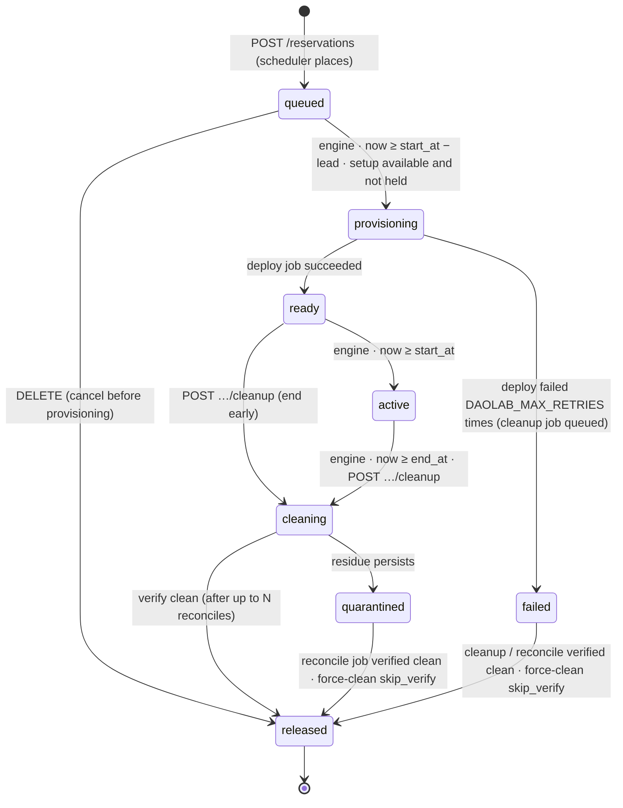
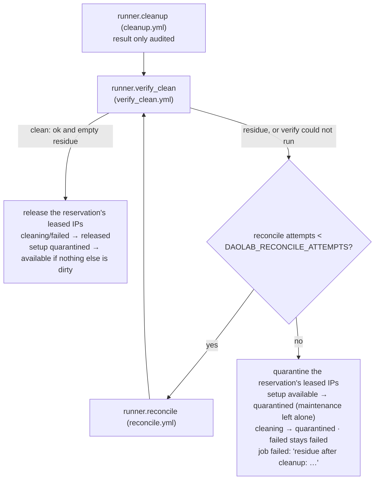

# Lifecycle engine and runner

Part of the daolab implementation plan — see [README.md](README.md) for the doc map.

This document specifies `service/engine.py` and `service/runner.py`. It draws on contract §8
(state machine, engine mechanics, runner contract) as refined by
[09-backend-system-design.md](09-backend-system-design.md) §6, §9, §10 (procedures run as job
rows; `cleaning` + `quarantined`; verify and reconcile after every cleanup). Placement itself —
capability matching, FCFS, slot-shift, the lead-time computation — is the scheduler's job
([03-scheduler.md](03-scheduler.md)); playbook internals are [05-provisioning.md](05-provisioning.md);
the endpoints that create jobs and the `/internal/*` callbacks are [02-backend-api.md](02-backend-api.md).

## Reservation state machine

States, exact list: `queued`, `provisioning`, `ready`, `active`, `cleaning`, `quarantined`,
`released`, plus `failed` — the terminal error state. `released` is final; `failed` leaves only
to `released`, once its cleanup (or a later reconcile / force-clean) proves the testbed clean.
`cleaning` replaced the older `tearing_down` (B-21, migration v6 rewrote the CHECK) and covers
teardown + verify + reconcile;
`quarantined` means cleanup finished but residue persists, and leaves only through reconcile or
force-clean. There is no `cancelled` state: cancelling a `queued` reservation goes straight to
`released`; ending a `ready`/`active` slot early (`POST /reservations/{id}/cleanup`) goes
through `cleaning`.

The legal moves are exactly the diagram of plan/09 §10, enforced by
`models.transition_reservation` (`RESERVATION_TRANSITIONS`): every state write is a
compare-and-set (`UPDATE … WHERE id = ? AND state = <the state it validated>`), so an illegal
move or a concurrent change raises `ReservationStateError` instead of overwriting.



| From | Trigger | Action | Next state | On failure |
|---|---|---|---|---|
| *(create)* | `POST /reservations` / `daolab reserve` (api) | quota check, then `scheduler.place` (capability match, FCFS, mode `asap`/`at`, lead, turnaround, grid) fixes `setup_id`, `start_at`, `end_at` | `queued` | API-side errors only ([02-backend-api.md](02-backend-api.md)); in mode `asap` a slot conflict is never an error |
| `queued` | `DELETE` (api) | nothing ran; no job | `released` | — |
| `queued` | engine step 3: setup `available` and not held, `now ≥ start_at − lead` | one transaction: CAS, the `vms` rows, a pending `deploy` job | `provisioning` | crash before commit = nothing happened; next tick redoes it |
| `provisioning` | `deploy` job succeeded | record `resources.hw_class` = the use case's class | `ready` | — |
| `provisioning` | `deploy` job failed, `attempt < DAOLAB_MAX_RETRIES` | a new `deploy` job, `attempt + 1`, same trace | `provisioning` | — |
| `provisioning` | `deploy` job failed, `attempt = DAOLAB_MAX_RETRIES` | `failure_reason` = the job's error; a `cleanup` job (same trace) | `failed` | — |
| `ready` | engine step 1: `now ≥ start_at` | none | `active` | — |
| `ready`/`active` | `POST …/cleanup` (api) | CAS + a pending `cleanup` job + audit row, one transaction | `cleaning` | — |
| `active` | engine step 2: `now ≥ end_at` | CAS + a pending `cleanup` job, one transaction | `cleaning` | — |
| `ready`/`active` | `POST …/redeploy` (api), inside `[start_at, end_at)` | a new `deploy` job; the reservation keeps its state | (unchanged) | a failed replay is recorded on the job only |
| `cleaning` | `cleanup` job: teardown, verify, reconcile ×N — clean | release the IP leases; free the setup if nothing else is dirty | `released` | — |
| `cleaning` | `cleanup` job: residue survives | quarantine the IP leases and the setup | `quarantined` | — |
| `failed` | its `cleanup` job — clean / residue | release the leases / quarantine the leases and the setup | `released` / stays `failed` | — |
| `quarantined`, dirty `failed` | `reconcile` job (force-clean) — clean / residue | release every lease, free the setup / setup stays quarantined | `released` / unchanged | — |
| `quarantined`, dirty `failed` | force-clean `skip_verify` (api) | release every lease; a quarantined setup → `available` | `released` | — |

Cancel (`DELETE`) is valid only for `queued`; every other state → `409 invalid_state`, and
cleanup only for `ready`/`active` — the engine never has to interrupt a running playbook. Retries live on job rows: the `reservations.retries`
column of the baseline schema is no longer read or written.

## Jobs

A **job** is a DB row (migration v5, `models.py`) and the only way a procedure runs; there is no
queue service. The engine is the only thing that executes jobs.

| Kind | Created by | Runs | Reservation must be |
|---|---|---|---|
| `deploy` | engine step 3 (first attempt); engine after a failed attempt (B-25); `POST …/redeploy` (B-28) | `runner.deploy` | `provisioning`, or `ready`/`active` for a redeploy |
| `cleanup` | engine step 2 at `end_at`; `POST …/cleanup` on a live slot (B-27); engine after the last deploy attempt failed | `runner.cleanup`, `runner.verify_clean`, `runner.reconcile` ×N | `cleaning` or `failed` |
| `reconcile` | `POST /admin/setups/{name}/force-clean` (B-74), one per dirty reservation | `runner.reconcile`, `runner.verify_clean` | `quarantined` or `failed` |
| `health_probe` | `POST …/health/probe` (B-66) | `runner.probe` | `ready` or `active` |

- **Lifecycle:** `pending → running → succeeded | failed` (`models.transition_job`, a CAS like
  the reservation's). A `failed` job is final and never revived: a retry is a *new* row for the
  same reservation and kind with `attempt + 1`. The one exception is crash recovery (B-26):
  `models.requeue_job` puts a stale `running` job back to `pending` with the same attempt.
- **Columns:** `kind`, `state`, `attempt`, `trace_id` (B-62), `log_path` (B-84), `steps` (a JSON
  list the runner appends to while the job runs: `{name, state: ok|failed|skipped, at,
  detail?}`; each append is a CAS on the list and bumps `updated_at`), `error` (failed only),
  `started_at`, `finished_at`.
- **Stale reservation:** when a job starts, the engine checks the reservation is in the state its
  kind needs (table above). If it moved on — cancelled, cleaned up, an admin override — the job
  fails with `reservation is <state>, expected …` without calling the runner.
- A job belongs to a setup through its reservation; the setup is not duplicated on the row.

## Engine loop — one tick, every minute

`service/engine.py` is a plain script, not a daemon framework. `python -m service.engine` runs
**one tick and exits** (systemd-timer friendly, prints `tick done: TickResult(...)`);
`python -m service.engine --loop` ticks every `DAOLAB_ENGINE_INTERVAL_SEC` (default `60`), and a
crash inside one tick is logged and the loop carries on. It refuses to start (exit 1) when the
database schema is not the latest version ("run `daolab init` first"), when
`DAOLAB_JOB_TIMEOUT_SEC` is not positive, or when `DAOLAB_RUNNER` / `DAOLAB_MOCK_FAIL` is
invalid. On exit it calls the runner's `close()` if it has one.

```python
# service/engine.py — no state outside the DB
def tick(db, now, rn=None, cfg=None, job_timeout_sec=None, health_query=None) -> TickResult:
    rn = rn or runner.get_runner()                          # DAOLAB_RUNNER
    cfg = cfg or scheduler.SchedConfig.from_settings(config.settings)
    out = TickResult()
    out.recovered = _recover_stale_jobs(db, now, timeout)   # 0. running, silent > DAOLAB_JOB_TIMEOUT_SEC -> pending (B-26)
    out.activated = _promote_ready_to_active(db, now)       # 1. ready -> active at start_at
    out.expired   = _expire_active(db, now)                 # 2. active -> cleaning at end_at + cleanup job
    out.started   = _start_due(db, now, cfg)                # 3. queued -> provisioning + vms rows + deploy job
    _run_pending(db, rn, out)                               # 4. pending jobs, oldest first
    _sweep_orphans(db, rn, out)                             # 5. orphan VMs / leases (B-73), finished passwords
    if (query := health_query or _health_query()):          # 6. only with DAOLAB_OTEL_ENDPOINT set
        _evaluate_health(db, now, query, out)               #    active reservations (B-67)
    return out
```

Tick order is fixed — 0 through 6 exactly as above. Rules:

- **Stateless.** Every decision derives from reservation, job, `vms` and `ip_leases` rows,
  `resources.hw_class`, the setup's `availability`, the clock, and `config.py`. The engine keeps
  nothing in memory across ticks; killing it at any instant loses no information (see the crash
  walkthrough below).
- **Compare-and-set transitions.** Every state write goes through
  `models.transition_reservation` / `models.transition_job`; a write that loses a race raises
  and is skipped, so a duplicate engine process cannot double-fire a transition. Because every
  timestamp is `YYYY-MM-DDTHH:MM:SSZ`, lexicographic string comparison equals time comparison —
  plain SQL `<=` works.
- **One transaction per decision.** Step 2's CAS and its cleanup job, step 3's CAS, `vms` rows
  and deploy job, and a finished job's result, reservation move, lease changes and audit row
  each commit together (`BEGIN IMMEDIATE`) or not at all.
- **Starting a booking (step 3).** Candidates come from `scheduler.startable_queued` — `queued`
  reservations whose setup is `available` (B-18: a `quarantined` or `maintenance` setup keeps
  its queue waiting; placement still books it). A candidate starts only when no reservation
  holds its setup (`provisioning`/`ready`/`active`/`cleaning`/`quarantined`, re-checked under
  the write lock) and `now ≥ start_at − lead`, where `lead` comes from
  `scheduler.start_lead_min`: the same `lead_min` the scheduler uses
  ([03-scheduler.md](03-scheduler.md)), but against the DPU's *actual* `resources.hw_class` at
  tick time, so the long reflash lead is used exactly when the board really needs a reflash.
- **Single-flight per setup (B-24).** A `deploy`, `cleanup` or `reconcile` job is only moved
  `pending → running` when no other such job is `running` on the same setup; the check and the
  move share one `BEGIN IMMEDIATE` transaction (`_claim`), so two engine processes cannot both
  win. A job that has to wait stays `pending` (it is not failed) and is retried next tick; jobs
  on one setup in the same tick run one after the other. Health probes are read-only and exempt.
- **Jobs run oldest first** from a snapshot taken at the start of step 4, so the cleanup and
  deploy jobs queued by steps 2 and 3 run in the same tick, while a retry or an automatic
  cleanup created during step 4 runs on the next one.
- **The next booking starts on the next tick.** A setup is freed in step 4 (cleanup verified →
  `released`), after step 3 has looked at it; that costs at most one
  `DAOLAB_ENGINE_INTERVAL_SEC`, which the lead time absorbs.
- **Blocking is fine.** Runner calls are synchronous; a deploy tick can take minutes. Ticks are
  serialized (one process), so a long tick simply delays the next. A runner exception becomes a
  failed result (`RunResult(ok=False, error="<Type>: <msg>")`) instead of killing the tick.
- **Crash recovery (B-26).** Step 0 puts `running` jobs whose `updated_at` is older than
  `DAOLAB_JOB_TIMEOUT_SEC` (default 1800 s) back to `pending`. Every recorded step bumps
  `updated_at`, so a slow but healthy deploy is not touched. The attempt is unchanged, the steps
  recorded so far are kept and a `requeued` marker step is added; the update is guarded (still
  `running`, nothing recorded since it was read), so a job that came back to life is left
  alone. Doing it every tick, not only at process start, also covers the systemd one-tick mode.
  Recovery runs before jobs are claimed, so it also frees a setup that single-flight was
  holding. The timeout must exceed the longest silent stretch of a healthy job.
- **`vms` rows in step 3**, inside the same transaction as the state CAS (`models.create_vms`,
  idempotent): one row per use-case role, resolved against the setup members
  (`models.planned_vms`). `on: dpu` → `host` = the DPU member name (`dpu-01`), `template` and
  `name` NULL; `on: dpu_host` / `on: tg_host` → `host` = the XCP-ng host of the DPU / NIC member
  (`tb-01-xcp`), `template` = the role's `vm`, `name` = `daolab-r<reservation_id>-<role>`. DIY
  → one row per host of `diy_templates`, the host name as `role`. Rows exist *before* any
  playbook runs, so the `/internal/vm-ip` and `/internal/leases` callbacks always find their
  `(reservation_id, role)`. They are created whatever `DAOLAB_DEPLOY_VMS` says; with VMs off
  the VM rows simply never get an IP.

## What a finished job does

Each job runs inside its own OTel span when tracing is on (§Observability), and its result, the
reservation move, the lease changes and an engine audit row (`deploy`, `cleanup` or `reconcile`,
carrying the job's `trace_id`) commit in one transaction.

**`deploy`**

- ok → `ready`; `resources.hw_class` of the DPU member = the use case's `hw_class` (when it has
  one), the DB's record of the board's personality. The engine does not inspect `vms.ip`: the
  playbook itself fails the job when a VM never comes up on its leased address
  ([05-provisioning.md](05-provisioning.md)).
- failed, `attempt < DAOLAB_MAX_RETRIES` (default 3) → a fresh `deploy` job with `attempt + 1`
  and the same `trace_id`; the reservation stays `provisioning` (B-25). Playbooks are
  idempotent, so the retry is "run it again".
- failed for the last time → `failed` with the job's error as `failure_reason`, plus a `cleanup`
  job on the same trace to tear down whatever the partial deploy left behind (plan/09 §10).
- **Redeploy** (a `deploy` job on a `ready`/`active` reservation, B-28): the runner replays the
  deploy and the job records the outcome; the reservation keeps its state either way — no
  retries, no automatic cleanup — so a failed replay never tears down a lab the user is working
  in. They can redeploy again or clean up.

**`cleanup`** (B-71, plan/09 §9) — Ansible teardown is best effort; correctness comes from
verify and reconcile:



- `verify_clean` runs whatever the cleanup reported. "Clean" means the verify run succeeded
  *and* listed no residue: a verify that could not run, or that reports ok while listing
  residue, is not clean.
- `DAOLAB_RECONCILE_ATTEMPTS` defaults to 2; a runner without `reconcile` goes straight from
  residue to quarantine.
- There is no `failed → quarantined` edge: residue after the cleanup of a failed deploy leaves
  the reservation `failed` and flags the setup; `models.dirty_reservations` counts such a
  reservation (its last cleanup/reconcile job failed) as dirty, so the setup stays quarantined
  until it is reconciled.

**`reconcile`** (B-72, queued by force-clean B-74) — `runner.reconcile`, then
`runner.verify_clean`, once. Clean → every live lease of the reservation is released
(quarantined ones too, `ipam.clear`), the reservation goes `released`, and the setup is
`available` again if nothing else on it is dirty. Residue → the job fails and the setup stays
(or goes back to) `quarantined`.

**`health_probe`** — `runner.probe` (the use case's verify command, `probe.yml`); only the job
is recorded. `GET /reservations/{id}/health` shows its result next to the verdict.

## Orphan sweep (B-73)

Step 5 cleans up what no job owns — residue of crashes, manual runs and VMs made by hand:

1. Generated passwords of reservations that are `released`/`failed` are wiped
   (`models.wipe_access_passwords`); the DPU account is locked by then anyway.
2. If the runner can list and destroy VMs (`tagged_vms()` / `destroy_vms(names, step)`; both
   optional), every `daolab-r<id>-*` VM whose reservation is missing, or terminal with no
   pending/running job, is destroyed in one call; audit row `orphan_sweep`. A listing failure is
   logged and the sweep goes on.
3. `leased` addresses still held by a terminal reservation with no job waiting are released
   (audit row per reservation) — unless that reservation's VMs just failed to be destroyed.
   Quarantined addresses are never swept; only a reconcile or force-clean clears them.

With `DAOLAB_DEPLOY_VMS` off the ansible runner reports no VMs without contacting the XCP-ng
host, so the sweep never reaches it.

## Health evaluation and the webhook (B-67)

Step 6 runs only with the telemetry stack on (`DAOLAB_OTEL_ENDPOINT` set); the query function
is Prometheus at `DAOLAB_PROMETHEUS_URL`. For every `active` reservation it evaluates the use
case's `health:` rules (`health.evaluate_reservation`, plan/09 §8: `healthy` / `degraded` /
`down` / `unknown`, stale after `DAOLAB_HEALTH_STALE_SEC`) and stores the verdict as the
reservation's single `health_snapshots` row (`changed_at` moves only when the verdict changes).
One reservation's broken rules are logged and skipped; the tick goes on.

When the verdict flips **to `down`** (and only then — not on every tick that stays down), the
engine posts to `DAOLAB_WEBHOOK_URL`:

```json
{"event": "reservation.health_down", "reservation_id": 12, "usecase": "vpp", "setup": "tb-01",
 "user": "alice", "previous": "healthy",
 "health": {"verdict": "down", "reason": "failing: dpu_app", "evaluated_at": "…", "last_seen": "…", "checks": []}}
```

(`health` is the full verdict object of `GET /reservations/{id}/health`, every check included.)

Semantics are **at-most-once**: the snapshot commits first, then the post (10 s timeout). A
non-2xx response or network error is logged at WARNING and never retried, never blocks the
tick, and a crash between commit and post loses that one webhook. Unset `DAOLAB_WEBHOOK_URL`
(the default) skips the call entirely. No webhook fires on `ready`; external automation that
wants SSH targets reads `GET /reservations/{id}` or the SSE stream.

## runner.py — one function per job kind

`service/runner.py` never touches the database. `DAOLAB_RUNNER` picks the backend
(`get_runner()`): `ansible` (the default, B-84) or `mock` (B-22).

```python
@dataclass(frozen=True)
class RunResult:
    ok: bool                         # verify_clean: ok means *clean*
    error: str | None = None         # what failed, becomes the job error
    residue: tuple[str, ...] = ()    # verify_clean: "kind:ident" items (B-70)

class Runner(Protocol):
    def deploy(self, res, step) -> RunResult: ...        # deploy job
    def cleanup(self, res, step) -> RunResult: ...       # cleanup job, best effort
    def verify_clean(self, res, step) -> RunResult: ...  # after every cleanup / reconcile
    def reconcile(self, res, step) -> RunResult: ...     # cleanup residue, reconcile jobs
    def probe(self, res, step) -> RunResult: ...         # health_probe job
    # optional: tagged_vms() / destroy_vms(names, step) (orphan sweep), close(), log_path_for(job_id)
```

- `res` is the **reservation context** the engine builds once per job:
  `models.reservation_context()` plus `job_id`, `job_kind`, `attempt`. Keys: `id` /
  `reservation_id`, `state`, `start_at`, `end_at`, `usecase`, `setup`, `user`, `hw_class`,
  `diy`, `templates`, the use case's `roles` and `verify`, the setup `members`
  (`{name, kind, host}`), the reservation's `vms` (`{role, host, template, name, ip}`), its live
  `leases` (IPs), and the access fields `ssh_pubkey` (the deployed key, empty in password mode),
  `access_password`, `access_login` (`lab`) and `access_expires` (the day after `end_at`).
- `step(name, state="ok", detail=None)` is called as each step finishes (`runner.job_sink`
  records it on the job row; with tracing on it also becomes a child span), so progress is
  visible while the job is still running.
- `method_for(runner, kind)` maps job kinds to functions (`health_probe` → `probe`);
  `verify_clean` is called by the engine itself.
- **Residue** is a structured list, one `kind:ident` string per item:
  `vm:daolab-r12-sink` (a VM still exists), `vf:<bdf>` (a VF is not back in pciback),
  `dpu_session:lab` (processes of the lab login), `dpu_app:<unit or process>` (an app still
  running on the DPU), `ip:<address>` (a leased address still answers ping).

### The ansible runner (B-84)

Every procedure is a playbook under `DAOLAB_PLAYBOOKS_DIR`, run with `ansible-runner` against
`DAOLAB_INVENTORY` ([05-provisioning.md](05-provisioning.md)):

| Runner function | Playbook | What it does |
|---|---|---|
| `deploy` | `deploy.yml` | resolve + lease, ebf_set, the DPU app, DPU access + telemetry, the VMs, verify |
| `cleanup` | `cleanup.yml` | revoke DPU access first (B-53), stop telemetry, the app's cleanup, destroy the VMs |
| `verify_clean` | `verify_clean.yml` | read-only checks → residue list (B-70) |
| `reconcile` | `reconcile.yml` | destroy / rebind / stop / kill directly, whatever is found (B-72) |
| `probe` | `probe.yml` | the use case's verify, against the recorded addresses |
| `tagged_vms` / `destroy_vms` | `orphans.yml` | list every `daolab-r*` VM / destroy exactly the named ones (B-73) |

- **Extra vars** (the playbook contract): `reservation_id`, `usecase`, `setup`, `user`,
  `ssh_pubkey`, `hw_class`, `diy`, `templates`; the structured facts `daolab_members`,
  `daolab_roles`, `daolab_verify`, `daolab_vms`, `daolab_leases`; `daolab_app` (the `app:` of
  the use case's `on: dpu` role, `none` for diy); `daolab_access_login` / `_password` /
  `_expires`; `daolab_api_url` + `daolab_internal_secret` for the callbacks;
  `daolab_otel_collector` (`DAOLAB_OTEL_AGENT_ENDPOINT`, the lab-reachable collector for the
  agents); `daolab_deploy_vms` (`DAOLAB_DEPLOY_VMS`); `daolab_output_file`; and the runbook
  playbooks' sign-off flags `allow_destructive_changes`, `allow_launch`, `allow_cleanup`, all
  equal to `DAOLAB_ALLOW_DESTRUCTIVE`.
- **`DAOLAB_ALLOW_DESTRUCTIVE`** (default false) is the owner sign-off Akshay's VPP and SmartNIC
  runbooks require before they stop nginx-tls, rebind PCI devices or set hugepages on the shared
  board; without it a VPP deploy that would change the board stops with that message.
- **`DAOLAB_DEPLOY_VMS`** (config default true; `.env.example` ships `false` for the real lab
  until the XCP-ng host is in the inventory): off → no leases, no VMs, no verify, and no
  playbook reaches the XCP-ng host (`r_dom0` is empty; `tagged_vms` returns `[]`). The DPU part
  of every playbook still runs.
- **Artifacts:** each job gets `<DAOLAB_ARTIFACTS_DIR>/job-<id>/` (default `./var/jobs`); each
  playbook run is its own ansible-runner private data dir `run-<n>-<playbook>/`, and
  `job.log` collects every playbook's output of the job in order. The engine records `job.log`
  as the job's `log_path` before the run, so `GET /jobs/{id}` shows its tail while it runs.
- **Steps and errors:** a task named `step: <name>` becomes a job step when it finishes
  (`ok` / `skipped` / `failed`); any failed task that is not `ignore_errors` becomes a failed
  step too, and the result's error is `<task> on <host>: <message>` (last 500 characters). A
  run is ok when ansible-runner reports `successful` with rc 0. Playbooks that report data
  (`verify_clean.yml`, `orphans.yml`) write JSON to `daolab_output_file`; a verify run that
  failed without a residue list is *not* clean.
- **Environment** (`ansible_env`, B-63): `ANSIBLE_CONFIG=playbooks/ansible.cfg`, no colour, no
  retry files; with `DAOLAB_OTEL_ENDPOINT` set also `DAOLAB_ANSIBLE_OTEL=true` (switches on the
  `community.general.opentelemetry` callback), the OTLP endpoint, `OTEL_SERVICE_NAME=daolab-ansible`
  and the job span's `TRACEPARENT`, so every Ansible task is a child span of the job.
- `ansible-runner` is imported only when a playbook actually runs
  (`pip install -e .[ansible]`; `dev.sh` and `make setup` install it).

### The mock runner (B-22, B-44, B-68)

A fake that sleeps `DAOLAB_MOCK_STEP_SEC` (default 5 s) through each step and records it, so
the whole flow — booking, deploy, cleanup, quarantine, health — runs on a laptop:

| Function | Steps |
|---|---|
| `deploy` | `lease_ips`, `dpu_prepare`, `create_vms`, `post_vm_ips`, `start_app`, `verify` |
| `cleanup` | `terminate-user` (first, B-53), `destroy_vms`, `unbind_vfs`, `stop_app` |
| `verify_clean` | `check_vms`, `check_vfs`, `check_sessions`, `check_ips` |
| `reconcile` | `destroy_vms`, `rebind_vfs`, `stop_app`, `kill_sessions` |
| `probe` | `ping_vms`, `check_dpu_app` |

- With `DAOLAB_INTERNAL_SECRET` set (dev.sh writes one) `lease_ips` and `post_vm_ips` call the
  real `/internal/leases` and `/internal/vm-ip` (B-44), so the reservation shows leased IPs.
- With `DAOLAB_OTEL_ENDPOINT` set, a successful deploy starts a fake per-reservation exporter
  registered through Prometheus file_sd (B-68) serving the series the use-case rules read;
  cleanup and `close()` stop it. Exporters live in the engine process, so the health demo needs
  `--loop`.
- It keeps a fake set of `daolab-r*` VM names, so the orphan sweep can be exercised.
- `DAOLAB_MOCK_FAIL` (comma-separated): `deploy` fails the deploy at `create_vms`; `cleanup`
  makes cleanup look fine while verify keeps reporting the reservation's VMs and leases as
  residue, so reconcile cannot fix it and the quarantine path is reachable; `health` never
  starts the exporter, so health stays `unknown`.

## Retry and failure policy

- **Deploy:** idempotent replay. Every playbook converges (the app wrappers read the board and
  run only the steps that move it forward; VMs are never cloned twice; leases are idempotent),
  so a retry replays the whole `deploy.yml`. At most `DAOLAB_MAX_RETRIES` attempts per
  reservation (each a job row with its own steps and log, one trace); a crash is not an observed
  failure and does not use an attempt.
- **Deploy exhausted** → `failed` + an automatic cleanup job. The scheduler ignores `failed`
  reservations, so the slot is free again; `POST …/redeploy` is not possible from `failed` — the
  user books again (the failed row stays as history).
- **Cleanup never "fails" into a stuck setup.** A cleanup that cannot prove the testbed clean
  after `DAOLAB_RECONCILE_ATTEMPTS` reconciles quarantines the reservation's addresses and the
  setup: the scheduler keeps booking, the engine starts nothing new on it, and `admin.html`
  shows the residue. Access was already revoked as the first cleanup step, and the DPU account
  expires the day after `end_at` on its own, so a stuck cleanup never extends anyone's access.
- **Operator recovery:** `POST /admin/setups/{name}/force-clean` (reconcile + verify per dirty
  reservation), or `{"skip_verify": true}` after checking by hand. A playbook can also be run by
  hand exactly as the engine runs it (idempotency makes this safe however far the engine got),
  e.g. `ansible-playbook -i inventory/hosts.yml playbooks/cleanup.yml -e reservation_id=12
  -e setup=tb-01 -e daolab_app=dao-vpp -e allow_destructive_changes=true` (the VPP runbook's
  cleanup guard; SmartNIC's is `allow_cleanup`) followed by
  `playbooks/verify_clean.yml` with the same `-e` set (add `-e daolab_deploy_vms=false` while the
  lab runs DPU-only).

## Cleanup semantics — the DPU keeps its hw_class

`cleanup.yml` revokes the owner's DPU access first (sessions killed, key emptied, password
scrambled, account locked and expired), stops the reservation's telemetry agent, runs the app's
own cleanup (`apps/<app>/cleanup.yml`: VPP stopped and its port given back, SmartNIC stopped
and its devices rebound, nginx-tls left running as the board's resting state), then destroys
the reservation's `daolab-r<id>-*` VMs ([05-provisioning.md](05-provisioning.md)). Three things
it deliberately does **not** do:

1. **Never resets `hw_class`.** `cleaning → released` leaves `resources.hw_class` and the
   board's `/etc/daolab/hw_class` marker untouched. The DPU keeps its last personality; only the
   next use case declaring a **different** `hw_class` needs a reflash, with the longer
   `DAOLAB_HW_CLASS_LEAD_MIN` lead. Back-to-back runs of the same class never touch EBF.
2. **Never edits the pciback configuration.** Passthrough prep lives in
   `/etc/modprobe.d/pciback.conf`, done once in dom0 (design invariant); destroying a VM returns
   its VF. (Reconcile may re-add a listed VF that fell out of `xl pci-assignable-list`, with
   `xl pci-assignable-add`; it never changes the list.)
3. **Never deletes `vms` rows.** They remain as history under the released reservation
   (`ON DELETE CASCADE` applies only if the reservation row itself is deleted).

DIY reservations have no DPU app (`daolab_app=none`) and no DPU access block; their cleanup is
the same `cleanup.yml` (there are VMs to destroy).

## Addresses during a deploy

The engine never learns IPs directly — the loop is closed through the API and the DB:

1. Step 3 creates the `vms` rows (ip NULL) before any playbook runs.
2. The runner passes `daolab_api_url` and `daolab_internal_secret` as extravars.
3. `deploy.yml` leases each VM role's management address (`POST /internal/leases`, idempotent
   per `(reservation, role)`; a conflicting address is swapped through
   `/internal/leases/conflict`), sets it statically through cloud-init, and once the guest
   reports it posts `{reservation_id, role, ip}` to `POST /internal/vm-ip`. The DPU role's
   address is its static inventory address, posted the same way.
4. Unknown `(reservation_id, role)` → `404`, which fails that playbook task — surfacing a
   role-mismatch bug immediately. Re-posted IPs (idempotent replay) simply overwrite.
5. When the cleanup is verified clean the reservation's leases are released; when it is not,
   they are quarantined and never re-issued until reconcile or force-clean clears them.

Operationally the **API process must be up while the engine deploys** — separate processes
sharing the sqlite file via WAL — and `DAOLAB_INTERNAL_SECRET` must be set (the API refuses the
callbacks while it is empty).

## Crash recovery walkthrough

Reservation 12, `vpp` on `tb-01`, `start_at` 10:00Z, 2 h, DPU currently on a different
`hw_class` → lead = 15 min. `DAOLAB_JOB_TIMEOUT_SEC` = 1800.

1. **09:45 tick, step 3:** `queued` → `provisioning`; `vms` rows for `sink`, `tgen`, `vpp` and
   deploy job 31 (`pending`, attempt 1) in one transaction. Step 4 claims job 31 (`running`),
   opens its span, and the ansible runner starts `deploy.yml`. Steps land on the job:
   `lease_ip sink`, `lease_ip tgen`, `ebf_set`, `vpp_board_state`, `dpu_app`, `dpu_access`,
   `post_dpu_ip`, `create_vm sink`, … `create_vm tgen` — when the engine host reboots.
2. **DB at the crash:** reservation `provisioning`; job 31 `running`, its steps so far, its
   `updated_at` = the last step; leases `leased` for `sink` and `tgen`; `vms.ip` set for `vpp`
   and `sink`.
   No in-memory state was lost, and the half-created `daolab-r12-tgen` exists on the host.
3. **Next ticks:** steps 1–3 find nothing due on tb-01, and single-flight keeps any other
   mutating job off the setup, because job 31 still looks `running`.
4. **Once job 31 has been silent for 30 min**, step 0 puts it back to `pending` (attempt still
   1, a `requeued` step added) and step 4 claims it again on the same trace. `deploy.yml`
   replays: the leases return the same addresses; `ebf_set` finds the marker matching; the VPP
   wrapper finds VPP installed and running and skips every runbook step but the base config;
   `sink` exists and runs, so it is not re-seeded;
   `daolab-r12-tgen` exists, so it is not cloned again — it is seeded, wired, started, and its
   address posted; verify passes. The job succeeds → `ready`, `resources.hw_class` recorded;
   step 1 of the next tick makes it `active` (start_at has passed). The cost of the crash is
   the timeout: a stranded job holds its setup for up to `DAOLAB_JOB_TIMEOUT_SEC`.
5. **Same story in every kind:** a crash mid-cleanup replays `cleanup.yml` (safe on a clean
   testbed) and then verify; a crash between a job's result and the reservation move cannot
   happen, because they commit together; a crash between two ticks loses nothing at all. The
   two rules doing all the work: playbooks are idempotent, and each decision is one atomic DB
   transaction.

## Deployment — make engine or a systemd timer

Development: `make engine` (or `make dev`) runs `scripts/run/dev.sh`, which starts the API and
`python -m service.engine --loop` together (Ctrl-C stops both, B-30); `make engine-loop` runs
the engine loop alone. Production: a systemd timer running the single-tick form every minute
(README Phase 3):

```ini
# /etc/systemd/system/daolab-engine.service
[Unit]
Description=daolab lifecycle engine (single tick)
After=network-online.target
[Service]
Type=oneshot
WorkingDirectory=/path/to/daolab          # repo root: relative DAOLAB_* defaults resolve here
EnvironmentFile=/path/to/daolab/.env
ExecStart=/path/to/daolab/.venv/bin/python -m service.engine

# /etc/systemd/system/daolab-engine.timer
[Timer]
OnCalendar=*-*-* *:*:00
Persistent=true
[Install]
WantedBy=timers.target
```

`Type=oneshot` gives overlap protection for free: systemd will not re-activate the service
while a long deploy tick is still running, so ticks stay serialized. Run **either** the loop
**or** the timer, never both — the CAS transitions and the single-flight claim make a duplicate
engine harmless to the state, but it would only contend for the same jobs. `GET /health` on the
API plus `systemctl list-timers daolab-engine.timer` is the whole liveness story. Ops runbook
details live in [08-cli-config-ops.md](08-cli-config-ops.md).

## Observability — jobs, audit rows, one trace per job

- **Job rows** are the primary record of what happened: kind, attempt, every step with its
  state, time and detail, the error, and `log_path` (the combined playbook log). The dashboard
  shows them through the reservation's `job` summary, `GET /jobs/{id}` (with the log tail) and
  the SSE stream.
- **Audit rows** (`audit_events`, append-only): the engine writes `deploy`, `cleanup`,
  `reconcile` (each with ok/error, residue, reconcile attempts and the job's `trace_id`) and
  `orphan_sweep`; `GET /admin/audit` lists them with the API's own rows.
- **Traces** (B-62, with `DAOLAB_OTEL_ENDPOINT` set): every job runs inside a `job <kind>` span
  (attributes `daolab.job`, `daolab.job.kind`, `daolab.attempt`, `daolab.reservation`,
  `daolab.usecase`, `daolab.setup`, `daolab.user`); its trace id is stored on the job. Retries
  and the automatic cleanup of a failed deploy inherit the trace id, and a requeued job
  continues its trace, so one booking's deploy story is one trace. Every recorded step becomes a
  child span; with the ansible runner each Ansible task does too (TRACEPARENT, B-63). Off by
  default; a no-op then.
- **Engine log** — stdlib `logging`, logger `daolab.engine`, level `DAOLAB_LOG_LEVEL`
  (default `INFO`), stderr: one `tick: TickResult(activated=…, expired=…, started=…, jobs_run=…,
  ready=…, failed=…, released=…, quarantined=…, …)` line for every tick that changed something;
  WARNING for a requeued job, a refused state move, a failed redeploy or webhook; INFO for a job
  waiting on its setup, `event=orphan_sweep step=… state=…` and `event=webhook r=… status=…`;
  a runner crash or failed health evaluation with its stack trace.
