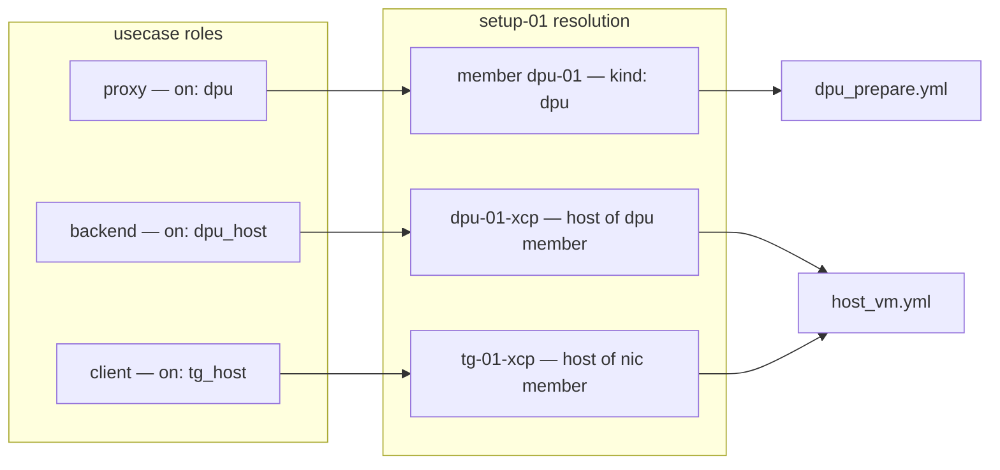

# Provisioning and XCP-ng automation

Part of the daolab implementation plan — see [README.md](README.md) for the doc map.

This document specifies everything under `inventory/` and `playbooks/`: the Ansible inventory,
the one-time dom0 passthrough prep, the `tpl-ubuntu2204-dao` template build, and the four
playbooks (`dpu_prepare.yml`, `host_vm.yml`, `verify.yml`, `teardown.yml`) that
`service/runner.py` invokes via ansible-runner (contract §8; invocation timing is
[04-lifecycle-engine.md](04-lifecycle-engine.md)'s territory). Two invariants govern every line
here: **every playbook is idempotent** (engine retry = run again) and **passthrough prep is
one-time in dom0, never per reservation**.

## Inventory layout — `inventory/hosts.yml` and `host_vars/`

Two functional groups: `dpus` (OCTEON boards, SSH targets that run DAO apps directly — not VMs)
and `xcp_hosts` (XCP-ng dom0s, where `xe`/`xl` commands run). Host names here are the join key:
`setups/*.yml` member names (`dpu-01`) and member `host` fields (`dpu-01-xcp`, `tg-01-xcp`)
must exist in this inventory (contract §10). Playbooks never hardcode these names — they
resolve them from the setup YAML at runtime (see role-driven provisioning below).

```yaml
# inventory/hosts.yml
all:
  vars:
    ansible_user: root
  children:
    dpus:                    # OCTEON boards — on: dpu roles execute here
      hosts:
        dpu-01:
    xcp_hosts:               # dom0s — xe vm-clone / vm-start / passthrough wiring
      vars:
        ansible_python_interpreter: /usr/bin/python3
      hosts:
        dpu-01-xcp:
        tg-01-xcp:
```

```yaml
# inventory/host_vars/dpu-01.yml — filled from `lspci -D` and /sys/bus/platform/devices (Phase 1)
ansible_host: 10.20.0.10          # device IP; the address posted for on: dpu roles
hw_class: sdp-pf1-vf8             # Phase-1 bootstrap value ONLY — after first sync/provision,
                                  # resources.hw_class in the DB is the single source of truth
bdf:
  sdp_pf: "0000:1f:00.0"
  cpt_pf: "0000:20:00.0"
  cpt_vfs:                        # bound to vfio-pci by dpu_prepare.yml; count = nproc
    - "0000:20:00.1"
    - "0000:20:00.2"
```

```yaml
# inventory/host_vars/dpu-01-xcp.yml — filled from `xl pci-assignable-list` and `xe sr-list`
ansible_host: 10.20.0.2
sr_uuid: "a1b2c3d4-…"             # SR holding tpl-ubuntu2204-dao and its clones
mgmt_network: "Pool-wide network associated with eth0"   # xe network-list name-label; VIF device=0
templates: [tpl-ubuntu2204-dao]   # templates present on this host (DIY pickers validate against DB)
sdp_vfs:                          # SDP VFs the OCTEON exposes to this host; in pciback; one per
  - "0000:03:02.0"                # backend VM with connect: sdp
  - "0000:03:02.1"
```

```yaml
# inventory/host_vars/tg-01-xcp.yml
ansible_host: 10.20.0.3
sr_uuid: "e5f6a7b8-…"
mgmt_network: "Pool-wide network associated with eth0"
templates: [tpl-ubuntu2204-dao]
e810_pf: "0000:5e:00.0"
e810_vfs:                         # E810 VFs in pciback; one per client VM with connect: e810-vf
  - "0000:5e:01.0"
  - "0000:5e:01.1"
```

Every playbook run receives this inventory via `-i inventory/hosts.yml`
(`DAOLAB_INVENTORY`, contract §12). New setup = new host entries + host_vars files + one
`setups/*.yml` — zero code changes.

## One-time dom0 preparation — pciback, single reboot

pciback claims PCI devices in dom0 for guest passthrough. It is configured **once per dom0**
with **every VF that will ever be passed through** (all `e810_vfs` on tg-01-xcp, all `sdp_vfs`
on dpu-01-xcp), followed by **one** dom0 reboot. No playbook ever touches pciback; a
reservation only picks from the pre-seized pool.

Per dom0, as root:

1. Create the VFs on the PF and confirm their BDFs:
   `echo 8 > /sys/bus/pci/devices/0000:5e:00.0/sriov_numvfs && lspci -D | grep -i virtual`.
   Persist creation with a `systemd` oneshot (`daolab-sriov.service`, `Before=xen-init-dom0.service`
   wants not required — any early oneshot writing `sriov_numvfs` works) so VFs exist on every boot.
2. Write the hide list — every VF, one parenthesized BDF each:
   ```
   # /etc/modprobe.d/pciback.conf
   options xen-pciback hide=(0000:5e:01.0)(0000:5e:01.1)
   ```
3. Reboot dom0 **once**.
4. Verify: `xl pci-assignable-list` prints exactly the hidden BDFs. Copy them into the host's
   `host_vars` VF list (`e810_vfs` / `sdp_vfs`). If a VF is created after boot (oneshot ordering),
   `xl pci-assignable-add 0000:5e:01.0` re-seizes it — idempotent, safe in the oneshot.

Adding hardware later (new NIC, more VFs) = edit `pciback.conf`, one more reboot, update
`host_vars`. Still never per reservation.

## Building `tpl-ubuntu2204-dao`

One base template per the contract (§14): Ubuntu 22.04 + xe-guest-utilities + a first-boot unit
that reads `vm-data/user` and `vm-data/ssh_key` from xenstore. **No role software is baked in**
— `http-server`, `ab`, `h2load` etc. are installed by `host_vm.yml` per the use case's `roles`
(README Phase 1 step 4).

1. `xe vm-install template="Ubuntu Focal Fossa 20.04" new-name-label=tpl-build sr-uuid=<sr_uuid>`
   (or the closest guest template), attach the Ubuntu 22.04 ISO, install minimal server + openssh.
2. Inside the guest: mount the XCP-ng guest-tools ISO, install `xe-guest-utilities` (this is what
   makes `xe vm-param-get … param-name=networks` report the IP — provisioning depends on it).
3. Install the first-boot script and unit:
   ```bash
   # /usr/local/sbin/daolab-firstboot.sh
   #!/bin/bash
   set -e
   U=$(xenstore-read vm-data/user)
   useradd -m -s /bin/bash "$U" || true
   install -d -m 700 -o "$U" -g "$U" /home/$U/.ssh
   xenstore-read vm-data/ssh_key > /home/$U/.ssh/authorized_keys   # may hold multiple lines
   chown "$U:$U" /home/$U/.ssh/authorized_keys; chmod 600 /home/$U/.ssh/authorized_keys
   echo "$U ALL=(ALL) NOPASSWD:ALL" > /etc/sudoers.d/90-daolab
   dpkg-reconfigure openssh-server            # regenerate host keys (cleaned before templating)
   mkdir -p /var/lib/daolab && touch /var/lib/daolab/firstboot.done
   ```
   systemd unit `daolab-firstboot.service`: `ConditionPathExists=!/var/lib/daolab/firstboot.done`,
   `After=network-online.target xe-linux-distribution.service`, `ExecStart=` the script, enabled.
4. Clean: `truncate -s0 /etc/machine-id`, `rm -f /etc/ssh/ssh_host_*`, apt clean, shut down.
5. Convert: `xe vm-param-set uuid=<vm-uuid> is-a-template=true name-label=tpl-ubuntu2204-dao`.

`vm-data/ssh_key` is newline-separated authorized keys: `host_vm.yml` writes the reservation
user's `ssh_pubkey` **plus** the control node's public key (var `control_pubkey`, default
`lookup('file', '~/.ssh/id_ed25519.pub')`) — the control key is what lets Ansible SSH into the
fresh VM for `install` tasks and `verify.yml`. In the manual Phase-1 run the two keys coincide.

## Playbook specifications

All four playbooks run against `inventory/hosts.yml` with the exact extravars of contract §8:
`reservation_id`, `usecase`, `setup`, `user`, `ssh_pubkey`, plus `hw_class`, `diy` (bool),
`templates` (JSON object, DIY only), `daolab_api_url`, `daolab_internal_secret`.
`reservation_id=0` is the manual Phase-1 sentinel (never issued by the DB); the
`/internal/vm-ip` callback tasks carry `when: reservation_id | int != 0`, so manual runs need no
API up. The shared callback task (delegated to localhost):

```yaml
- name: post ip to daolab api
  ansible.builtin.uri:
    url: "{{ daolab_api_url }}/internal/vm-ip"
    method: POST
    headers: { X-Daolab-Secret: "{{ daolab_internal_secret }}" }
    body_format: json
    body: { reservation_id: "{{ reservation_id | int }}", role: "{{ vm_role }}", ip: "{{ vm_ip }}" }
  delegate_to: localhost
  when: reservation_id | int != 0
```

Each playbook opens with the same **play 0 on localhost**: load `setups/{{ setup }}.yml` and
(non-diy) `usecases/{{ usecase }}.yml`, resolve the `on:` selectors to inventory hosts (next
section), and `add_host` the resolved names into transient groups `r_dpu` and `r_dom0` —
`add_host` with an existing inventory name keeps its `host_vars`, so BDF lists and SR uuids
follow automatically.

### `playbooks/dpu_prepare.yml`

**Purpose** — make the OCTEON serve the use case's `on: dpu` role: correct `hw_class`
personality, CPT firmware, CPT VFs on vfio-pci, DAO app built and running. Engine runs it for
non-diy reservations only (DIY never touches the DPU). **Inputs** — all common extravars;
consumes `hw_class` and the role's `app`/`crypto`/`upstream` fields. **Tasks** (host: `r_dpu`):

1. Play 0 (localhost): load YAMLs; assert exactly one `roles` entry has `on: dpu`; resolve it.
2. `include_role: name=ebf_set` with `ebf_target_hw_class: "{{ hw_class }}"`, only
   `when: hw_class | default('') != ''` — the role itself no-ops when the board already matches
   (stub contract below). The engine only expects a reflash when `usecase.hw_class` differs from
   `resources.hw_class` (contract §8 transition 2), but the role re-checks on-board state so a
   retried run is safe.
3. `package: name=cpt-firmware-cn10k state=present`.
4. Enable CPT VFs (count = `nproc`) and bind `bdf.cpt_vfs` to vfio-pci
   (`modprobe vfio-pci`, then `dpdk-devbind.py -b vfio-pci {{ item }}`), each guarded by a
   current-driver check (`readlink /sys/bus/pci/devices/{{ item }}/driver`) so a rebind is a no-op.
5. Build/install the DAO app named by the role's `app` (e.g. `nginx-tls` with the DPDK OpenSSL
   engine), guarded by `creates:`; render its config from the role fields (`crypto: cpt-vfs`,
   `upstream` resolved to the named role's IP once known — use-case specifics live in
   [07-usecase-tls-proxy.md](07-usecase-tls-proxy.md)); start/enable its service.
6. Post the dpu role's IP (`ansible_host` of the board — the address clients reach) via the
   callback task (contract §5: `dpu_prepare.yml` posts for `on: dpu` roles; the reservation
   object shows `ssh: null` for these, so no guest user is created on the board).

**Idempotency** — every step is check-then-act or `creates:`-guarded; re-running after any
failure resumes cleanly. **Failure modes** — `ebf_set` stub mismatch (manual flash needed, see
below); vfio bind failure (missing module → clear assert message); app build failure; callback
401 when `DAOLAB_INTERNAL_SECRET` is unset (contract §12: the API refuses the callback while
empty).

### `playbooks/host_vm.yml`

**Purpose** — clone, wire, boot and soften every VM role (`on: dpu_host` / `on: tg_host`), then
report IPs. The only playbook DIY reservations run. **Inputs** — all common extravars; for DIY,
`templates` (JSON object host → template) replaces the use-case roles: one synthetic role per
host, role name = host name (matching `vms.role` for diy, contract §4). **Tasks** (per VM role,
executed on that role's dom0 in `r_dom0`):

1. Play 0 (localhost): build the VM-role list — non-diy from `usecases/*.yml` roles with `vm:`
   set; diy from the `templates` extravar.
2. Existence check: `xe vm-list name-label=daolab-r{{ reservation_id }}-{{ vm_role }} --minimal`
   → if a uuid comes back, skip clone/wiring and jump to step 8 (idempotent re-run).
3. `TPL=$(xe template-list name-label={{ role.vm }} --minimal)`; fail with a named message if
   empty. `VM=$(xe vm-clone uuid=$TPL new-name-label=daolab-r{{ reservation_id }}-{{ vm_role }})`.
4. Seed xenstore identity:
   `xe vm-param-set uuid=$VM xenstore-data:vm-data/user={{ user }}`
   `xe vm-param-set uuid=$VM "xenstore-data:vm-data/ssh_key={{ ssh_pubkey }}\n{{ control_pubkey }}"`.
5. Management VIF: `NET=$(xe network-list name-label="{{ mgmt_network }}" --minimal)`;
   `xe vif-create vm-uuid=$VM network-uuid=$NET device=0` (skip if a device-0 VIF exists).
6. Data-path wiring per the role's `connect` (skip for DIY — bare wired VMs get the VIF only):
   pick a free VF (allocation strategy below) from `e810_vfs` (`connect: e810-vf`) or `sdp_vfs`
   (`connect: sdp`) and attach it:
   `xe vm-param-set uuid=$VM other-config:pci=0/{{ vf_bdf }}`.
7. `xe vm-start uuid=$VM`.
8. Wait for the guest IP (xe-guest-utilities + first boot):
   `xe vm-param-get uuid=$VM param-name=networks param-key=0/ip`, `retries: 60 delay: 5 until` success.
9. Non-diy: `add_host` the VM (`ansible_host=<ip> ansible_user={{ user }}`) and install the
   role's `install` list via a playbook-vars map from install ids to apt packages
   (`install_map: {http-server: [nginx], ab: [apache2-utils], h2load: [nghttp2-client]}`) —
   new install ids extend the map, template stays clean.
10. Post `{reservation_id, role, ip}` via the callback task — this is what lets the engine see
    "every VM role has an `ip`" and flip the reservation to `ready`.

**Idempotency** — step 2 makes clone/wire once-only; xenstore/param-set writes are overwrite-
safe; apt installs and the callback (same ip) are naturally idempotent. **Failure modes** —
template absent on host; no free VF (fail naming host + connect value; retries will not fix —
admin adds VFs per the dom0-prep section); IP never appears (guest-utilities or first-boot
broken → timeout after 5 min); callback 401/404.

### `playbooks/verify.yml`

**Purpose** — execute the use case's `verify` block (`{from, cmd, expect}`, contract §9) from
inside the `from` role's VM. Engine runs it for non-diy only. **Inputs** — common extravars;
the verify block itself comes from `usecases/{{ usecase }}.yml`. **Tasks**:

1. Play 0 (localhost): load YAMLs; resolve every role's IP **live** — dom0
   `xe vm-param-get … param-name=networks param-key=0/ip` for VM roles, `ansible_host` of the
   board for the `on: dpu` role. These are byte-identical to what `dpu_prepare.yml`/`host_vm.yml`
   posted, so the substitution equals `vms.ip` without the playbook needing a DB handle.
2. Substitute every `{<role>_ip}` placeholder in `cmd` (e.g. `{proxy_ip}`).
3. `add_host` the `from` role's VM; run `cmd` there with the shell module, `register: out`.
4. `assert: that: "expect_string in out.stdout"` with a failure message quoting both.

**Idempotency** — read-only traffic test; rerun at will. **Failure modes** — `expect` substring
absent (the real signal: provisioning produced a broken data path — engine retries then
`failed`); `from` VM unreachable.

### `playbooks/teardown.yml`

**Purpose** — return the setup to free: destroy the reservation's VMs (their VFs return to the
assignable pool implicitly), stop the DAO app. **Never** touches EBF, `hw_class`, or pciback —
the DPU keeps its last `hw_class` after teardown (invariant; contract §8 transition 9).
**Inputs** — common extravars; only `reservation_id`, `setup`, `diy` matter. **Tasks**:

1. Play 0 (localhost): load `setups/{{ setup }}.yml`, resolve dom0s (and the dpu node, non-diy).
2. On each dom0: `xe vm-list name-label-startswith` is not a real filter — use
   `xe vm-list params=uuid,name-label | grep daolab-r{{ reservation_id }}-`; for each uuid:
   `xe vm-shutdown uuid=$VM force=true` (ignore "halted" errors), then
   `xe vm-uninstall uuid=$VM force=true` (destroys VM, VIFs and VDIs; the `other-config:pci`
   VF is released with the VM).
3. Non-diy, on the dpu node: stop/disable the DAO app service (`failed_when: false` — absent
   service is fine). CPT vfio binding and firmware stay (harmless, next `dpu_prepare.yml`
   no-ops them). `hw_class` untouched.

**Idempotency** — empty vm-list → clean no-op; a half-torn-down reservation re-runs to
completion. **Failure modes** — dom0 unreachable or VM stuck → after `DAOLAB_MAX_RETRIES` the
reservation goes `failed` and the setup stays held under `held_by` on admin.html until an admin
intervenes (contract §8 transition 10).

## `playbooks/roles/ebf_set` — stub contract

EBF (early-boot firmware) configuration sets the OCTEON's personality; `hw_class` names the
result (e.g. `sdp-pf1-vf8` = SDP, 1 PF, 8 VFs). The role's **interface is fixed now**, the
board-specific flash lands later:

- **Input var**: `ebf_target_hw_class` (kebab-case string). **Postcondition**: the board's
  personality equals it, or the role fails.
- **Layout**: `playbooks/roles/ebf_set/{defaults/main.yml, tasks/main.yml}`.
- **Contracted behavior**: read the board's current personality (marker file
  `/etc/daolab/hw_class` on the board, written by the role after a successful flash); if equal
  to the target → no-op, `changed: false`. If different → flash the EBF config for the target,
  reboot the board, `wait_for_connection`, re-read, write the marker, `changed: true`.
- **Stub (today)**: implements only the compare-and-no-op path; on mismatch it fails with:
  `ebf_set stub: board is <current>, use case needs <target>; flash manually per board docs,
  then: echo <target> > /etc/daolab/hw_class and re-run`. That is the **manual-flash
  fallback** (README Phase 1 step 5) — the engine's retry then sails through the no-op path.
- The scheduler's `DAOLAB_HW_CLASS_LEAD_MIN` lead exists precisely because the real flash +
  reboot takes minutes (see [03-scheduler.md](03-scheduler.md)); the engine updates
  `resources.hw_class` in the DB after a successful `dpu_prepare.yml`
  ([04-lifecycle-engine.md](04-lifecycle-engine.md)).

## Hardware reality notes — DPU personality and SDP VFs (observed 2026-10-17)

Verified by hand on the live testbed (`dpu-01` @10.68.0.190, `dpu-01-xcp` @10.68.0.53). This
corrects assumptions in the stub contract above and in the bring-up checklist below.

**The DPU `sdp-pf1-vf8` personality is NOT an `Image_SDP` boot switch.** The board boots
`/boot/Image-6.1-marvell`; boot is controlled at U-Boot/firmware level (`extlinux.conf`
`DEFAULT` is ignored, and `fw_printenv` cannot read the SPI env). The OVS personality's kernel
cmdline blacklists the EP driver: `modprobe.blacklist=pcie_marvell_cnxk_ep`. The SDP personality
is produced by **loading that driver** — `pcie_marvell_cnxk_ep` ("OcteonTX2 PEM EP Driver") —
which creates `/dev/uio0` (`PEM0_PERST`) for the platform EP `8e0000000000.pcie-ep`. Only then
does `octep_cp_agent` (enabled unit `octep-cp-agent.service`; config `/usr/bin/bins/cn106xx.cfg`,
1 PEM → 1 PF → VFs) get past `CNXK: Get uio dev failed for pem0`. Applied on `dpu-01`:

- `/etc/modules-load.d/sdp-ep.conf` → `pcie_marvell_cnxk_ep` (explicit `modprobe`, which
  bypasses the cmdline blacklist at boot).
- drop-in `/etc/systemd/system/octep-cp-agent.service.d/10-load-ep.conf` →
  `ExecStartPre=-/sbin/modprobe pcie_marvell_cnxk_ep`.
- marker `/etc/daolab/hw_class` = `sdp-pf1-vf8` (the value `ebf_set` compares against).

Verified across a reboot: module auto-loaded, `/dev/uio0` present, `octep-cp-agent` active. This
is the concrete work `ebf_set` should eventually automate — today the manual "flash" is exactly
these three steps.

**Host-side SDP VF creation is BLOCKED on `dpu-01-xcp`.** That dom0 is XCP-ng 8.3 (kernel
`4.19.0+1`) and has **no SR-IOV-capable PF driver** for the EP's PF `0000:6f:00.0`
(`177d:b900`): `modinfo octeon_ep` → not found, no `vfio-pci`, and the PF is bound to
`xen-pciback`. The SR-IOV capability is visible (`sriov_totalvfs=8`, matching the personality's
8 VFs) but `echo 8 > .../sriov_numvfs` fails with
`pciback 0000:6f:00.0: Driver doesn't support SRIOV configuration via sysfs`, and a PCI rescan
produces no VFs. Therefore checklist step 3's SDP half (create `sdp_vfs`, hide them in
`pciback.conf`) **cannot be completed** until that dom0 has an SR-IOV-capable driver for
`177d:b900` (e.g. Marvell `octeon_ep`). `inventory/host_vars/dpu-01-xcp.yml` `sdp_vfs:` stays
empty.

## Role-driven provisioning — `on:` selectors to plays and hosts

Use-case roles never name hosts (invariant: capability match only). The `on:` selector is
resolved against the **matched setup** at provisioning time (contract §9):

| `on:` value | Resolution against `setups/<setup>.yml` | Executing playbook | Play target |
|---|---|---|---|
| `dpu` | the member with `kind: dpu` → its member name (`dpu-01`) | `dpu_prepare.yml` | that inventory host (`r_dpu`) |
| `dpu_host` | the `host` field of the `kind: dpu` member (`dpu-01-xcp`) | `host_vm.yml` | that dom0 (`r_dom0`) |
| `tg_host` | the `host` field of the `kind: nic` member (`tg-01-xcp`) | `host_vm.yml` | that dom0 (`r_dom0`) |



A future setup with a different wiring (two NICs, a GPU host) only needs its YAML + inventory
entries; the same four playbooks resolve and run unchanged. Resolution failures (no `kind: dpu`
member for an `on: dpu` role) fail play 0 with a named assert — they indicate a use case whose
`requires` did not actually encode its needs.

## XCP-ng operations reference

Everything runs in dom0 over SSH (command module — dom0 is not a place for heavy Ansible
modules). Exact invocations used by the playbooks:

| Operation | Command |
|---|---|
| Discover assignable VFs (fills `host_vars` VF lists) | `xl pci-assignable-list` |
| Discover SRs (fills `sr_uuid`) | `xe sr-list params=uuid,name-label,type` |
| Find template | `xe template-list name-label=tpl-ubuntu2204-dao --minimal` |
| Clone per reservation | `xe vm-clone uuid=<tpl-uuid> new-name-label=daolab-r<reservation_id>-<role>` |
| Seed first-boot identity | `xe vm-param-set uuid=<vm> xenstore-data:vm-data/user=<user>` / `…vm-data/ssh_key=<keys>` |
| Management network | `xe network-list name-label="<mgmt_network>" --minimal` |
| Attach VIF | `xe vif-create vm-uuid=<vm> network-uuid=<net> device=0` |
| PCI passthrough of a VF | `xe vm-param-set uuid=<vm> other-config:pci=0/<bdf>` |
| Boot | `xe vm-start uuid=<vm>` |
| Read guest IP | `xe vm-param-get uuid=<vm> param-name=networks param-key=0/ip` |
| Destroy (VM + VIFs + VDIs) | `xe vm-shutdown uuid=<vm> force=true` then `xe vm-uninstall uuid=<vm> force=true` |

## VF allocation strategy per reservation

Three VF families, two owners:

| VF family | Lives in | Consumed by | Allocator |
|---|---|---|---|
| `e810_vfs` | tg-01-xcp dom0 (pciback) | client VMs, `connect: e810-vf` | `host_vm.yml` |
| `sdp_vfs` | dpu-01-xcp dom0 (pciback) | backend VMs, `connect: sdp` | `host_vm.yml` |
| `bdf.cpt_vfs` | the OCTEON itself (vfio-pci) | DPDK OpenSSL engine, `crypto: cpt-vfs` | `dpu_prepare.yml` (all of them, count = nproc — not per-VM) |

Allocation rule for the passthrough families: the engine is **single-flight per setup** and the
scheduler holds a setup exclusively for a reservation's whole window (contract §8), so at most
one reservation ever owns a setup's VFs at a time. Allocation is therefore **deterministic by
index**: sort the reservation's VM roles needing a given `connect` on a given host
alphabetically by role name; the k-th role takes `vf_list[k]`. Deterministic choice makes a
retried `host_vm.yml` re-pick the same BDF for the same role — idempotent by construction.
Before assigning, guard: the BDF must appear in `xl pci-assignable-list` and in no other
`daolab-r*` VM's `other-config:pci` (`xe vm-list params=name-label,other-config`); a violation
fails with the BDF and host named (fix = dom0-prep section, not a retry). Teardown frees VFs
implicitly by destroying the VMs — no allocation state is stored anywhere.

## Manual Phase 1 bring-up checklist

Goal (README Phase 1): run every playbook by hand, once, successfully, for `tls-proxy-nginx`.
Use-case specifics — NGINX/DPDK build flags, CPT engine config, payload — are in
[07-usecase-tls-proxy.md](07-usecase-tls-proxy.md); this list is the provisioning skeleton.

1. On the DPU: `lspci -D`; `ls /sys/bus/platform/devices` → fill
   `inventory/host_vars/dpu-01.yml` (`bdf.sdp_pf`, `bdf.cpt_pf`, `bdf.cpt_vfs`, `hw_class`).
2. On each XCP-ng host: `xl pci-assignable-list`, `xe sr-list params=uuid,name-label,type`,
   `xe network-list` → fill `dpu-01-xcp.yml` / `tg-01-xcp.yml` (`sr_uuid`, `mgmt_network`,
   VF lists, `templates`).
3. One-time dom0 prep on both hosts: E810 VFs on tg-01-xcp and SDP VFs on dpu-01-xcp into
   `/etc/modprobe.d/pciback.conf`; reboot each dom0 once; re-verify with `xl pci-assignable-list`.
   **Note (2026-10-17): the SDP-VF half is blocked on dpu-01-xcp — see "Hardware reality notes".**
4. Build `tpl-ubuntu2204-dao` per the recipe above; confirm
   `xe template-list name-label=tpl-ubuntu2204-dao --minimal` returns a uuid on both hosts'
   SRs (or a shared SR).
5. On the OCTEON: install `cpt-firmware-cn10k`, bind CPT VFs (= nproc) to vfio-pci, build DAO
   NGINX with the DPDK OpenSSL engine — exactly what `dpu_prepare.yml` automates. Implement
   `playbooks/roles/ebf_set` for the board, or leave the stub, flash the `sdp-pf1-vf8`
   personality manually, and `echo sdp-pf1-vf8 > /etc/daolab/hw_class`.
6. Run, in order (reservation_id=0 skips the API callbacks, so no `make api` needed):
   ```
   ansible-playbook -i inventory/hosts.yml playbooks/dpu_prepare.yml \
     -e reservation_id=0 -e usecase=tls-proxy-nginx -e setup=setup-01 \
     -e user=<you> -e ssh_pubkey="$(cat ~/.ssh/id_ed25519.pub)"
   ```
   then the same `-e` set for `playbooks/host_vm.yml`, `playbooks/verify.yml`,
   `playbooks/teardown.yml`.
7. Checkpoint before teardown: from the client VM,
   `h2load -n1000 https://<proxy_ip>/` returns `200: 1000` and the backend VM's access log
   shows plain-HTTP hits — the same assertion `verify.yml` automates from the YAML's
   `verify` block.
8. Re-run each playbook a second time and confirm it is a no-op (idempotency is the contract
   the engine's retry logic depends on).

After this passes, hardware truth is captured in `inventory/` and the engine
([04-lifecycle-engine.md](04-lifecycle-engine.md)) can drive the exact same playbooks with real
reservation ids.
