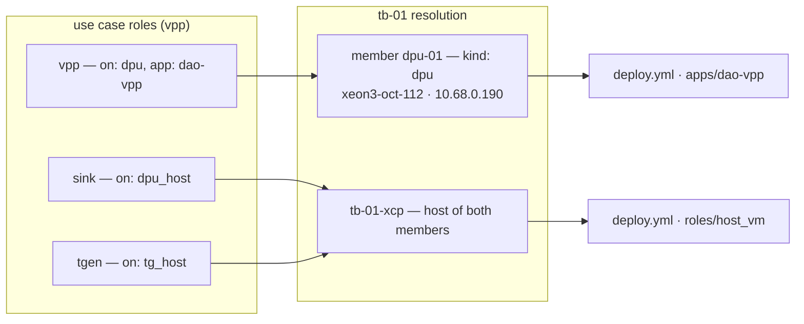

# Provisioning and XCP-ng automation

Part of the daolab implementation plan — see [README.md](README.md) for the doc map.

This document specifies everything under `inventory/` and `playbooks/`: the one-testbed
inventory, the one-time dom0 passthrough prep, the `tpl-ubuntu2204-dao` template, and the
playbooks `service/runner.py` runs through ansible-runner — **one `deploy.yml`** plus
`cleanup.yml`, `verify_clean.yml`, `reconcile.yml`, `orphans.yml` and `probe.yml` — and the
admin's `bringup.yml`. Which playbook runs for which job, and when, is
[04-lifecycle-engine.md](04-lifecycle-engine.md)'s territory; the design behind it is
[09-backend-system-design.md](09-backend-system-design.md) §6–§9. Two invariants govern every
line here: **every playbook is idempotent** (engine retry = run again) and **passthrough prep is
one-time in dom0, never per reservation**.

The DPU apps are not re-implemented here: `playbooks/apps/<app>/` wrappers import Akshay's
runbook playbooks (`VPP_ansible/`, `dao-smartnic/dao_smart_nic_ansible_direct/`, written and
tested on the real board) **unchanged**, and only decide which of their steps a deploy needs.

## Inventory layout — one testbed

One testbed, `tb-01`: one XCP-ng host with the E810 for the use cases' VMs, plus the DPU. Host
names are the join key: `setups/tb-01.yml` member `host` fields (`tb-01-xcp`) must exist in the
inventory (`daolab sync` refuses one it does not know), and so must the DPU member's name
(`dpu-01`), which the playbooks target and whose `ansible_host` becomes its address.
Playbooks never hardcode these names — play 0 resolves them from the setup at run time.

```yaml
# inventory/hosts.yml
all:
  children:
    xcp_hosts:
      hosts:
        tb-01-xcp:
          ansible_host: 10.0.0.10        # TODO(B-85): the XCP-ng host's real address
    dpus:
      hosts:
        dpu-01:
          ansible_host: 10.68.0.190      # xeon3-oct-112
          ansible_user: dao-test
```

```yaml
# setups/tb-01.yml (members + the Y-cable links)
name: tb-01
pool: lab-1
members:
  dpu-01: {kind: dpu, capabilities: [octeon-cn106, sdp], host: tb-01-xcp}
  tg-01:  {kind: nic, capabilities: [e810],              host: tb-01-xcp}
links:
  - {a: tg-01.e810p0, b: dpu-01.sfp0, capability: wire}
  - {a: tg-01.e810p1, b: dpu-01.sfp1, capability: wire}
```

- **DPUs are static.** `dpu-01` is the CN10K board **xeon3-oct-112** (CRB106) at its fixed
  management address `10.68.0.190`, reached as `dao-test` — the account the VPP / SmartNIC
  runbooks were run with, which needs passwordless sudo for their `become: true` steps. Users
  never get `dao-test`: a deploy gives them the `lab` login (`roles/dpu_access`). `daolab sync`
  copies each member's `ansible_host` into `resources.address`, which the API shows as
  `ssh lab@10.68.0.190`.
- **`inventory/host_vars/dpu-01.yml`** holds only what daolab needs about the board:
  `hw_class: sdp-pf1-vf8` (the personality `bringup.yml` writes to the board's marker). The
  VPP / SmartNIC specifics (PCI addresses, ports, paths) stay in the runbooks' own
  `VPP_ansible/group_vars/all.yml` and `dao-smartnic/…/group_vars/all.yml`, which the app
  wrappers load.
- **`inventory/host_vars/tb-01-xcp.yml`** — needed only with `DAOLAB_DEPLOY_VMS=true`;
  placeholders until the host is known (B-85):

  ```yaml
  ansible_user: root
  sr_uuid: ""                                     # xe sr-list params=uuid,name-label,type
  mgmt_network: "Pool-wide network associated with eth0"   # xe network-list
  templates: [tpl-ubuntu2204-dao]                 # built per "Building tpl-ubuntu2204-dao"
  e810_vfs: []                                    # xl pci-assignable-list; alternate p0 / p1
  sdp_vfs: []                                     # the SDP VFs the OCTEON exposes to this host
  ```

- **`inventory/group_vars/all.yml`** — the VMs' management network: `mgmt_prefix` (16, to
  confirm), `mgmt_gateway`, `mgmt_dns` (TODO B-85).
- **`playbooks/ansible.cfg`** (the runner sets `ANSIBLE_CONFIG` to it): the inventory above,
  `roles_path = roles:../dao-smartnic/dao_smart_nic_ansible_direct/roles` so the SmartNIC
  runbook's roles resolve, and the `community.general.opentelemetry` callback, which switches
  itself on only when the runner sets `DAOLAB_ANSIBLE_OTEL=true` (B-63;
  `playbooks/requirements.yml` installs the collection).

Every playbook run receives this inventory via `DAOLAB_INVENTORY`. A new testbed = new host
entries + host_vars files + one `setups/*.yml` — zero code changes.

## Addresses — leased VM IPs, static DPUs

| What | Address | Owner |
|---|---|---|
| VM management interfaces | leased from `DAOLAB_IP_POOL` = `10.68.1.0-10.68.2.200`, one per VM role per reservation | the backend (`ipam.py`); the playbook asks |
| The DPU | static `ansible_host` (`10.68.0.190`), never leased | the inventory |
| Data plane (E810 wire, SDP) | fixed per use case in `playbooks/vars/dataplane.yml` | the testbed is booked as one unit, so they never collide |

- `daolab sync` writes `DAOLAB_IP_POOL` into the single `default` pool. `POST /internal/leases
  {reservation_id, role}` returns the lowest address with no live lease, and the *same* address
  again for the same `(reservation, role)`, so a replayed deploy never takes a second IP. A
  unique index on `(pool, ip)` among live leases guarantees no address is given to two
  reservations ([02-backend-api.md](02-backend-api.md)).
- Before use, `roles/lease_ip` pings the address from the VM's XCP-ng host (skipped when the
  reservation's own VM already exists — a replay). If something answers, it reports
  `/internal/leases/conflict`: that address is quarantined for good and the role gets a
  replacement, which must be silent too.
- The VM gets the address **statically through cloud-init** (`network-config`); nothing depends
  on DHCP, so two VMs can never race for one address.
- Lease lifecycle: `leased → released` once the cleanup is verified clean;
  `leased → quarantined` when it could not prove the VM is gone (or for a conflict). Quarantined
  addresses are never re-issued until a reconcile job or an admin's force-clean clears them.
- The DPU role's `vms.ip` is the DPU's static address (`post_dpu_ip`); what verify substitutes
  for `{<dpu role>_ip}` is its first `wire*` data-plane address, so the verify traffic crosses
  the real datapath.

## The playbook contract — extra vars

The ansible runner passes the same extra vars to every playbook
([04-lifecycle-engine.md](04-lifecycle-engine.md)):

| Extra var | Meaning |
|---|---|
| `reservation_id`, `usecase`, `setup`, `user`, `hw_class`, `diy`, `templates` | the reservation (`templates`: DIY host → template) |
| `ssh_pubkey` | the key(s) the owner deployed with; empty in password mode |
| `daolab_access_login` / `daolab_access_password` / `daolab_access_expires` | `lab`; the generated password (or empty); the day after `end_at` |
| `daolab_members`, `daolab_roles`, `daolab_verify`, `daolab_vms`, `daolab_leases` | the setup members, the use case's roles and verify block, the reservation's `vms` rows and live lease IPs |
| `daolab_app` | the `app:` of the use case's `on: dpu` role (`dao-vpp`, `nginx-tls`, `dao-smartnic`), `none` for diy — selects `apps/<app>/` |
| `daolab_api_url`, `daolab_internal_secret` | the callbacks (`/internal/leases*`, `/internal/vm-ip`) |
| `daolab_otel_collector` | `DAOLAB_OTEL_AGENT_ENDPOINT`, the lab-reachable collector for the agents (empty = no agent) |
| `daolab_deploy_vms` | `DAOLAB_DEPLOY_VMS`: create the VMs (needs the XCP-ng host in the inventory) |
| `allow_destructive_changes`, `allow_launch`, `allow_cleanup` | the runbooks' owner sign-off flags, all = `DAOLAB_ALLOW_DESTRUCTIVE` |
| `daolab_output_file` | where `verify_clean.yml` / `orphans.yml` write their JSON answer |

`reservation_id=0` is the manual-run sentinel (never issued by the DB): every callback task
carries `when: reservation_id | int != 0`, `lease_ip` takes the addresses from `manual_ips`
(`{role: address}`) instead of the API, and play 0 loads the setup and use-case YAML from the
repo because a manual run passes no `daolab_*` facts. A task named `step: <name>` becomes a job
step in the dashboard (B-84); `no_log` hides the secret-carrying tasks unless
`daolab_no_log=false`.

## Play 0 — `tasks/resolve.yml` and `tasks/plan_vms.yml`

Every playbook starts on localhost with `tasks/resolve.yml`:

1. Manual runs only: load `setups/{{ setup }}.yml` (and `usecases/{{ usecase }}.yml` unless
   diy) and fill in the facts the runner would have passed.
2. Find the DPU member (`daolab_dpu`) and the XCP-ng hosts of all members (`daolab_dom0s`);
   assert the setup has at least one.
3. `add_host` the dom0s into the transient group `r_dom0` — **only when `daolab_deploy_vms` is
   on**, so with VMs off no play reaches the XCP-ng host at all — and the DPU into `r_dpu` and
   `dpu` (the group Akshay's runbook playbooks target). `add_host` with an existing inventory
   name keeps its host_vars.

`deploy.yml` and `probe.yml` then run `tasks/plan_vms.yml`, which builds `daolab_vm_plan` — one
entry per VM: `{role, host, name: daolab-r<id>-<role>, template, connect, install, vf_family,
vf_index, data_ip}` — from the use case's roles (DIY: one bare VM per `templates` host, the host
name as the role), plus `daolab_dpu_role`, `daolab_dpu_ip` (static management address) and
`daolab_dpu_data_ip` (first wire address). It asserts every VM lands on an XCP-ng host of the
setup.

## `playbooks/deploy.yml` — one click, one playbook

The four playbooks of the earlier design (`dpu_prepare.yml`, `host_vm.yml`, `verify.yml`, plus
leasing) are now plays and roles inside one entry playbook, so the dashboard sees exactly one
job (plan/09 §6):

| Play | Hosts | What | Skipped when |
|---|---|---|---|
| 0 | localhost | `resolve.yml`, `plan_vms.yml`, `roles/lease_ip` | lease: `daolab_deploy_vms` off |
| 1 | `r_dpu` | `roles/ebf_set`: the board runs the use case's `hw_class` | diy, or no `hw_class` |
| apps | `dpu` | `apps/{{ daolab_app }}/deploy.yml`: the DAO app, by the runbook playbooks | `daolab_app=none` does nothing |
| 2 | `r_dpu` | `roles/dpu_access` (the owner's `lab` login), `roles/otel_agent` (+ the app's exporter as a scrape target), `step: post_dpu_ip` | access: diy; agent: no `on: dpu` role or no collector; post: manual run |
| 3 | `r_dom0` | `roles/host_vm`: every VM of the plan on this host | `daolab_deploy_vms` off |
| 4 | localhost | `roles/verify`: the use case's YAML `verify` block from its `from` VM | `daolab_deploy_vms` off; diy |

**Idempotency** — the app wrappers read the board and run only the steps that move it forward;
`host_vm` never clones twice, never re-picks a wired VF and never restarts a running VM; leases
are idempotent; access, agent and exporter tasks converge. A second run reports only `ok` /
`skipped`. **Failure modes** — a board on another personality (ebf_set's manual-flash message);
VPP changes without `DAOLAB_ALLOW_DESTRUCTIVE`; a runbook step failing (its own message); a
missing or ambiguous template, an unknown install id, no free VF (each named); a VM that never
comes up on its leased address (5 min); a verify whose output lacks `expect`; callback
`401`/`404`.

### `roles/lease_ip`

Runs on localhost after the plan; leaves `daolab_ips = {role: address}`. Per VM role (step
`lease_ip <role>`): `POST /internal/leases`; check the reservation's VM is not already there
(`xe vm-list name-label=<name>` on its host); if it is not, `ping -c 2 -W 1 <ip>` from that host;
if the address answers, `POST /internal/leases/conflict` (step `lease_conflict <role>`) and
require the replacement to be silent. A manual run asserts every VM role is in `manual_ips`.

### `roles/ebf_set` — stub contract

EBF (early-boot firmware) configuration sets the OCTEON's personality; `hw_class` names the
result (e.g. `sdp-pf1-vf8` = SDP, 1 PF, 8 VFs). The role's **interface is fixed now**, the
board-specific flash lands later:

- **Input var**: `ebf_target_hw_class` (kebab-case string, `deploy.yml` passes `hw_class`).
  **Postcondition**: the board's personality equals it, or the role fails.
- **Layout**: `playbooks/roles/ebf_set/{defaults/main.yml, tasks/main.yml}`; marker file
  `ebf_marker: /etc/daolab/hw_class` on the board.
- **Contracted behavior**: read the marker; if equal to the target → no-op, `changed: false`.
  If different → flash the EBF config for the target, reboot the board, `wait_for_connection`,
  re-read, write the marker, `changed: true`.
- **Stub (today)** implements only the compare path:
  - marker present and equal → passes;
  - marker present and different → fails with `ebf_set stub: board is <current>, use case needs
    <target>; flash manually per board docs, then: echo <target> > /etc/daolab/hw_class and
    re-run` — the **manual-flash fallback**; the engine's retry then sails through;
  - **marker missing → assumed to match**: the board's personality is not tracked yet (e.g.
    configured by hand before daolab), so the step `ebf_set` only logs that and the deploy goes
    on. `bringup.yml` writes the marker from `host_vars/dpu-01.yml`, after which mismatches are
    enforced.
- The scheduler's `DAOLAB_HW_CLASS_LEAD_MIN` lead exists precisely because the real flash +
  reboot takes minutes (see [03-scheduler.md](03-scheduler.md)); the engine records
  `resources.hw_class` after a successful deploy ([04-lifecycle-engine.md](04-lifecycle-engine.md)).
  Cleanup never touches the marker.

### DPU apps — `apps/<app>/deploy.yml` over the runbook playbooks

`deploy.yml` imports `apps/{{ daolab_app }}/deploy.yml` (and `cleanup.yml` imports
`apps/{{ daolab_app }}/cleanup.yml`). Each wrapper loads the runbook's own `group_vars`, reads
the board first, and imports the runbook playbooks it needs **unchanged**, so a retry or a
redeploy is safe:

| `daolab_app` (use case) | Reads | Imports (runbook step) only when … | Then |
|---|---|---|---|
| `dao-vpp` (`vpp`) | is VPP installed (`which vpp`), running (`pgrep -x vpp`), which driver holds `pci_live_port` (step `vpp_board_state`) | `03_install` (4–5): not installed · `04_configure_02` (6): always · `08_prepare_04` (11) + `09_configure_04` (12): VPP not running and the live port still on `rvu_nicpf` · `10_verify_04` (13–14): VPP not running | step `dpu_app` (`vppctl show version`); exporter `--app vpp` |
| `dao-smartnic` (`smartnic`) | is `dao-smart-nic` built and running (step `smartnic_board_state`); saves the PCI restore point `pci-before.txt` before a launch | `01_build`: binary missing · `02_launch_verify`: not running | step `dpu_app` (`pgrep -x dao-smart-nic`); exporter `--app smartnic` |
| `nginx-tls` (`tls-proxy-nginx`) | — (nginx-tls is the board's resting state) | — | step `dpu_app` (`systemctl start nginx-tls.service`, must stay active); exporter `--app nginx` |
| `none` (diy) | — | — | nothing on the DPU |

- **Sign-off.** The runbooks refuse to stop nginx-tls, move the live port to vfio-pci, launch
  SmartNIC or clean up without their owner sign-off flags; the runner sets all three from
  `DAOLAB_ALLOW_DESTRUCTIVE`. The VPP wrapper checks it up front when VPP is not already running
  and stops with "deploying VPP stops nginx-tls and moves <port> to vfio-pci … Set
  DAOLAB_ALLOW_DESTRUCTIVE=true". Redeploying a running VPP needs no sign-off.
- **Health exporter** (`tasks/app_exporter.yml`): `files/daolab-app-exporter` (stdlib Python)
  installed as `/usr/local/bin/daolab-app-exporter` with the `daolab-app-exporter` unit on
  `127.0.0.1:9273`; it serves exactly the series the use-case `health:` rules read (`vpp_up`,
  `vpp_interface_*`; `nginx_up`; `smartnic_up`, `smartnic_offload_pps`) and is handed to the otel
  agent as a scrape target.
- **Cleanup wrappers:** `dao-vpp` runs `11_cleanup_04` (step 15: stop VPP, live port back to
  `rvu_nicpf`, restart nginx-tls) only when VPP runs or the port is on vfio-pci, then makes sure
  nginx-tls runs (step `stop_app`); `dao-smartnic` runs `03_cleanup` (steps 13–14) and checks
  `dao-smart-nic` is gone; `nginx-tls` leaves nginx running; these three also stop the
  exporter.
  The board's specifics (the use-case data paths and payloads) are in
  [07-usecase-tls-proxy.md](07-usecase-tls-proxy.md) and the runbooks' READMEs.

### `roles/dpu_access` — the `lab` login

One shared login, `lab` (plan/09 §7: isolation is *who* and *when*, not per-user accounts),
with sudo for the slot. `deploy.yml` play 2 opens it with what the owner chose in the Deploy
dialog; `cleanup.yml` closes it first. The operator account `dao-test` is never touched.

- **Deploy** (`tasks/main.yml`, not for diy): create `lab` if missing; `/etc/sudoers.d/90-daolab-lab`
  (`NOPASSWD:ALL`, `visudo`-checked); write the owner's key lines to the root-owned
  `/etc/daolab/authorized_keys/lab` (step `dpu_access`; empty in password mode), each key prefixed
  with sshd's `expiry-time` option set to `end_at` (rendered in the DPU's local time from
  `daolab_access_until`), so key logins stop at the end of the slot even if no cleanup runs; an sshd drop-in
  `/etc/ssh/sshd_config.d/10-daolab-lab.conf` with `Match User lab` → `AuthorizedKeysFile
  /etc/daolab/authorized_keys/%u`, public-key and password login allowed **for `lab` only**,
  checked with `sshd -t` and reloaded only when it changed; in password mode `chpasswd` sets the
  generated password (`no_log`) and `usermod -U`, in key mode `usermod -L` locks password login;
  `chage -E <the day after end_at>` — the account expires on its own if a cleanup never runs.
- **Revoke** (`tasks_from: revoke`, the first thing `cleanup.yml` does): step `terminate-user`
  (`loginctl terminate-user lab`, `pkill -KILL -u lab`), then — if the login exists — empty the
  key file, set a random 32-character password, and step `revoke_access`
  (`usermod -L lab && chage -E 0 lab`). Safe when the login does not exist.
- **The B-52 alternative.** `playbooks/files/daolab-keys` (an sshd `AuthorizedKeysCommand` that
  asks `GET /internal/authz/keys` at every login, fail-closed with a 2 s budget, its secret in a
  header file only its command user can read) and `files/sshd-daolab.conf` are built and tested,
  but no playbook installs them on the board today: key access opens when the deploy finishes
  (`ready`, a few minutes before `start_at`) and ends at `end_at` through `expiry-time`; password
  access ends when the cleanup revokes it, with the next-day account expiry as backstop.

### `roles/otel_agent` — telemetry (B-83)

On the DPU (play 2) it installs `otelcol-contrib` (v0.160.0, the release tarball for the board's
architecture) if missing, renders `/etc/daolab/otelcol.yaml` (step `otel_agent`) and runs it as
`daolab-otel`. On the VMs the same config is rendered (`tasks_from: render`) and handed to
cloud-init by `host_vm`. The config: `hostmetrics`; a self-scrape (so `up` exists per host); the
app exporter on the DPU; `tcpcheck` of `127.0.0.1:22` (→ `tcpcheck_status{port="22"}`);
optional `httpcheck` targets; resource attributes `daolab.reservation`, `daolab.user`,
`daolab.role`, `daolab.setup`, `host`, which the collector turns into the
`daolab_reservation` … labels every health rule selects on; OTLP to `daolab_otel_collector`.
Without a collector address the role does nothing. Cleanup disables `daolab-otel` on the DPU.

### `roles/host_vm` — one VM per role

Runs on each host of `r_dom0` for the plan entries on that host. Per VM (all checks first, so a
re-run after any failure converges):

1. `xe vm-list name-label=daolab-r<id>-<role> --minimal`; two VMs of that name → fail (destroy
   the extras with `reconcile.yml`).
2. Missing → find the template (`xe template-list name-label=<vm> --minimal`; absent or
   ambiguous → a named failure) and clone it (step `create_vm <role>`).
3. Every `install` id must be in `host_vm_install_map` (`http-server: [apache2]`,
   `ab: [apache2-utils]`, `h2load: [nghttp2-client]`, `pktgen: [pktgen-dpdk]`, `sink: [iperf3]`,
   `offload-client: [ethtool]`, `trex: []` — TRex ships in the template); an unknown id fails the
   deploy rather than booting a VM without its software.
4. Render the cloud-init NoCloud seed and, **only while the VM is not running**, write it to
   xenstore (step `seed <role>`): `xe vm-param-set uuid=<vm> xenstore-data:vm-data/ip=<ip>
   xenstore-data:vm-data/daolab/{user-data,network-config,meta-data,otel}=<base64>`; each value
   must stay under 3800 bytes (xenstore takes < 4 KiB). The template's `daolab-seed` unit turns
   them into `/var/lib/cloud/seed/nocloud/` before cloud-init runs.
   - `user-data`: the owner's login (sudo) with **only** the deployed key(s) — or, in password
     mode, the generated password with `ssh_pwauth: true`; a separate `daolab` service login
     with the control node's key (`~/.ssh/id_ed25519.pub`, when it has one), used by verify and
     probe; the role's
     packages; for `http-server` an index page and a 64 KiB payload; enable `daolab-otel` when an
     agent config was seeded.
   - `network-config`: `mgmt0` (the VIF) with the **leased address** `/mgmt_prefix`, gateway
     and DNS from `group_vars`; `data0` (matched by the VF's guest driver: `iavf` for
     `e810-vf`, `octeon_ep_vf` for `sdp`) with the role's data-plane address.
   - `meta-data`: `instance-id: <name>-<ip>`, `local-hostname: <name>`.
5. Management VIF on device 0 if missing (step `vif <role>`).
6. Data-plane VF (`connect: e810-vf` → `e810_vfs`, `sdp` → `sdp_vfs`; other `connect` values get
   none): the host must have entry `vf_index`; if `other-config:pci` is not already `0/<bdf>`,
   the BDF must be in `xl pci-assignable-list`, then `xe vm-param-set other-config:pci=0/<bdf>`
   (step `vf <role>`).
7. `xe vm-start` unless running (step `start_vm <role>`); wait until
   `xe vm-param-get … param-name=networks param-key=0/ip` equals the leased address (60 × 5 s,
   step `wait_ip <role>`); post it to `/internal/vm-ip` (step `post_vm_ip <role>`).

### `roles/verify` and `playbooks/probe.yml`

`roles/verify` runs the use case's `verify` block (`{from, cmd, expect}`) from inside the `from`
VM, for non-diy use cases that have one. `{<role>_ip}` placeholders get the role's data-plane
address (`vars/dataplane.yml`; the DPU role: its first wire address), else its management
address — this run's leases, or for a probe the recorded `daolab_vms` IPs. It asserts nothing is
left unsubstituted, reaches the VM as the `daolab` service login (never the owner's), runs `cmd`
(step `verify`) and asserts `expect` is in the output, quoting both on failure.

`probe.yml` (the `health_probe` job, `POST …/health/probe`) is play 0 + the plan + this role,
read-only, against the live reservation. With `DAOLAB_DEPLOY_VMS` off there is no `from` VM, so
it asks the DPU app instead: `daolab-app-exporter --once` (installed by the deploy) must report
the app's `_up` as 1 (step `probe_dpu_app`).

## `playbooks/cleanup.yml` — best-effort teardown (B-82)

| Play | Hosts | What |
|---|---|---|
| 0 | localhost | `resolve.yml` |
| 1 | `r_dpu` | `dpu_access` revoke **first** (access ends at `end_at` whatever else happens, B-53); stop the reservation's `daolab-otel` agent |
| apps | `dpu` | `apps/{{ daolab_app }}/cleanup.yml` (see above) |
| 2 | `r_dom0` | step `destroy_vms`: every `daolab-r<id>-*` VM → `xe vm-shutdown force=true`, `xe vm-uninstall force=true` (VIFs and VDIs go with it; its VF returns to the host) |

The DPU keeps its `hw_class` and its marker; pciback is never edited. Safe on an
already-clean testbed. Its result is not trusted: the engine runs `verify_clean.yml` after it
either way and reconciles residue ([04-lifecycle-engine.md](04-lifecycle-engine.md)).

## `playbooks/verify_clean.yml` — prove nothing is left (B-70)

Read-only: every check is a direct query, never an Ansible "changed" result. It writes the
residue list (JSON, one `kind:ident` per item) to `daolab_output_file`; empty means clean.

| Check (step) | Where | Residue |
|---|---|---|
| `check_vms` | each `r_dom0` | `vm:<name>` — a `daolab-r<id>-*` VM still exists |
| `check_vfs` | each `r_dom0` | `vf:<bdf>` — a host_vars VF is missing from `xl pci-assignable-list` |
| `check_sessions` | `r_dpu` | `dpu_session:lab` — processes of the lab login |
| (app units / processes) | `r_dpu` | `dpu_app:<unit>` — an active `daolab-app-*` unit; `dpu_app:vpp` / `dpu_app:dao-smart-nic` — an app process the runbooks start by hand |
| `check_ips` | first `r_dom0` | `ip:<address>` — a leased address still answers ping |

A host that cannot be reached fails the run, so the runner reports "could not verify" and the
engine treats the setup as not clean: verification is fail-safe. With VMs off only the DPU
checks run.

## `playbooks/reconcile.yml` — destroy what is found (B-72)

Unlike `cleanup.yml` it does not trust Ansible facts or the use case; it acts on what verify
looks at. Every step is idempotent and safe on a clean testbed; `verify_clean.yml` follows.

1. Each `r_dom0`: every VM named `daolab-r<id>-*` (or exactly the `daolab_vm_names` given) →
   force shutdown + uninstall (step `destroy_vms`).
2. Each `r_dom0`: every host_vars VF missing from `xl pci-assignable-list` →
   `xl pci-assignable-add <bdf>` (step `rebind_vfs`; a VF still held by a running VM is left for
   verify to report).
3. The DPU: the app's runbook cleanup again (`apps/<app>/cleanup.yml`), then every active
   `daolab-app-*` unit stopped (step `stop_app`); `hw_class` untouched.
4. The DPU: every session / process of the lab login killed (step `kill_sessions`).

## `playbooks/orphans.yml` — the orphan sweep's two halves (B-73)

Runs over the whole `xcp_hosts` group (an orphan's setup may be unknown, e.g. a VM made by hand
as `daolab-r999-x`). Without `daolab_vm_names` it writes every `daolab-r<id>-*` VM name to
`daolab_output_file` (read-only, step `list_vms`); with it, it force-destroys exactly those
names wherever they live (step `destroy_vms`). The engine decides in the DB which names are
orphans ([04-lifecycle-engine.md](04-lifecycle-engine.md)); with `DAOLAB_DEPLOY_VMS` off the
runner does not run it at all.

## `playbooks/bringup.yml` — testbed bring-up (B-85)

Run once by an admin, and again after hardware changes; idempotent:

```
ansible-playbook -i inventory/hosts.yml playbooks/bringup.yml -e setup=tb-01 [-e daolab_deploy_vms=true]
```

- **The DPU:** `dao-test` can sudo without a password; `dpdk-devbind.py` is on the path;
  `/home/dao-test` and the SmartNIC tree `/home/dao-test/dao-clean` exist; the Marvell DAO apt
  repository is configured (VPP install); `nginx-tls.service` exists (the resting state VPP
  cleanup restarts); `host_vars/dpu-01.yml` has `hw_class`. It writes the personality marker
  `/etc/daolab/hw_class` from `hw_class` — never overwriting one that exists (step
  `hw_class marker`).
- **The XCP-ng host** (only with `daolab_deploy_vms=true`): every template in `templates` exists;
  every listed VF is in `xl pci-assignable-list`; `sr_uuid` and `e810_vfs` are filled in.
- It fails at the end listing **every** missing prerequisite, so one run gives the whole to-do
  list; "ready: nothing missing" otherwise.

## Role-driven provisioning — `on:` selectors to plays and hosts

Use-case roles never name hosts (invariant: capability match only). The `on:` selector is
resolved against the **matched setup** at provisioning time — by `models.planned_vms` for the
`vms` rows and by `tasks/plan_vms.yml` for the playbook:

| `on:` value | Resolution against `setups/<setup>.yml` | On tb-01 | Executing play |
|---|---|---|---|
| `dpu` | the member with `kind: dpu` → its member name | `dpu-01` | `deploy.yml` plays 1–2 + `apps/<app>/` (`r_dpu` / `dpu`) |
| `dpu_host` | the `host` field of the `kind: dpu` member | `tb-01-xcp` | `roles/host_vm` (`r_dom0`) |
| `tg_host` | the `host` field of the `kind: nic` member | `tb-01-xcp` | `roles/host_vm` (`r_dom0`) |



With one XCP-ng host, `dpu_host` and `tg_host` resolve to the same dom0; a future setup with a
different wiring only needs its YAML + inventory entries, and the same playbooks resolve and run
unchanged. A role whose member the setup lacks is left out of the plan (capability matching
should make that impossible).

## One-time dom0 preparation — pciback, single reboot

pciback claims PCI devices in dom0 for guest passthrough. It is configured **once per dom0**
with **every VF that will ever be passed through** (on `tb-01-xcp`: the E810 VFs of both ports
and the SDP VFs the OCTEON exposes to the host), followed by **one** dom0 reboot. No deploy
touches the pciback configuration; a reservation only picks from the pre-seized pool.

On `tb-01-xcp`, as root:

1. Create the VFs on each PF and confirm their BDFs:
   `echo 8 > /sys/bus/pci/devices/<e810-pf>/sriov_numvfs && lspci -D | grep -i virtual`.
   Persist creation with an early `systemd` oneshot (`daolab-sriov.service`) so VFs exist on
   every boot.
2. Write the hide list — every VF, one parenthesized BDF each:
   ```
   # /etc/modprobe.d/pciback.conf
   options xen-pciback hide=(0000:5e:01.0)(0000:5e:01.1)
   ```
3. Reboot dom0 **once**.
4. Verify: `xl pci-assignable-list` prints exactly the hidden BDFs. Copy them into
   `host_vars/tb-01-xcp.yml` (`e810_vfs`, alternating p0 / p1, and `sdp_vfs`). If a VF is
   created after boot (oneshot ordering), `xl pci-assignable-add <bdf>` re-seizes it —
   idempotent, safe in the oneshot (and what `reconcile.yml` does for a VF that fell out).

Adding hardware later (new NIC, more VFs) = edit `pciback.conf`, one more reboot, update
`host_vars`. Still never per reservation.

## Building `tpl-ubuntu2204-dao`

One base template: Ubuntu 22.04 that takes everything at first boot from **cloud-init NoCloud
seeded through xenstore**. No role software is baked in except what is not packaged (TRex) —
`host_vm` installs the rest per the use case's `install` list.

1. `xe vm-install template="Ubuntu Focal Fossa 20.04" new-name-label=tpl-build sr-uuid=<sr_uuid>`
   (or the closest guest template), attach the Ubuntu 22.04 ISO, install minimal server +
   openssh + cloud-init.
2. Inside the guest: install `xe-guest-utilities` from the XCP-ng guest-tools ISO. It provides
   `xenstore-read` for the seed and makes `xe vm-param-get … param-name=networks` report the
   guest IP, which `host_vm` waits on.
3. Install the daolab first-boot pieces from `playbooks/files/`:
   - `daolab-seed` → `/usr/local/sbin/daolab-seed`: at every boot, before cloud-init, it reads
     the base64 values under `vm-data/daolab/` (`user-data`, `network-config`, `meta-data`,
     `otel`) and writes `/var/lib/cloud/seed/nocloud/*` and `/etc/daolab/otelcol.yaml`; a VM
     with no seed (the template itself) is left alone.
   - `daolab-seed.service` → `/etc/systemd/system/`, enabled (`Before=cloud-init-local.service`).
   - `cloud-daolab.cfg` → `/etc/cloud/cloud.cfg.d/99-daolab.cfg` (`datasource_list: [NoCloud,
     None]`): cloud-init reads only that seed.
4. Ship `otelcol-contrib` and a `daolab-otel` unit (as rendered by
   `roles/otel_agent/templates/daolab-otel.service.j2`): the user-data enables it when an agent
   config was seeded. Ship TRex.
5. Clean: `cloud-init clean`, `truncate -s0 /etc/machine-id`, `rm -f /etc/ssh/ssh_host_*`, apt
   clean, shut down.
6. Convert: `xe vm-param-set uuid=<vm-uuid> is-a-template=true name-label=tpl-ubuntu2204-dao`.

The owner's login, keys or password, the `daolab` service login, the static address and the
packages all come from the seed `host_vm` writes, so the template never holds a user's key.

## XCP-ng operations reference

Everything runs in dom0 over SSH (command/shell modules — dom0 is not a place for heavy Ansible
modules). Exact invocations used by the playbooks:

| Operation | Command | Used by |
|---|---|---|
| Discover assignable VFs | `xl pci-assignable-list` | bring-up, `host_vm`, `verify_clean`, `reconcile` |
| Re-seize a VF | `xl pci-assignable-add <bdf>` | `reconcile` |
| Discover SRs (fills `sr_uuid`) | `xe sr-list params=uuid,name-label,type` | bring-up (by hand) |
| Find template | `xe template-list name-label=tpl-ubuntu2204-dao --minimal` | `host_vm`, `bringup` |
| Does a VM exist | `xe vm-list name-label=daolab-r<id>-<role> --minimal` | `lease_ip`, `host_vm` |
| List daolab VMs | `xe vm-list is-control-domain=false params=name-label --minimal` | `cleanup`, `verify_clean`, `reconcile`, `orphans` |
| Clone per reservation | `xe vm-clone uuid=<tpl-uuid> new-name-label=daolab-r<id>-<role>` | `host_vm` |
| Power state | `xe vm-param-get uuid=<vm> param-name=power-state` | `host_vm` |
| Seed first boot | `xe vm-param-set uuid=<vm> xenstore-data:vm-data/ip=<ip> xenstore-data:vm-data/daolab/<key>=<base64> …` | `host_vm` |
| Management network | `xe network-list name-label="<mgmt_network>" --minimal` | `host_vm` |
| Attach VIF | `xe vif-list vm-uuid=<vm> device=0 --minimal`, `xe vif-create vm-uuid=<vm> network-uuid=<net> device=0` | `host_vm` |
| PCI passthrough of a VF | `xe vm-param-get uuid=<vm> param-name=other-config param-key=pci`, `xe vm-param-set uuid=<vm> other-config:pci=0/<bdf>` | `host_vm` |
| Boot | `xe vm-start uuid=<vm>` | `host_vm` |
| Read guest IP | `xe vm-param-get uuid=<vm> param-name=networks param-key=0/ip` | `host_vm` |
| Destroy (VM + VIFs + VDIs) | `xe vm-shutdown uuid=<vm> force=true` then `xe vm-uninstall uuid=<vm> force=true` | `cleanup`, `reconcile`, `orphans` |
| Is an address in use | `ping -c 2 -W 1 <ip>` (from dom0) | `lease_ip`, `verify_clean` |

## VF allocation strategy per reservation

| VF family | Lives in | Consumed by | Allocator |
|---|---|---|---|
| `e810_vfs` | tb-01-xcp dom0 (pciback) | VMs with `connect: e810-vf` (client / traffic-gen / sink) | `plan_vms.yml` + `host_vm` |
| `sdp_vfs` | tb-01-xcp dom0 (pciback) | VMs with `connect: sdp` (the TLS backend) | `plan_vms.yml` + `host_vm` |
| CPT / SDP devices on the board | the OCTEON itself | the DPU app | the runbook playbooks (`apps/<app>/`) |

Allocation rule for the passthrough families: the testbed is booked as one exclusive unit and
the engine is single-flight per setup, so at most one reservation ever owns a host's VFs at a
time. Allocation is therefore **deterministic by index per (host, VF family)**: the
reservation's VM roles on that host needing that family, in role-name order — the k-th takes
`vf_list[k]` (`plan_vms.yml` computes `vf_index`). On tb-01, `vpp` gives `sink` `e810_vfs[0]`
and `tgen` `e810_vfs[1]`; `tls-proxy-nginx` gives `backend` `sdp_vfs[0]` and `client`
`e810_vfs[0]`. A retried deploy re-picks the same BDF for the same role — idempotent by
construction. Before wiring, `host_vm` asserts the host has entry k (a named failure: add VFs per
the dom0-prep section, not a retry) and, unless the VM already carries it, that the BDF is in
`xl pci-assignable-list`. Teardown frees VFs by destroying the VMs; no allocation state is stored
anywhere.

## Bring-up checklist — tb-01

Goal: the real lab runs dashboard deploys. Status (B-85): `bringup.yml` and the inventory are
ready; ticking the list on the hardware is still open. Use-case specifics (VPP / SmartNIC
runbooks, NGINX, payloads) are in the runbooks and [07-usecase-tls-proxy.md](07-usecase-tls-proxy.md).

**DPU-only first** (the VMs need the XCP-ng host, which is still a placeholder):

1. On the board (xeon3-oct-112, `10.68.0.190`): `dao-test` with passwordless sudo (or
   `ansible_become_password` in `host_vars/dpu-01.yml` through ansible-vault, never plain
   text); the runbooks' prerequisites per `VPP_ansible/README.md` and the `dao-smartnic`
   runbook.
2. `host_vars/dpu-01.yml` has the board's `hw_class`; run
   `ansible-playbook -i inventory/hosts.yml playbooks/bringup.yml -e setup=tb-01` until it
   reports "ready: nothing missing" (it writes `/etc/daolab/hw_class`).
3. On the daolab server (`.env`): `DAOLAB_RUNNER=ansible`, `DAOLAB_INTERNAL_SECRET` set,
   `DAOLAB_IP_POOL=10.68.1.0-10.68.2.200`, `DAOLAB_DEPLOY_VMS=false`,
   `DAOLAB_ALLOW_DESTRUCTIVE=true` once the board's owner has signed off; `daolab sync` (the
   pool, `resources.address` = `10.68.0.190`).
4. Deploy `vpp` from the dashboard: the job runs ebf_set, the VPP runbook steps, `lab` access;
   `ssh lab@10.68.0.190` works with the owner's key or password during the slot only; End now →
   cleanup gives the board back (nginx-tls running) and verify is clean.

**Then the VMs:**

5. Fill `inventory/hosts.yml` (`tb-01-xcp` address), `host_vars/tb-01-xcp.yml` (`sr_uuid`,
   `mgmt_network`, `e810_vfs`, `sdp_vfs`) and `group_vars/all.yml` (`mgmt_prefix`,
   `mgmt_gateway`, `mgmt_dns`) from `xl pci-assignable-list`, `xe sr-list`, `xe network-list`.
6. One-time dom0 prep (pciback, one reboot) and the template, per the sections above.
7. `bringup.yml -e setup=tb-01 -e daolab_deploy_vms=true` until ready; then
   `DAOLAB_DEPLOY_VMS=true`.
8. A manual run first (`reservation_id=0` skips every API call, so no `make api` is needed):
   ```
   ansible-playbook -i inventory/hosts.yml playbooks/deploy.yml \
     -e reservation_id=0 -e usecase=vpp -e setup=tb-01 -e hw_class=sdp-pf1-vf8 \
     -e daolab_app=dao-vpp -e allow_destructive_changes=true \
     -e user=<you> -e ssh_pubkey="$(cat ~/.ssh/id_ed25519.pub)" \
     -e '{"manual_ips": {"sink": "10.68.1.0", "tgen": "10.68.1.1"}}'
   ```
   The verify play is the checkpoint (the YAML's `verify` block from `tgen`).
9. Re-run it and confirm only `ok`/`skipped` (idempotency is the contract the engine's retry
   depends on); then `playbooks/cleanup.yml` and `playbooks/verify_clean.yml` with the same
   `-e` set — verify prints `clean`.
10. B-86: alice one-click VPP from the dashboard → ready → healthy → slot end → released; bob
    cannot log into the DPU at any point; the job's trace in Jaeger.

The engine ([04-lifecycle-engine.md](04-lifecycle-engine.md)) then drives the exact same
playbooks with real reservation ids. `tests/test_playbooks.py` runs every playbook above for
real against `tests/fakelab.py`, a fake testbed installed under the names of the commands the
playbooks call (`xe`, `xl`, `ping`, `systemctl`, `pgrep`, …), so the contract is checked without
hardware.
