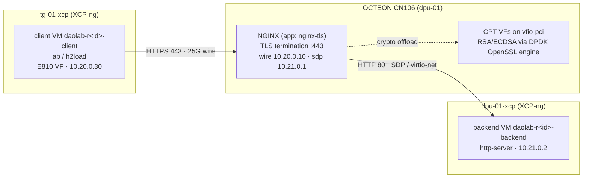

# First use case — NGINX TLS proxy (separate backend)

Part of the daolab implementation plan — see [README.md](README.md) for the doc map.

## Goal and references

The first use case daolab must run end-to-end is **`tls-proxy-nginx`**: the NGINX TLS termination
proxy from the [Marvell DAO application docs](https://marvellembeddedprocessors.github.io/dao/),
with RSA/ECDSA handshake crypto offloaded to the OCTEON's CPT block. The DAO docs describe two
variants: **separate-backend** (NGINX forwards decrypted traffic to a distinct upstream web
server) and **inbuilt-server** (NGINX serves the payload itself). We implement
`variant: separate-backend` first because it exercises every part of `setup-01`: both XCP-ng
hosts, the 25G wire, the SDP path, VM provisioning on both sides, and the IP callback. The
inbuilt-server variant is deferred; the last section lists exactly which YAML fields change.

Everything in this document is data plus playbook content — one YAML file
(`usecases/tls-proxy-nginx.yml`), inventory facts, and tasks inside the four shared playbooks.
Zero service-code changes (invariant: use cases and setups are data, never code). YAML schema:
[01-domain-model.md](01-domain-model.md). Playbook and inventory mechanics:
[05-provisioning.md](05-provisioning.md). State machine driving the runs:
[04-lifecycle-engine.md](04-lifecycle-engine.md).

## Topology and traffic path

Three roles land on `setup-01` (pool `lab-1`): the **proxy** runs directly on the OCTEON CN106
(member `dpu-01`, no VM), the **backend** is a VM on `dpu-01-xcp`, the **client** is a VM on
`tg-01-xcp` with an E810 VF passed through. The client requests the payload over HTTPS 443; NGINX
on the OCTEON terminates TLS (RSA/ECDSA offloaded to CPT VFs via the DPDK OpenSSL engine) and
forwards plain HTTP over the SDP/virtio-net path to the backend VM.



Addressing plan (data segments are static, configured by the playbooks; management is DHCP):

| Segment | Subnet | proxy (OCTEON) | backend VM | client VM |
|---|---|---|---|---|
| lab management (XCP-ng VIF / Ansible reach) | site DHCP | OCTEON mgmt IP (inventory host `dpu-01`) | DHCP → posted as `vms.ip`, used for `ssh` | DHCP → posted as `vms.ip`, used for `ssh` |
| wire — client E810 VF ↔ CN106 port (link capability `wire`) | 10.20.0.0/24 | **10.20.0.10** — posted as the proxy role's `vms.ip` | — | 10.20.0.30 |
| sdp — SDP virtio-net ↔ backend VIF (capability `sdp`) | 10.21.0.0/24 | 10.21.0.1 | 10.21.0.2 | — |

Key decision: for the `on: dpu` role, `dpu_prepare.yml` posts the **wire-facing data IP**
(10.20.0.10) to `POST /internal/vm-ip`, not the OCTEON's management IP. `verify.yml` substitutes
`{proxy_ip}` from that `vms.ip`, so the h2load traffic is forced across the 25G wire through the
client's E810 VF — the checkpoint measures the real datapath. VM roles post their management IP
(that is what the `ssh` field needs). The mermaid diagram shown on admin.html comes verbatim from
the `diagram` block of `setups/setup-01.yml` ([06-frontend.md](06-frontend.md)); the diagram
above is documentation, not a second source of topology truth.

## Role deep dive — proxy on the OCTEON

The proxy role is `proxy: {on: dpu, app: nginx-tls, crypto: cpt-vfs, upstream: backend}`. It is
provisioned entirely by `playbooks/dpu_prepare.yml` against inventory host `dpu-01`. Ordered
steps (each idempotent — engine retry = run again):

1. **EBF personality `sdp-pf1-vf8`** — SDP enabled, 1 PF, 8 VFs exposed across PCIe to
   `dpu-01-xcp` (that is what carries the proxy→backend hop). `playbooks/roles/ebf_set` flashes
   it and reboots the board **iff** the `hw_class` extravar differs from the DPU's current
   `resources.hw_class`; equal means skip entirely. Until `ebf_set` is implemented for the board
   it stays a stub: flash `sdp-pf1-vf8` manually once and record it in
   `inventory/host_vars/dpu-01.yml` (`hw_class:`).
2. **CPT firmware** — install the `cpt-firmware-cn10k` package (CPT microcode). Package present
   ⇒ no-op.
3. **CPT VFs = logical CPU count, bound to `vfio-pci`** — NGINX runs `worker_processes auto`
   (one worker per logical CPU) and the DPDK OpenSSL engine wants one CPT VF per worker:

   ```sh
   # cpt_pf BDF comes from inventory/host_vars/dpu-01.yml (bdf:)
   NVF=$(nproc)
   CUR=$(cat /sys/bus/pci/devices/${cpt_pf}/sriov_numvfs)
   [ "$CUR" = "$NVF" ] || echo "$NVF" > /sys/bus/pci/devices/${cpt_pf}/sriov_numvfs
   for vf in /sys/bus/pci/devices/${cpt_pf}/virtfn*; do
     dpdk-devbind.py -b vfio-pci "$(basename "$(readlink "$vf")")"
   done
   ```

   Guarded on current count and current driver, so a re-run changes nothing.
4. **DAO NGINX build** — build NGINX per the DAO tls-proxy-nginx docs against the DAO OpenSSL
   with the DPDK engine (`dpdk_engine`), installed under `/usr/local/dao/nginx`. Idempotency
   guard: skip the build when `/usr/local/dao/nginx/sbin/nginx -V` already reports the pinned
   DAO revision.
5. **Self-signed certificate** — generated only if absent (`creates:` guard):

   ```sh
   mkdir -p /etc/nginx/certs
   openssl req -x509 -newkey rsa:2048 -nodes -days 365 \
     -keyout /etc/nginx/certs/daolab-proxy.key \
     -out    /etc/nginx/certs/daolab-proxy.crt \
     -subj   "/CN=10.20.0.10"
   ```
6. **Data-plane IPs** — wire port 10.20.0.10/24, SDP-side 10.21.0.1/24 (`ip addr replace`
   semantics; device names from `inventory/host_vars/dpu-01.yml`).
7. **nginx.conf template + (re)start** — templated by `dpu_prepare.yml`; the upstream address is
   the backend's static SDP IP, so there is no ordering dependency on `host_vm.yml`:

   ```nginx
   # /usr/local/dao/nginx/conf/nginx.conf — templated by dpu_prepare.yml
   worker_processes  auto;               # one worker per logical CPU = one CPT VF each
   ssl_engine        dpdk_engine;        # DPDK OpenSSL engine -> CPT VFs (crypto: cpt-vfs)

   events { worker_connections 1024; }

   http {
     server {
       listen 443 ssl;
       server_name _;
       ssl_certificate     /etc/nginx/certs/daolab-proxy.crt;
       ssl_certificate_key /etc/nginx/certs/daolab-proxy.key;
       ssl_protocols       TLSv1.2 TLSv1.3;
       ssl_asynch          on;           # async offload path of the DAO NGINX build
       location / {
         proxy_pass http://10.21.0.2:80; # upstream: backend — plain HTTP over SDP
       }
     }
   }
   ```
8. **IP callback** — `POST /internal/vm-ip` with
   `{"reservation_id": <id>, "role": "proxy", "ip": "10.20.0.10"}` and header
   `X-Daolab-Secret` (extravars `daolab_api_url`, `daolab_internal_secret`).

## Role deep dive — backend VM on dpu_host

Role: `backend: {on: dpu_host, vm: tpl-ubuntu2204-dao, install: http-server, connect: sdp}`.
`on: dpu_host` resolves to `dpu-01-xcp` (the XCP-ng `host` of the `kind: dpu` member).
Provisioned by `playbooks/host_vm.yml`:

- **Clone** `tpl-ubuntu2204-dao` → VM `daolab-r<reservation_id>-backend` (skip if the VM name
  already exists). The template already carries xe-guest-utilities and the first-boot script that
  reads `vm-data/user` and `vm-data/ssh_key` from xenstore and creates the user — `host_vm.yml`
  sets both via `xe vm-param-set xenstore-data:...` from the `user` / `ssh_pubkey` extravars.
- **SDP connectivity** (`connect: sdp`) — with hw_class `sdp-pf1-vf8`, dom0 on `dpu-01-xcp` sees
  the SDP PF plus 8 VFs on PCIe; those VFs are already claimed by pciback (one-time
  `/etc/modprobe.d/pciback.conf`, never per reservation). `host_vm.yml` attaches one free SDP VF:
  `xe vm-param-set uuid=<vm> other-config:pci=0/<bdf>` with the BDF taken from
  `inventory/host_vars/dpu-01-xcp.yml`. Inside the guest it appears as a virtio-net-style netdev
  carrying frames to/from the OCTEON.
- **IP plumbing** — boot, wait for xe-guest-utilities to report the management IP, post it via
  `POST /internal/vm-ip` (`role: "backend"`); then in-guest, a netplan drop-in matches the SDP
  netdev by PCI address and sets static `10.21.0.2/24`, no gateway (management VIF stays DHCP).
- **Software + payload** — the `install: http-server` token maps in `host_vm.yml` to
  `apt-get install -y apache2` (chosen for its unambiguous access log), plus payload files:
  `/var/www/html/index.html` (one line naming the reservation) and
  `/var/www/html/payload-64k.bin` (`dd if=/dev/urandom of=... bs=1024 count=64`). Role software
  is never baked into the template.

## Role deep dive — client VM on tg_host

Role: `client: {on: tg_host, vm: tpl-ubuntu2204-dao, install: [ab, h2load], connect: e810-vf}`.
`on: tg_host` resolves to `tg-01-xcp` (the XCP-ng `host` of the `kind: nic` member). Same
`host_vm.yml` flow as the backend, differing only in the wiring and package tasks:

- **Clone** `tpl-ubuntu2204-dao` → `daolab-r<reservation_id>-client`; xenstore `vm-data/user`
  and `vm-data/ssh_key` as above.
- **E810 VF passthrough** (`connect: e810-vf`) — E810 VFs were created once in dom0 on
  `tg-01-xcp` and listed in `/etc/modprobe.d/pciback.conf` during Phase 1 (visible in
  `xl pci-assignable-list`). `host_vm.yml` attaches one via `other-config:pci=0/<bdf>`, BDF from
  `inventory/host_vars/tg-01-xcp.yml`. The guest sees an `iavf` netdev on the 25G wire.
- **IP plumbing** — management IP posted via `POST /internal/vm-ip` (`role: "client"`); netplan
  sets static `10.20.0.30/24` on the VF netdev, so `https://10.20.0.10/` routes over the wire.
- **Software** — `ab` maps to `apache2-utils`, `h2load` to `nghttp2-client`
  (`apt-get install -y apache2-utils nghttp2-client`).

## The complete usecases/tls-proxy-nginx.yml

Final form, valid against the use-case YAML contract in [01-domain-model.md](01-domain-model.md):

```yaml
# usecases/tls-proxy-nginx.yml
name: tls-proxy-nginx                 # must equal the file stem
variant: separate-backend             # docs also describe: inbuilt-server (deferred)
requires: [octeon-cn106, e810, wire]  # capability match only — no hostnames
hw_class: sdp-pf1-vf8                 # SDP, 1 PF, 8 VFs — the proxy->backend path
roles:
  proxy:   {on: dpu,      app: nginx-tls, crypto: cpt-vfs, upstream: backend}
  backend: {on: dpu_host, vm: tpl-ubuntu2204-dao, install: http-server, connect: sdp}
  client:  {on: tg_host,  vm: tpl-ubuntu2204-dao, install: [ab, h2load], connect: e810-vf}
verify: {from: client, cmd: "h2load -n1000 https://{proxy_ip}/", expect: "200: 1000"}
```

Trace: `requires` ⊆ setup-01's computed capabilities `[e810, octeon-cn106, sdp, wire]`, so the
scheduler matches it ([03-scheduler.md](03-scheduler.md)); `upstream: backend` names a sibling
role; `connect` values `sdp` / `e810-vf` are data — a new value needs no code change; `from:
client` exists in `roles`; after `daolab sync` this file flips the catalog row to `active`.

## Per-role playbook task mapping

Which tasks each role contributes to the shared playbooks (run order top to bottom):

| Playbook | # | Task | Role | Idempotency guard |
|---|---|---|---|---|
| `dpu_prepare.yml` | 1 | `roles/ebf_set`: flash `sdp-pf1-vf8` + reboot | proxy | only iff `hw_class` extravar ≠ current `resources.hw_class` |
| `dpu_prepare.yml` | 2 | install `cpt-firmware-cn10k` | proxy | package already present |
| `dpu_prepare.yml` | 3 | create CPT VFs = `nproc`, bind `vfio-pci` | proxy | current `sriov_numvfs` + driver checked first |
| `dpu_prepare.yml` | 4 | build/install DAO NGINX + DPDK OpenSSL engine | proxy | pinned rev in `nginx -V` |
| `dpu_prepare.yml` | 5 | self-signed cert | proxy | `creates:` on the key file |
| `dpu_prepare.yml` | 6 | wire 10.20.0.10/24 + sdp 10.21.0.1/24 | proxy | `ip addr replace` |
| `dpu_prepare.yml` | 7 | template nginx.conf, (re)start nginx | proxy | template + restart handler |
| `dpu_prepare.yml` | 8 | `POST /internal/vm-ip` (proxy, 10.20.0.10) | proxy | API upserts `vms.ip` |
| `host_vm.yml` | 9 | clone `tpl-ubuntu2204-dao` → `daolab-r<reservation_id>-<role>` | backend, client | skip if VM name exists |
| `host_vm.yml` | 10 | xenstore `vm-data/user`, `vm-data/ssh_key` | backend, client | rewrite same values |
| `host_vm.yml` | 11 | attach passthrough: SDP VF (backend) / E810 VF (client) | per role | skip if `other-config:pci` set |
| `host_vm.yml` | 12 | boot; wait for guest-tools IP | backend, client | running VM ⇒ no-op |
| `host_vm.yml` | 13 | `POST /internal/vm-ip` (role, mgmt IP) | backend, client | API upserts `vms.ip` |
| `host_vm.yml` | 14 | in-guest static data IP (10.21.0.2 / 10.20.0.30) | per role | netplan file content |
| `host_vm.yml` | 15 | in-guest install per `install:` token | per role | apt is idempotent |
| `host_vm.yml` | 16 | payload files under `/var/www/html/` | backend | `creates:` guards |
| `verify.yml` | 17 | substitute `{proxy_ip}`, run `cmd` on the `from` role's VM, assert `expect` in stdout | client | read-only |
| `teardown.yml` | 18 | destroy VMs, stop nginx, remove reservation config | all | absent ⇒ no-op |

DIY reservations run `host_vm.yml` only (no `dpu_prepare.yml`, no `verify.yml`), so tasks 1–8
and 17 never touch a DIY run.

## Verify procedure

Automated (`verify.yml`, driven verbatim by the YAML `verify` block): resolve `{proxy_ip}` from
the proxy role's `vms.ip` (10.20.0.10), then on the client VM run
`h2load -n1000 https://10.20.0.10/` and assert the substring `200: 1000` in stdout — all 1000
requests answered 200 across the wire, through TLS termination, to the backend and back.

Manual corroboration for the Phase-1 checkpoint:

1. **Backend saw plain HTTP** — on the backend VM:
   `sudo tail -n 5 /var/log/apache2/access.log` shows `GET / HTTP/1.1" 200` entries with client
   address `10.21.0.1` — the proxy's SDP address, proving the decrypted hop.
2. **CPT actually did the crypto** — the default `h2load -n1000` opens one connection, hence one
   TLS handshake; to make counters move visibly, run `h2load -n1000 -c100 https://10.20.0.10/`
   (100 handshakes). On the OCTEON, read the CPT instruction counters before and after (debugfs
   path per the CN10K SDK kernel, e.g. under `/sys/kernel/debug/cn10k/cpt/`) and confirm the
   delta ≈ the handshake count; additionally the NGINX error log must show `dpdk_engine`
   initialising against the CPT VF queue pairs at startup. If the counters do not move, the
   handshakes were done in software and the run fails review even with `200: 1000`.

## Manual Phase 1 bring-up walkthrough

Goal (per README Phase 1): run every playbook by hand, once, successfully, for
`tls-proxy-nginx`, with `reservation_id=0` (reserved for manual runs, never issued by the DB).

1. **OCTEON facts** — `ssh dpu-01 'lspci -D; ls /sys/bus/platform/devices'`; record the CPT PF,
   SDP PF and wire port BDFs under `bdf:` plus the current `hw_class:` in
   `inventory/host_vars/dpu-01.yml`.
2. **XCP-ng facts** — on each host: `xl pci-assignable-list` and `xe sr-list`; fill
   `inventory/host_vars/dpu-01-xcp.yml` (SDP VF BDFs, SR uuid) and
   `inventory/host_vars/tg-01-xcp.yml` (E810 VF BDFs, SR uuid).
3. **One-time dom0 pciback** — add every VF you will ever pass through (E810 VFs on `tg-01-xcp`,
   SDP VFs on `dpu-01-xcp`) to `/etc/modprobe.d/pciback.conf`; reboot each dom0 once; confirm
   with `xl pci-assignable-list`. Never repeated per reservation.
4. **Base template** — build `tpl-ubuntu2204-dao` (Ubuntu 22.04 + xe-guest-utilities + the
   first-boot script reading `vm-data/user` and `vm-data/ssh_key` from xenstore). No role
   software baked in.
5. **OCTEON prep** — install `cpt-firmware-cn10k`; create and bind CPT VFs (= `nproc`) to
   `vfio-pci`; build DAO NGINX with the DPDK OpenSSL engine. This is exactly what
   `dpu_prepare.yml` automates. If `playbooks/roles/ebf_set` is still the stub, flash
   `sdp-pf1-vf8` manually and record it in `inventory/host_vars/dpu-01.yml`.
6. **API for the IP callback** — `cp .env.example .env`, set `DAOLAB_INTERNAL_SECRET`, run
   `make api` — or comment out the `POST /internal/vm-ip` task in `host_vm.yml` for this run.
7. **Run the playbooks in order**, same extravars each time:

   ```sh
   ansible-playbook -i inventory/hosts.yml playbooks/dpu_prepare.yml \
     -e reservation_id=0 -e usecase=tls-proxy-nginx -e setup=setup-01 \
     -e user=<you> -e ssh_pubkey="$(cat ~/.ssh/id_ed25519.pub)"
   ansible-playbook -i inventory/hosts.yml playbooks/host_vm.yml   # same -e flags
   ansible-playbook -i inventory/hosts.yml playbooks/verify.yml    # same -e flags
   ansible-playbook -i inventory/hosts.yml playbooks/teardown.yml  # same -e flags
   ```

   VMs appear as `daolab-r0-backend` and `daolab-r0-client`.
8. **Idempotency proof** — before teardown, run `dpu_prepare.yml` and `host_vm.yml` a second
   time; both must finish with `changed=0`. This is the property the engine's retry rule
   (`DAOLAB_MAX_RETRIES`) depends on.
9. **Checkpoint** — from the client VM, `h2load -n1000 https://10.20.0.10/` returns 1000×200 and
   the backend VM's access log shows plain-HTTP hits (previous section). Only then move to
   Phase 2.

## Teardown behavior and persisted state

`teardown.yml` removes reservation-scoped state and deliberately leaves machine-scoped state in
place:

| Removed by `teardown.yml` | Persists after `released` |
|---|---|
| VMs `daolab-r<reservation_id>-backend` / `-client` (force shutdown, destroy VM + disks) | EBF personality `sdp-pf1-vf8` on the board **and** `resources.hw_class` in the DB — teardown never resets it |
| NGINX stopped; reservation nginx.conf and `/etc/nginx/certs/*` removed on the OCTEON | `cpt-firmware-cn10k`, the DAO NGINX build, CPT VF `vfio-pci` binding (re-asserted by the next `dpu_prepare.yml`) |
| — | dom0 pciback config and the created VFs (one-time, never per reservation) |
| — | `tpl-ubuntu2204-dao` on both hosts |

The hw_class persistence is the scheduling payoff: the next `tls-proxy-nginx` reservation finds
`resources.hw_class = 'sdp-pf1-vf8'` already matching, so the scheduler and engine use the short
lead (`DAOLAB_PROVISION_LEAD_MIN`, 5 min) and `ebf_set` is skipped. Only a future use case
declaring a *different* `hw_class` triggers a reflash and the long lead
(`DAOLAB_HW_CLASS_LEAD_MIN`, 15 min). See [03-scheduler.md](03-scheduler.md) for how the lead
enters placement.

## Adding the inbuilt-server variant later

The inbuilt-server variant is a **new YAML file** — `usecases/tls-proxy-nginx-inbuilt.yml`
(`name` must equal the file stem and be unique) — not an edit of the existing one, so both
variants stay reservable side by side. Field-by-field diff:

| Field | separate-backend (today) | inbuilt-server (later) |
|---|---|---|
| `name` | `tls-proxy-nginx` | `tls-proxy-nginx-inbuilt` |
| `variant` | `separate-backend` | `inbuilt-server` |
| `requires` | `[octeon-cn106, e810, wire]` | unchanged |
| `hw_class` | `sdp-pf1-vf8` | unchanged — deliberately, so alternating variants never trigger `ebf_set` and always get the short lead |
| `roles.proxy` | `{on: dpu, app: nginx-tls, crypto: cpt-vfs, upstream: backend}` | drops `upstream` — NGINX serves the payload from its local root |
| `roles.backend` | present | **deleted** — no `dpu_host` VM, no SDP hop |
| `roles.client` | unchanged | unchanged |
| `verify` | `{from: client, cmd: "h2load -n1000 https://{proxy_ip}/", expect: "200: 1000"}` | unchanged verbatim |

One playbook-template consequence, still zero service code: the `dpu_prepare.yml` nginx.conf
template branches on whether the `on: dpu` role carries `upstream` — present ⇒ `proxy_pass` to
the upstream role's static IP; absent ⇒ `root /var/www/dao-payload;` with locally generated
payload files. `daolab sync` picks up the new file and the catalog row appears on user.html with
no frontend change.
