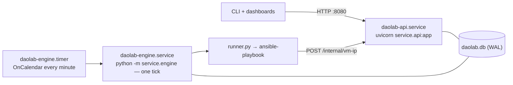

# CLI, configuration, and operations

Part of the daolab implementation plan — see [README.md](README.md) for the doc map.

This document specifies `service/cli.py` (the `daolab` console script), `service/config.py`
(the `.env` settings surface), the `Makefile`, deployment as systemd units, and day-2
operations: backups, token hygiene, troubleshooting. The API semantics behind the CLI live in
[02-backend-api.md](02-backend-api.md); engine mechanics in
[04-lifecycle-engine.md](04-lifecycle-engine.md); playbooks and inventory in
[05-provisioning.md](05-provisioning.md).

## CLI reference — `daolab init | sync | add-user | reserve | status`

Installed by `pyproject.toml` as console script `daolab = "service.cli:main"` (`make setup`).
`init` and `sync` open the DB directly at `DAOLAB_DB_PATH`; `reserve` and `status` are thin
HTTP clients over `DAOLAB_API_URL` authenticating with `DAOLAB_TOKEN`. **Exit codes, all
verbs: `0` success, `1` any error** (validation failure, API error response, duplicate user).
Errors print to stderr as `error: <code>: <message>` using the API error model's `code` when
the error came from the API. All timestamps are UTC ISO-8601 `YYYY-MM-DDTHH:MM:SSZ`; `reserve`
additionally accepts `YYYY-MM-DDTHH:MM` (interpreted as UTC) and the literal `now`.

| Verb | Arguments | Flags | Talks to |
|---|---|---|---|
| `init` | — | — | DB |
| `sync` | — | — | DB |
| `add-user` | `USERNAME PUBKEY_PATH` | `--role {admin,user}` (default `user`) | DB |
| `reserve` | `USECASE START` | `--hours N` (default `1`), `--setup NAME`, `--template HOST=TEMPLATE` (repeatable) | API |
| `status` | — | `--all` (admin token required) | API |

### `daolab init`

Creates the sqlite file at `DAOLAB_DB_PATH`, applies the `service/schema.sql` baseline, then
every pending migration from `service/migrations.py` (tracked in `PRAGMA user_version`),
enables WAL, seeds the 15 planned catalog rows from the README use-case table (`yaml_path`
NULL) plus the `diy` pseudo-row (`yaml_path = 'builtin'`). Idempotent: safe to re-run, never
overwrites existing rows, and upgrades an older DB in place without wiping data. Exit `1` if the
DB's schema is newer than this checkout.

```
$ daolab init                      # first run, or an older DB being upgraded
db: ./daolab.db (journal_mode=wal)
schema: v1 (applied: v1)
usecases seeded: 15 planned + diy

$ daolab init                      # re-run: no-op
db: ./daolab.db (journal_mode=wal)
schema: v1 (up to date)
usecases seeded: 15 planned + diy
```

### `daolab sync`

Loads and validates every `usecases/*.yml` and `setups/*.yml` (`DAOLAB_USECASES_DIR`,
`DAOLAB_SETUPS_DIR`), mirrors them into the DB (upsert by `name`), auto-creates pools,
recomputes capability unions, refreshes `resources` rows. Rows whose YAML disappeared are
deleted unless referenced by a reservation not in `released`/`failed` — then sync fails naming
the blocking reservation. On any validation error: exit `1`, one `file: field: problem` line
per error, **write nothing**.

```
$ daolab sync
setups: setup-01 (pool lab-1, capabilities: e810, octeon-cn106, sdp, wire)
usecases: tls-proxy-nginx (variant separate-backend) -> active
ok

$ daolab sync        # after a bad edit
usecases/tls-proxy-nginx.yml: requires: must be a non-empty list
$ echo $?
1
```

### `daolab add-user USERNAME PUBKEY_PATH [--role {admin,user}]`

Reads the SSH public key file, generates `secrets.token_urlsafe(32)`, stores only
`sha256(token).hexdigest()` in `users.token_hash`, and prints the plaintext token **exactly
once** as `token: <token>` — it is unrecoverable afterwards (see Security operations for
rotation). Duplicate username → exit `1`. Default role is `user`.

```
$ daolab add-user hrushi ~/.ssh/id_ed25519.pub
token: 4qXo9vGm1cT7ZfWkH2sYpBad3nRjLu8eKQxOI5wDyhc

$ daolab add-user ops ~/.ssh/id_ed25519.pub --role admin
token: kV7dPq2zXnJ4mW9sRtY6bC1gHf8aLoE3uNiT5wZxQjM
```

### `daolab reserve USECASE START [--hours N] [--setup NAME] [--template HOST=TEMPLATE ...]`

> **Deploy access:** `--ssh-key PUBKEY_PATH` logs in with that key instead of the registered
> one; `--password` asks for a generated password instead of a key (shown by `daolab status`
> once the slot is live). Either way the output names the access line, `ssh lab@10.68.0.190`.

`START` is `YYYY-MM-DDTHH:MM[:SS]` (UTC) or `now`. `--hours` positive integer, default `1`.
`--setup` and `--template` (one per VM host of the setup) are **required when `USECASE` is
`diy` and forbidden otherwise** — violations surface as the API's `422 validation_error`.
Calls `POST /reservations`; prints the granted reservation (`id`, `setup`,
`start_at → end_at`, `state`) and, when slot-shifted, a line `shifted from
<requested_start_at>`. Slot conflicts are never errors ([03-scheduler.md](03-scheduler.md)).

```
$ DAOLAB_TOKEN=<token> daolab reserve tls-proxy-nginx 2026-09-01T10:00 --hours 2
id: 12  setup: setup-01  state: queued
slot: 2026-09-01T10:00:00Z -> 2026-09-01T12:00:00Z

$ DAOLAB_TOKEN=<token> daolab reserve tls-proxy-nginx 2026-09-01T10:00 --hours 2
id: 13  setup: setup-01  state: queued
slot: 2026-09-01T12:00:00Z -> 2026-09-01T14:00:00Z
shifted from 2026-09-01T10:00:00Z

$ DAOLAB_TOKEN=<token> daolab reserve diy now --hours 4 --setup setup-01 \
    --template dpu-01-xcp=tpl-ubuntu2204-dao --template tg-01-xcp=tpl-ubuntu2204-dao
id: 14  setup: setup-01  state: queued
slot: 2026-08-30T12:00:00Z -> 2026-08-30T16:00:00Z

$ DAOLAB_TOKEN=<token> daolab reserve ovs-offload now
error: usecase_unavailable: ovs-offload is planned (no YAML yet)
$ echo $?
1
```

### `daolab status [--all]`

Calls `GET /reservations` (`?all=1` with `--all`; admin token required). One row per
reservation: `id`, `usecase`, `setup`, `state`, `start_at`, `end_at`; for `ready`/`active`
reservations also one `ssh <user>@<ip>` line per VM role (`on: dpu` roles have no VM, hence no
ssh line — the proxy is reached at its posted `ip`).

```
$ DAOLAB_TOKEN=<token> daolab status
id  usecase          setup     state     start_at              end_at
12  tls-proxy-nginx  setup-01  ready     2026-09-01T10:00:00Z  2026-09-01T12:00:00Z
      ssh hrushi@10.20.0.21   (backend)
      ssh hrushi@10.20.0.31   (client)
13  tls-proxy-nginx  setup-01  queued    2026-09-01T12:00:00Z  2026-09-01T14:00:00Z
```

## Configuration reference — `.env.example`

`service/config.py` loads `.env` from the repo root via `python-dotenv`; real environment
variables take precedence over `.env` values (dotenv default). `.env.example` lists every
setting with its default; `cp .env.example .env` is part of Phase 0. Keep lines as plain
`KEY=value` (no `export`, no quotes) so the same file doubles as a systemd `EnvironmentFile`
(see Deployment).

| Variable | Default | Read by | Meaning |
|---|---|---|---|
| `DAOLAB_DB_PATH` | `./daolab.db` | cli, api, engine | Path to the sqlite database file. |
| `DAOLAB_API_HOST` | `0.0.0.0` | api | Bind address for `make api`. |
| `DAOLAB_API_PORT` | `8080` | api | Bind port for `make api`. |
| `DAOLAB_API_URL` | `http://localhost:8080` | cli, engine | API base URL used by the CLI and passed to playbooks (extravar `daolab_api_url`) for the VM-IP callback. |
| `DAOLAB_TOKEN` | *(empty)* | cli | Bearer token for `daolab reserve` / `daolab status` — per user, not in `.env` on shared machines. |
| `DAOLAB_INTERNAL_SECRET` | *(empty — must be set)* | api, engine | Shared secret for `POST /internal/vm-ip` (`X-Daolab-Secret`); passed to playbooks as `daolab_internal_secret`. API refuses the callback while empty. |
| `DAOLAB_USECASES_DIR` | `./usecases` | cli (sync) | Directory scanned by `daolab sync`. |
| `DAOLAB_SETUPS_DIR` | `./setups` | cli (sync) | Directory scanned by `daolab sync`. |
| `DAOLAB_INVENTORY` | `./inventory/hosts.yml` | engine (runner) | Ansible inventory passed to every playbook run. |
| `DAOLAB_PLAYBOOKS_DIR` | `./playbooks` | engine (runner) | Directory with `deploy.yml`, `cleanup.yml`, `probe.yml`, `verify_clean.yml`, `reconcile.yml`, `orphans.yml`, `bringup.yml` and `ansible.cfg` (B-80/B-84). |
| `DAOLAB_DASHBOARD_DIR` | `./dashboard` | api | Static directory served by `api.py` (`user.html`, `admin.html`). |
| `DAOLAB_HW_CLASS_LEAD_MIN` | `15` | api (scheduler), engine | Lead minutes before `start_at` when the use case's `hw_class` differs from the DPU's current one (EBF reflash time). |
| `DAOLAB_PROVISION_LEAD_MIN` | `5` | api (scheduler), engine | Lead minutes before `start_at` when no `hw_class` change is needed. |
| `DAOLAB_CLEANUP_MIN` | `10` | api (scheduler) | Turnaround buffer blocked after every reservation's `end_at` (B-11); the gap between two bookings is this plus the next booking's lead. |
| `DAOLAB_SLOT_MIN` | `30` | api (scheduler) | Start-time grid in minutes after UTC midnight (B-12); `asap` rounds up to it, `at` must be on it. Must be ≥ 1. |
| `DAOLAB_RUNNER` | `ansible` | engine | Backend of `service/runner.py`: `ansible` runs the playbooks through ansible-runner (B-84; `pip install -e .[ansible]`), `mock` (no testbed) sleeps through each step and records it on the job. Any other value is a configuration error. |
| `DAOLAB_MOCK_STEP_SEC` | `5` | engine (mock runner) | Seconds the mock sleeps before each step; a default deploy has 6 steps, so about 30 s. `0` makes it instant (tests). Must be ≥ 0. |
| `DAOLAB_MOCK_FAIL` | *(empty)* | engine (mock runner) | Failure injection: empty, or a comma-separated subset of `deploy` (fails at `create_vms`), `cleanup` (cleanup looks fine but residue survives verify and reconcile, so the setup is quarantined) and `health` (the fake telemetry exporter never starts, so health reads `unknown`). |
| `DAOLAB_JOB_TIMEOUT_SEC` | `1800` | engine | Crash recovery (B-26): a `running` job with no recorded step for this many seconds is presumed dead and put back to `pending`. Must be > 0 and longer than the longest silent stretch of a healthy job. |
| `DAOLAB_ENGINE_INTERVAL_SEC` | `60` | engine | Sleep between ticks in `python -m service.engine --loop`. |
| `DAOLAB_MAX_RETRIES` | `3` | engine | Deploy attempts before the reservation is `failed` and an automatic cleanup job runs (B-25). |
| `DAOLAB_SCHED_HORIZON_HOURS` | `168` | api (scheduler) | Slot-shift / availability search horizon (7 days). |
| `DAOLAB_WEBHOOK_URL` | *(empty)* | engine | If set, the engine POSTs `{event: reservation.health_down, …}` here when an active reservation's health flips to `down` (B-67), at most once per flip. |
| `DAOLAB_LOG_LEVEL` | `INFO` | api, engine, cli | Log level for api/engine/cli. |
| `DAOLAB_ALLOW_DESTRUCTIVE` | `false` | engine (runner) | The owner sign-off the VPP / SmartNIC runbook playbooks require (`allow_destructive_changes`, `allow_launch`, `allow_cleanup`): they stop nginx-tls, rebind PCI devices and set hugepages on a shared board. Off: a VPP deploy that would take the live port refuses up front with the runbook's message. Turn on once the board's owner agreed that dashboard deploys may do this. |
| `DAOLAB_DEPLOY_VMS` | `true` (`.env.example`: `false`) | engine (runner) | Create the use cases' VMs on the XCP-ng host. Off: deploys are DPU-only and no playbook (deploy, cleanup, verify, reconcile, orphan sweep) reaches the XCP-ng host — keep it off until `tb-01-xcp` is in the inventory. |
| `DAOLAB_IP_POOL` | `10.68.1.0-10.68.2.200` | cli (sync) | The VMs' management addresses, leased per reservation (B-41/B-43). DPUs are static (inventory `ansible_host`) and never leased. Shrinking it never drops a live lease. |
| `DAOLAB_RECONCILE_ATTEMPTS` | `2` | engine | Reconcile + verify rounds a cleanup job tries when residue is found, before the setup is quarantined (B-71). `0` quarantines on the first residue. |
| `DAOLAB_EARLY_ACCESS` | `false` | api | Let a `ready` reservation's key open the DPU before `start_at` (B-50). |
| `DAOLAB_OTEL_ENDPOINT` | *(empty)* | api, engine, runner | The OTel collector (OTLP gRPC) for the API / engine traces and the Ansible callback (B-61/B-62/B-63). Empty: tracing, the engine's health evaluation and the agents are off; health falls back to the probe job. |
| `DAOLAB_OTEL_AGENT_ENDPOINT` | *(empty)* | engine (runner) | The collector address the DPU / VM agents send to (B-83) — a lab-reachable `host:4317`, not `localhost`. Empty: no agents are installed. |
| `DAOLAB_PROMETHEUS_URL` | `http://localhost:9090` | api, engine | Where health rules are evaluated (B-65). |
| `DAOLAB_HEALTH_STALE_SEC` | `120` | api, engine | No telemetry for a reservation for this long -> health `unknown`. |
| `DAOLAB_AUTHZ_SECRET` | *(empty)* | api | Optional read-only secret for `GET /internal/authz/keys` (the strict `daolab-keys` mode on the DPU, B-51/B-52); the internal secret is accepted too. |
| `DAOLAB_ARTIFACTS_DIR` | `./var/jobs` | engine (runner) | Per-job ansible-runner artifacts; `job-<id>/job.log` is the job's log shown by `GET /jobs/{id}` (B-84). |
| `DAOLAB_MAX_LIVE_RESERVATIONS` / `DAOLAB_MAX_FUTURE_RESERVATIONS` | `1` / `2` | api | Per-user quota (B-15); admins are exempt. |

## Make targets

One `Makefile` at repo root; dependencies come from `pyproject.toml` (there is no
`requirements.txt`).

| Target | Command | Purpose |
|---|---|---|
| `setup` | `python -m pip install -e ".[ansible]"` | Install dependencies (incl. ansible-core + ansible-runner for the real runner) + the `daolab` console script into the active venv. |
| `test` | `python -m pytest tests/ -q` | The whole suite, no hardware: unit + API tests, the real playbooks against a fake testbed (needs ansible-playbook), and the dashboard in a browser (needs Playwright + Chromium; skipped otherwise). |
| `api` | `python -m uvicorn service.api:app --host $(DAOLAB_API_HOST) --port $(DAOLAB_API_PORT)` | Serve the API + dashboards (defaults → `http://localhost:8080`). |
| `engine` | `python -m service.engine --loop` | Lifecycle loop, one tick per `DAOLAB_ENGINE_INTERVAL_SEC`. `python -m service.engine` with no flag runs **one tick and exits** — that form is for the systemd timer. Exit code 1 (with a message on stderr) if the database is not at the latest schema version or `DAOLAB_RUNNER` is invalid (B-23). |

## Deployment — systemd units and logs

Production layout: repo checkout at `/opt/daolab`, venv at `/opt/daolab/.venv`, settings in
`/opt/daolab/.env` (with `DAOLAB_INTERNAL_SECRET` set and `DAOLAB_API_URL` pointing at the API
host's lab address so playbook callbacks resolve). Two units share the sqlite file through WAL:



```ini
# /etc/systemd/system/daolab-api.service
[Unit]
Description=daolab API and dashboards
After=network.target

[Service]
User=daolab
WorkingDirectory=/opt/daolab
EnvironmentFile=/opt/daolab/.env
ExecStart=/opt/daolab/.venv/bin/python -m uvicorn service.api:app --host ${DAOLAB_API_HOST} --port ${DAOLAB_API_PORT}
Restart=on-failure

[Install]
WantedBy=multi-user.target
```

```ini
# /etc/systemd/system/daolab-engine.service
[Unit]
Description=daolab engine tick (single pass)
After=daolab-api.service

[Service]
Type=oneshot
User=daolab
WorkingDirectory=/opt/daolab
EnvironmentFile=/opt/daolab/.env
ExecStart=/opt/daolab/.venv/bin/python -m service.engine
```

```ini
# /etc/systemd/system/daolab-engine.timer
[Unit]
Description=Run the daolab engine every minute

[Timer]
OnCalendar=*-*-* *:*:00
Persistent=true

[Install]
WantedBy=timers.target
```

```
systemctl daemon-reload
systemctl enable --now daolab-api.service daolab-engine.timer
curl -s http://localhost:8080/health        # {"status": "ok"}
```

The oneshot single-tick engine makes the timer safe: overlapping ticks cannot happen
(systemd will not start the service while a previous run is active), and the engine's
single-flight-per-setup rule ([04-lifecycle-engine.md](04-lifecycle-engine.md)) bounds work per
tick. **Logs**: api and engine log to stdout at `DAOLAB_LOG_LEVEL`, captured by journald —
`journalctl -u daolab-api -f` and `journalctl -u daolab-engine --since -1h`. The
ansible-runner event stream returned by each `runner.py` call is logged by the engine, so a
failing playbook's task output appears under `daolab-engine`.

## Database operations

- **WAL mode** — `models.py` executes `PRAGMA journal_mode=WAL` and `PRAGMA foreign_keys=ON`
  on every connection; WAL is what lets the `api` and `engine` processes share the file safely.
  Sidecar files `daolab.db-wal` / `daolab.db-shm` appear next to `DAOLAB_DB_PATH`; keep the DB
  on a local filesystem (WAL's shared memory does not work over network mounts).
- **Backup** — never `cp` the live file; use sqlite's online backup, safe under WAL while both
  units run:
  ```
  sqlite3 /opt/daolab/daolab.db ".backup '/opt/daolab/backups/daolab-$(date -u +%Y%m%dT%H%M%SZ).db'"
  ```
  Run nightly (cron or another systemd timer), prune by age. Restore: stop
  `daolab-api.service` and `daolab-engine.timer`, replace `daolab.db`, delete stale
  `-wal`/`-shm` files, start again.
- **Schema evolution stance** — a small migration runner, no external framework.
  `service/schema.sql` is the frozen v0 baseline (every statement `CREATE ... IF NOT EXISTS`);
  every later change is a numbered, append-only migration in `service/migrations.py`, applied
  by `daolab init` and tracked in `PRAGMA user_version`. `init` is always safe to re-run and
  upgrades live rows in place — no hand-applied `ALTER TABLE`. Still take a `.backup` before
  upgrading a production DB. Catalog tables (`pools`, `setups`, `resources`, `usecases`) are
  fully regenerable from YAML via `daolab sync`; only `users`, `reservations`, `vms` carry
  state. A schema change = append a migration (idempotent, never edit a released one) + a test
  in `tests/test_migrations.py`. Dev databases can still be deleted and rebuilt (`daolab init`
  + `daolab sync` + `daolab add-user`).
- **Postgres trigger** — exactly one condition, per README Phase 4: move sqlite → Postgres
  **only if you get >1 API worker**. Data volume, user count, and uptime wishes are not
  triggers; a single uvicorn worker plus WAL covers this system's write rates.

## Security operations

- **Token storage** — `users.token_hash` holds only the SHA-256 hex of the bearer token; the
  plaintext exists once, on `add-user` stdout (`token: <token>`). A lost token cannot be
  recovered, only rotated. Tokens do not expire.
- **Token rotation** — re-running `add-user` for an existing username is an error; rotate by
  deleting the row and re-adding:
  ```
  sqlite3 "$DAOLAB_DB_PATH" "DELETE FROM users WHERE username='hrushi';"
  daolab add-user hrushi ~/.ssh/id_ed25519.pub
  ```
  With `foreign_keys=ON`, historical `reservations` rows referencing the user block the
  DELETE — clear that user's reservation history first (admin decision; it is audit data).
- **Disabling vs deleting** — to cut off a user, disable them from `admin.html`
  (`PATCH /users/{id}`, `{"enabled": false}`): the token stops working immediately
  (`403 user_disabled`) and reservation history stays intact. Deleting the row is only for
  token rotation (below).
- **Internal callback secret** — generate once with
  `python -c 'import secrets; print(secrets.token_urlsafe(32))'`, set as
  `DAOLAB_INTERNAL_SECRET` in `.env`. The API compares `X-Daolab-Secret` with
  `hmac.compare_digest` and refuses `POST /internal/vm-ip` while the variable is empty. The
  engine hands it to playbooks as extravar `daolab_internal_secret`. Rotate by editing `.env`
  and restarting `daolab-api.service` while no reservation is in `provisioning`
  (`daolab status --all`) — in-flight playbook runs carry the old value.
- **Lab network only** — tokens travel as plain bearer headers over HTTP, so the lab network
  is the perimeter. Bind `DAOLAB_API_HOST` to the lab-facing interface (the `0.0.0.0` default
  is acceptable only on a machine with no other network path), firewall port
  `DAOLAB_API_PORT` to the lab subnet, and never port-forward the API beyond it. The XCP-ng
  hosts and provisioned VMs must reach `DAOLAB_API_URL` for the VM-IP callback, so the API
  host lives on the same lab network as everything in `inventory/hosts.yml`. Dashboards keep
  the pasted token in browser `localStorage` ([06-frontend.md](06-frontend.md)) — use per-user
  tokens, never a shared one.

## Developer workflow — everything without hardware

Only playbook execution touches hardware; the scheduler is pure placement over its DB handle
and the API and dashboards run against sqlite alone. The one-shot path is
`scripts/run/dev.sh` (`--fresh` wipes the dev DB first): it creates the venv, installs, writes
`.env` with a generated internal secret, runs `init` + `sync`, rotates the two dev users
(`dev`, `dev-admin`) so it can print their tokens on every run, and serves API + dashboards in
the foreground. The manual Phase-0 bootstrap it automates:

```
python -m venv .venv && . .venv/bin/activate
make setup
cp .env.example .env          # set DAOLAB_INTERNAL_SECRET even in dev
daolab init
make test                     # scheduler tests pass, no hardware needed
```

**Test layout under `tests/`** — the canonical file is `tests/test_scheduler.py`: each test
opens `sqlite3.connect(":memory:")`, applies `service/schema.sql`, inserts fixture `setups` /
`resources` / `usecases` / `reservations` rows, and calls `scheduler.py` directly with a fixed
`now` — covering FCFS order, slot-shift, capability matching, the `hw_class` lead-time gap,
and the `DAOLAB_SCHED_HORIZON_HOURS` bound ([03-scheduler.md](03-scheduler.md)). New test
modules follow `tests/test_<module>.py` (e.g. `tests/test_catalog.py` for sync validation
errors, `tests/test_api.py` on FastAPI's `TestClient` over an in-memory DB). `make test` runs
the whole directory.

**Seeding data for frontend work** — populate real rows through the real code paths, then
point a browser at `http://localhost:8080`:

```
daolab sync                                        # loads usecases/tls-proxy-nginx.yml + setups/setup-01.yml
daolab add-user dev ~/.ssh/id_ed25519.pub          # note the token
daolab add-user dev-admin ~/.ssh/id_ed25519.pub --role admin
make api
DAOLAB_TOKEN=<dev token> daolab reserve tls-proxy-nginx 2026-09-01T10:00 --hours 2
DAOLAB_TOKEN=<dev token> daolab reserve tls-proxy-nginx 2026-09-01T10:00 --hours 2   # exercises slot-shift
```

Reserve future slots so rows stay `queued`; do not run `make engine` on a machine without
hardware unless you *want* due reservations to march to `failed` (itself a fair way to style
the failure UI). To fake a `ready` reservation for dashboard styling, edit the throwaway dev
DB by hand:

```
sqlite3 daolab.db "
UPDATE reservations SET state='ready' WHERE id=1;
INSERT INTO vms (reservation_id, role, host, template, name, ip, created_at, updated_at)
VALUES (1,'client','tg-01-xcp','tpl-ubuntu2204-dao','daolab-r1-client','10.20.0.31',
        strftime('%Y-%m-%dT%H:%M:%SZ','now'), strftime('%Y-%m-%dT%H:%M:%SZ','now'));"
```

Dev-only trick — production state changes belong to the engine and API exclusively.

## Operations runbook (B-91)

Who reads this: whoever is on lab duty. The two pages to keep open are `admin.html` (setups,
quarantine banner, every reservation with its job) and the engine's log
(`journalctl -u daolab-engine -f`, or the terminal running `dev.sh`).

### A deploy, end to end

A user clicks **Deploy**, chooses their SSH key (pre-filled) or a generated password, and gets
`ssh lab@10.68.0.190`. Behind it: the reservation is placed (`queued`), the engine starts it at
`start_at - lead` (`provisioning`, a `deploy` job), the runner runs `playbooks/deploy.yml`
(the app's runbook steps on the DPU, the `lab` login, telemetry, the VMs if
`DAOLAB_DEPLOY_VMS`), and the reservation is `ready` -> `active`. At `end_at` (or **End now**)
the reservation goes `cleaning`: `cleanup.yml` revokes the `lab` login first, runs the app's
runbook cleanup, destroys the VMs; `verify_clean.yml` then proves the board clean and the
leases are released. Every job's playbook output is in `var/jobs/job-<id>/job.log` (and its
tail in `GET /jobs/{id}`); its steps are on the reservation card.

### Before the first dashboard deploy

1. From the daolab host, `ssh dao-test@10.68.0.190` must work with a key (the runner connects
   as dao-test), and `sudo -n true` must work there.
2. `ansible-playbook -i inventory/hosts.yml playbooks/bringup.yml -e setup=tb-01
   -e daolab_deploy_vms=false` — fix everything it lists; it also writes the board's
   personality marker.
3. In `.env`: `DAOLAB_RUNNER=ansible`; `DAOLAB_ALLOW_DESTRUCTIVE=true` once the board's owner
   signed off; `DAOLAB_DEPLOY_VMS=false` until the XCP-ng host is in the inventory.
4. `daolab add-user <name> <pubkey file>` per user; hand them the token.

### A deploy failed

The card shows the failing step and message; `job.log` has the whole run. A deploy is retried
`DAOLAB_MAX_RETRIES` times (each a fresh job, one trace), then the reservation is `failed` and a
cleanup job runs. Common causes: `DAOLAB_ALLOW_DESTRUCTIVE` off (the runbook's sign-off
message); `ebf_set stub: board is X` (the board runs another personality: flash it, write
`/etc/daolab/hw_class`, retry); dao-test cannot sudo; the VPP runbook's step 11 needs nginx-tls
running to save its state. The user can deploy again once the cause is fixed.

### A setup is quarantined

Cleanup could not prove the board clean, even after `DAOLAB_RECONCILE_ATTEMPTS` reconcile
rounds. New deploys on it wait (their owners see them stay `queued`). `admin.html` shows a red
banner with each dirty reservation and its residue (`vm:…`, `vf:…`, `dpu_session:lab`,
`dpu_app:…`, `ip:…`).

1. Look at the residue and the cleanup job's `job.log`.
2. If the residue is real, remove it by hand on the board (or let the reconciler try again), then
   **Force clean (reconcile, then verify)**: a `reconcile` job runs per dirty reservation and the
   setup is `available` again when the last one verifies clean. If it is still dirty the setup
   stays quarantined — read the new residue.
3. Only if you checked the board yourself and verify keeps reporting something that is not
   there: **Mark clean without verifying** (`{"skip_verify": true}`) releases everything now.
   Both are audit-logged (`GET /admin/audit`).

### Ending someone's access early

**End now** on the reservation (admin.html or the user's own card): the cleanup kills the `lab`
sessions first, empties the key, scrambles the password and expires the account. Disabling the
user (admin.html) only stops their API token: the key / password on the DPU stay until their
reservation is ended, so end it as well. (With the optional strict `daolab-keys` drop-in, B-52,
a disabled user's key is also refused at the next login.) Independently of any cleanup, the
`lab` account expires the day after the slot.

### The telemetry stack (optional)

`docker compose -f deploy/otel/docker-compose.yml up -d` starts the collector (OTLP 4317/4318,
health :13133), Prometheus (:9090, 7-day retention) and Jaeger (:16686). Then set
`DAOLAB_OTEL_ENDPOINT` (where the API, engine and Ansible send traces),
`DAOLAB_OTEL_AGENT_ENDPOINT` (a lab-reachable collector address for the DPU / VM agents) and
`DAOLAB_PROMETHEUS_URL`, and restart the API and engine. A job's `trace_id` (in
`GET /jobs/{id}`) opens its whole run in Jaeger, one span per Ansible task. Health badges come
from the use cases' `health:` rules in Prometheus; with the stack off they show `unknown` and
**Re-check** runs the use case's verify instead. Stopping the stack does not affect deploys.

### Rotating the internal secret

Generate a new one (`python -c 'import secrets; print(secrets.token_urlsafe(32))'`), put it in
`.env` as `DAOLAB_INTERNAL_SECRET`, and restart the API and the engine together while no job is
running (`daolab status --all` / admin.html show none provisioning or cleaning): playbook runs
in flight carry the old value. If the strict `daolab-keys` mode is installed on the DPU, its
`/etc/daolab/authz-header` holds `DAOLAB_AUTHZ_SECRET` (rotate it the same way and rewrite that
file).

### Housekeeping

`var/jobs/` grows by one directory per job: prune old ones
(`find var/jobs -maxdepth 1 -name 'job-*' -mtime +30 -exec rm -rf {} +`). Back up the DB as
described under Database operations; generated passwords are wiped once a reservation is over.

## Troubleshooting

| Symptom | Likely cause | Remedy |
|---|---|---|
| A deploy fails at once with "Set DAOLAB_ALLOW_DESTRUCTIVE=true on the daolab server" | The VPP runbook would stop nginx-tls and take the live port, which needs the board owner's sign-off | Get it, set `DAOLAB_ALLOW_DESTRUCTIVE=true`, restart the engine; the user deploys again. |
| A deploy fails with "ebf_set stub: board is X, use case needs Y" | The board's personality marker says another EBF personality | Flash Y per the board docs, `echo Y > /etc/daolab/hw_class` on the DPU, deploy again. |
| Every cleanup ends `quarantined` with `vm:` / `vf:` residue although no VMs are used | `DAOLAB_DEPLOY_VMS=true` while the XCP-ng host in the inventory is a placeholder | Set `DAOLAB_DEPLOY_VMS=false` (or fill `tb-01-xcp`), then Force clean. |
| The user's key is refused on the DPU | They deployed in password mode, the slot is not live yet, or the reservation ended | Check the card's access line; a password shows once the slot is live. |
| Reservation stuck in `provisioning`, `retries` climbing on each engine tick | A playbook fails repeatedly — typically a wrong `bdf` in `inventory/host_vars/dpu-01.yml` or a VF missing from `/etc/modprobe.d/pciback.conf` (one-time dom0 prep skipped, needs a dom0 reboot) | Read the runner event stream in `journalctl -u daolab-engine`; fix inventory/dom0. Playbooks are idempotent, so the engine's retry is just "run again". After `DAOLAB_MAX_RETRIES` the reservation goes `failed` with `failure_reason` set — fix, then create a new reservation. |
| `daolab reserve` exits 1 with `unmet_capability` naming a missing capability list | No setup's `capabilities` ⊇ the use case's `requires` — usually `daolab sync` was not re-run after editing a setup YAML, or a `links` entry (e.g. `capability: wire`) is missing so the union lacks it | Add the capability or link to `setups/<name>.yml`, run `daolab sync`, confirm via `GET /setups` that the sorted union now covers `requires`. The error's `detail.closest_setup` names the nearest miss. |
| `dpu_prepare` fails inside `playbooks/roles/ebf_set` (stub not implemented) | The use case declares an `hw_class` different from the DPU's `resources.hw_class`, so the engine invoked the EBF reflash path, but `ebf_set` is still the stub | Implement `playbooks/roles/ebf_set` for the board (README Phase 1 step 5), or flash the board manually and record it: `sqlite3 daolab.db "UPDATE resources SET hw_class='sdp-pf1-vf8' WHERE name='dpu-01';"` — matching `hw_class` values never trigger `ebf_set`. |
| Playbooks succeed but the reservation never reaches `ready`; `vms.ip` stays NULL (VM IP never posted) | `POST /internal/vm-ip` never lands: `DAOLAB_INTERNAL_SECRET` empty (API refuses the callback), `DAOLAB_API_URL` unreachable from where `host_vm.yml` runs (a `localhost` default pointing at the wrong machine), or `tpl-ubuntu2204-dao` lacks xe-guest-utilities so there is no IP to report | Set the secret and restart `daolab-api.service`; set `DAOLAB_API_URL` to the API host's lab address; rebuild the template per README Phase 1 step 4. Verify with `curl -H "X-Daolab-Secret: ..." -d '{"reservation_id":12,"role":"client","ip":"10.20.0.31"}' $DAOLAB_API_URL/internal/vm-ip`. |
| `daolab reserve`/`status` exit 1 with `unauthorized` | `DAOLAB_TOKEN` unset, mistyped, or rotated away | Export the current token; if lost, rotate (Security operations above). |
| Catalog row shows `planned` on user.html although its YAML exists | `daolab sync` not run since the YAML was added — `status` flips on `yaml_path` | Run `daolab sync`; the row flips to `active` with no frontend change. |
| Setup stays under `held_by` on admin.html after `end_at` | Teardown failed after `DAOLAB_MAX_RETRIES` → reservation is `failed` and the setup stays held pending manual intervention | Run `playbooks/teardown.yml` by hand with the reservation's extravars (idempotent), verify the hosts are clean, then release: `sqlite3 daolab.db "UPDATE reservations SET state='released' WHERE id=<id>;"`. |
| `daolab sync` exits 1 printing `file: field: problem` lines | YAML validation failure (unknown key, missing required field, name ≠ file stem) | Fix the named field(s); nothing was written, so re-run `daolab sync` when clean. |
