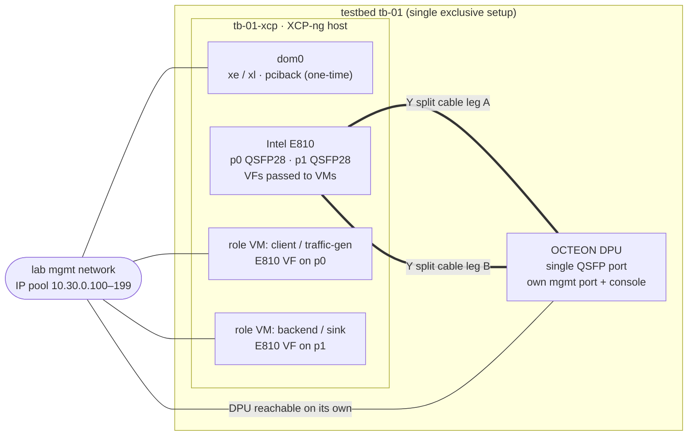
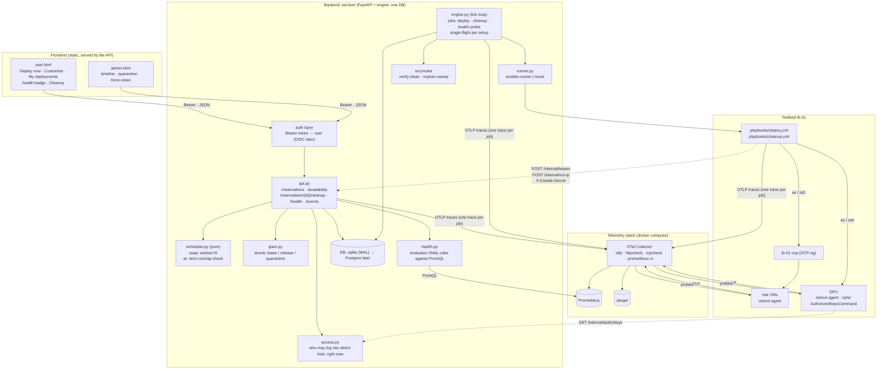
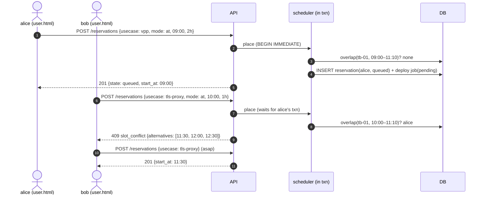
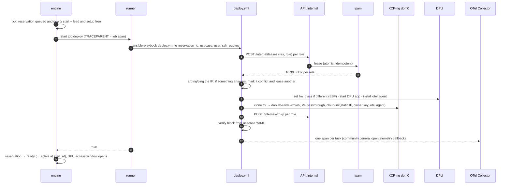
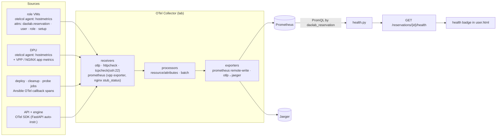
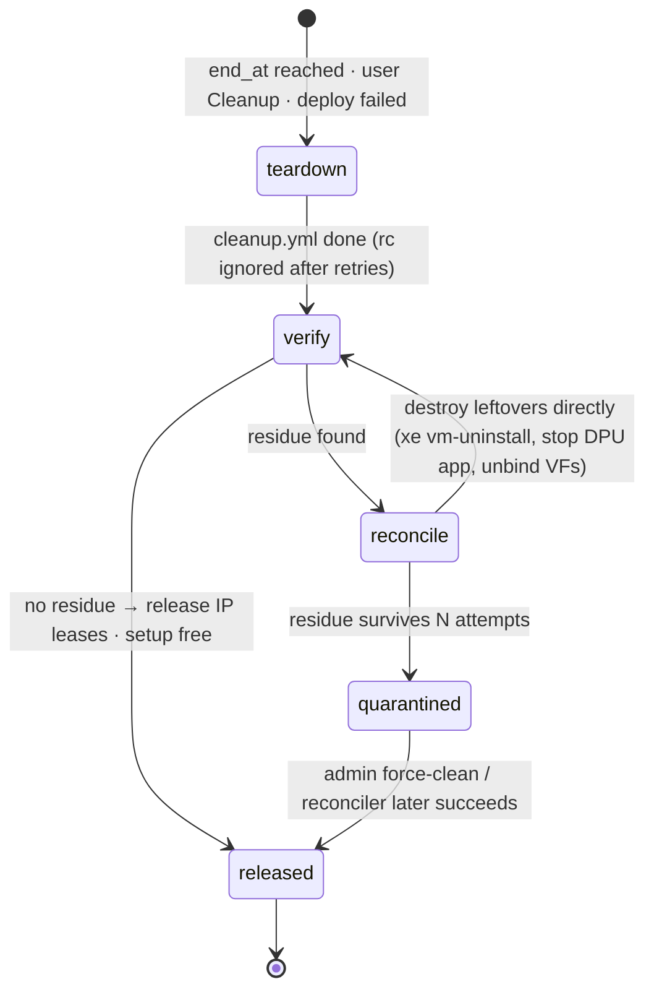
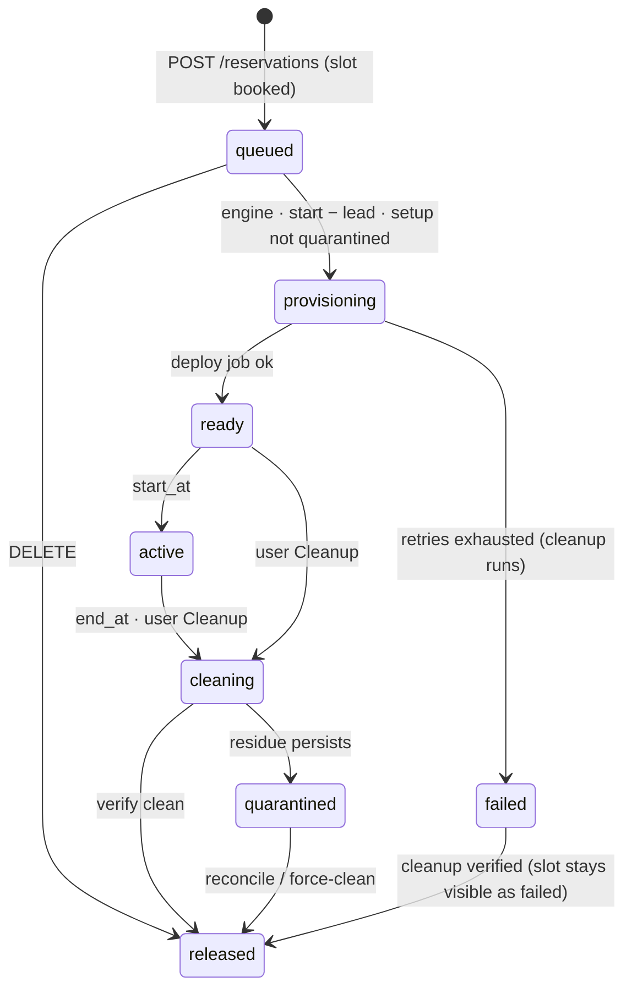

# Backend system design — one-click deploy, cleanup, health

Part of the daolab implementation plan — see [README.md](README.md) for the doc map.

This document is the backend blueprint for the dashboard. It covers the authenticated API that
`user.html` and `admin.html` call, and the three procedures (**deploy**, **cleanup**,
**health**) that act on one user's deployment. It also covers slot exclusivity on the single
testbed, IP leasing, DPU access control, and OpenTelemetry-based health. It refines
[02-backend-api.md](02-backend-api.md), [03-scheduler.md](03-scheduler.md),
[04-lifecycle-engine.md](04-lifecycle-engine.md) and [05-provisioning.md](05-provisioning.md).
Where it differs from them, the differences are listed in
[Changes to earlier plan docs](#changes-to-earlier-plan-docs).

The database is only sketched here: entities and their key constraints, not DDL.

---

## 1. Goals and non-goals

| Goal | How it is met |
|---|---|
| Deploying any setup takes one click | `POST /reservations {usecase}` places the reservation, and the engine runs a single `deploy.yml` with no further user input |
| One click books the next free slot; the user can still customise | `mode: asap` (default) books the earliest free slot; `mode: at` takes a user-chosen start and length |
| Conflicting reservations are blocked | `mode: at` overlaps are rejected with `409 slot_conflict` and alternative slots; the overlap check runs inside one write transaction |
| A booked setup belongs to its user for the whole slot | The testbed is the unit of exclusivity, with at most one live reservation per setup per time window |
| A user can reach the DPU only during their own slot | sshd `AuthorizedKeysCommand` on the DPU asks the backend which keys are valid right now |
| Every VM has its own access | One VM per role per reservation, holding only the owner's key and a static IP leased to that reservation |
| The deploy playbook leases an IP from a range | It calls `POST /internal/leases`; allocation is atomic and unique, so no IP is ever given to two users |
| Cleanup still works when Ansible is incomplete | Cleanup runs teardown, then verifies, then reconciles. A setup with leftovers is quarantined; nothing else blocks |
| Health comes from OpenTelemetry | OTel agents on the VMs and the DPU send data to an OTel Collector, which feeds Prometheus and Jaeger; the backend evaluates the health rules declared in the use-case YAML |
| The design is easy to prototype | `DAOLAB_RUNNER=mock`, seeded test users, sqlite, and one `docker compose` file for the telemetry stack |

**Non-goals for the prototype:** SSO/OIDC (the bearer-token gate stays, with a clean swap
point), multi-testbed partitioning (the data model allows it, the scheduler doesn't use it yet),
billing and quotas beyond a simple per-user cap.

---

## 2. The testbed



- **One XCP-ng host** with the E810. Its two QSFP28 ports go through the Y cable into the DPU's
  single port, so traffic can leave on p0, cross the DPU, and come back on p1. That loop is the
  data path for all three use cases.
- **The DPU has its own management path.** It can be used on its own, for example a user who
  SSHes in to run VPP by hand. This is why DPU access needs its own gate (section 7) rather
  than relying on "the VMs are gone".
- **Every role VM is independent.** Each has its own mgmt IP from the pool, the owner's SSH
  key, and its own E810 VF.
- **All three use cases need the DPU and both E810 ports.** VPP, TLS proxy and SmartNIC are
  therefore mutually exclusive, and the whole testbed is booked as one unit. Capability
  matching ([03-scheduler.md](03-scheduler.md)) keeps working unchanged when more testbeds are
  added.

| Use case | DPU runs | Host VMs | Datapath |
|---|---|---|---|
| `vpp` | DAO VPP (DPDK on OCTEON) | traffic-gen VM (TRex/pktgen on VF p0), sink VM (VF p1) | p0 → DPU VPP → p1 |
| `tls-proxy-nginx` | NGINX + CPT crypto offload | client VM (h2load, VF p0), backend VM (HTTP, VF p1) | client → DPU TLS terminate → backend |
| `smartnic` | DAO SmartNIC/virtio offload app | host VM using the offloaded interface, traffic-gen VM | traffic-gen → DPU offload → host VM |

Each use case is still one `usecases/*.yml` file (roles, `requires`, `hw_class`, and the new
`health:` block from section 8), so adding a use case requires no code change.

---

## 3. Architecture



**Processes:** the API (uvicorn), the engine (`python -m service.engine --loop`), and the
telemetry stack, which is optional and can be left off when running with the mock runner.
There are no queues and no extra services: a **job** is a DB row, and the engine is the only
thing that runs playbooks.

**Why procedures are jobs and not synchronous calls:** a deploy takes minutes, cleanup can need
retries, and both must survive an API restart. Every procedure therefore becomes a job with a
state and an OTel `trace_id`. The API answers `202 Accepted` with the job, and the dashboard
polls or streams its progress.

---

## 4. API surface for the dashboard

Every endpoint needs `Authorization: Bearer <token>`. `owner` means the reservation's user;
admins pass every owner check.

| Method · path | Who | Purpose | Notes |
|---|---|---|---|
| `GET /whoami` | any | identity + role | unchanged |
| `GET /usecases` | any | catalog cards with `next_free_at` | unchanged; feeds the **Deploy now** label ("starts at 14:00") |
| `GET /availability?usecase=&from=&to=` | any | free and busy windows for the date picker | busy windows show the owner only to admins |
| `POST /reservations` | any | **one-click deploy** or customised booking | body below → `201` with reservation + deploy job |
| `GET /reservations` · `/{id}` | owner | state, VMs, IPs, ssh lines, DPU access line, health summary | `?all=1` admin |
| `POST /reservations/{id}/redeploy` | owner | re-run `deploy.yml` (idempotent) inside the slot | `409` outside the slot |
| `POST /reservations/{id}/cleanup` | owner | end early: teardown + verify + release | `202` + cleanup job |
| `DELETE /reservations/{id}` | owner | cancel a `queued` booking | same as today |
| `GET /reservations/{id}/health` | owner | latest health verdict + per-check detail | read-only, from Prometheus (section 8) |
| `POST /reservations/{id}/health/probe` | owner | on-demand active check | `202` + health-probe job |
| `GET /reservations/{id}/events` | owner | SSE stream of job steps and state changes | the dashboard progress bar; falls back to polling |
| `GET /jobs/{id}` | owner | job state, steps, `trace_id`, log tail | links to the Jaeger trace |
| `POST /admin/setups/{name}/force-clean` | admin | run the reconciler + clear quarantine | audit-logged |
| `POST /internal/leases` | playbook | lease an IP for `{reservation_id, role}` | `X-Daolab-Secret`; idempotent |
| `POST /internal/vm-ip` | playbook | confirm a VM is up on its IP | existing callback |
| `GET /internal/authz/keys?host=&login=` | DPU/VM sshd | keys valid **now** for that host | plain-text `authorized_keys` output |

**`POST /reservations` body:**

```jsonc
// one click: the "Deploy now" button sends only this
{ "usecase": "vpp" }

// customised booking
{ "usecase": "tls-proxy-nginx", "mode": "at", "start_at": "2026-10-20T09:00:00Z", "hours": 3 }
```

- `mode` defaults to `asap` and `hours` defaults to `DAOLAB_DEFAULT_HOURS`.
- **asap:** the scheduler returns the earliest free slot on a capable setup, and the booking
  always succeeds unless the horizon is full.
- **at:** the scheduler checks exactly that window. If it overlaps anything, it returns
  `409 slot_conflict` with `detail.alternatives` (the next three free starts of the same
  length), which the dashboard shows as one-click chips. As implemented (B-13): the scheduler
  returns them on every `NoFit` as `NoFit.alternatives`, searched forward from the requested
  start (or `now`), on the slot grid, any capable setup ([03-scheduler.md](03-scheduler.md) Step 5c).
- Per-user caps give `409 quota_exceeded`. The prototype allows one live reservation and two
  future reservations per user, which stops one person hoarding the only testbed.

---

## 5. Scheduling: exclusivity and conflict blocking

**Unit of exclusivity:** `(setup, [start_at, end_at + turnaround))`. Each reservation blocks its
own window plus a **turnaround buffer** after it, so the next user never lands on a dirty or
half-reflashed board:

```
turnaround = cleanup_budget (DAOLAB_CLEANUP_MIN, e.g. 10)
           + reflash_lead   (DAOLAB_HW_CLASS_LEAD_MIN, only if the next booking needs another hw_class)
```

As implemented (B-11, [03-scheduler.md](03-scheduler.md) Step 3): the next booking always carries its own lead before its start (`DAOLAB_PROVISION_LEAD_MIN`, or the reflash lead when its `hw_class` differs), and that lead comes **after** the previous booking's cleanup, so the gap between two bookings is `cleanup + lead`: **15 min** for the same `hw_class` (10 + 5) and **25 min** when a reflash is needed (10 + 15). The scheduler takes the cleanup length from `DAOLAB_CLEANUP_MIN`, not from the `reservations.turnaround_min` column.

**Slot grid:** starts snap to `DAOLAB_SLOT_MIN` (e.g. 30 minutes). This keeps the date picker
simple and packs bookings back-to-back with no unusable gaps.

As implemented (B-12, [03-scheduler.md](03-scheduler.md) Step 5a): the grid is multiples of `DAOLAB_SLOT_MIN` minutes after UTC midnight; `asap` rounds each candidate start up to it, and an `at` start that is off the grid is refused (`NoFit("off_grid")`) because snapping it would be shifting. The scheduler starts `asap` from `max(requested, now)` rounded up to the grid and does **not** add `provision_lead` to `now` as the sentence below says; which of the two is intended is an open question.

**Placement:**

- `asap`: earliest start at or after `now + provision_lead` on the grid, where the window plus
  turnaround is free. This is the existing slot-shift sweep.
- `at`: a single overlap test. Anything overlapping is a conflict and is rejected, never
  shifted.
- **Optimisation within the rules:** when several starts tie, prefer the one next to a booking
  with the same `hw_class`, which avoids an EBF reflash. FCFS order is never broken.

**Race safety (two users clicking at the same instant):** placement and insert happen in one
write transaction. Today that is sqlite `BEGIN IMMEDIATE`, which is already in `api.py` and
serialises writers. After the move to Postgres, a DB **exclusion constraint** on
`(setup_id, time-range)` over live states enforces it, so even a buggy code path cannot
double-book. The second request then gets `409 slot_conflict` (`at`) or the next slot (`asap`).



---

## 6. Deploy procedure: one click → one playbook



**One playbook, `playbooks/deploy.yml`:** the four playbooks of
[05-provisioning.md](05-provisioning.md) (`dpu_prepare`, `host_vm`, `verify`, plus lease) become
**roles** inside one entry playbook. Ansible's `when:` on the use-case's `roles[*].on` decides
which ones run. The dashboard sees exactly one job.

**IP leasing (the playbook requests it; the backend owns it):**

- The pool comes from config (`DAOLAB_IP_POOL=10.30.0.100-10.30.0.199`) or, later, from each
  setup's YAML.
- `POST /internal/leases {reservation_id, role}` returns the **same** IP when called again for
  the same pair, so playbook retries are safe. Otherwise it allocates the lowest IP with no
  live lease.
- A uniqueness rule on *(pool, ip) among live leases* is what guarantees "no other user gets
  that IP".
- A lease has a lifecycle: `leased → released` after cleanup is verified, or
  `leased → quarantined` when cleanup could not prove the VM is gone. Quarantined IPs are never
  re-issued until the reconciler or an admin clears them.
- VMs get the IP **statically through cloud-init**. Nothing depends on DHCP, so two VMs can
  never race for one address.

**Retries and idempotency:** unchanged from [04-lifecycle-engine.md](04-lifecycle-engine.md).
A failed deploy is re-run up to `DAOLAB_MAX_RETRIES`, and every role is skip-if-exists. If
deploy finally fails, the engine runs cleanup and marks the reservation `failed`, and the slot
stays the user's for a manual `redeploy`.

---

## 7. Access control: VMs and the DPU

The rule is that only the slot owner can log in, and only while the slot is open. It is
enforced in four layers, so a missed cleanup step never leaks access.

| Layer | Mechanism | Takes effect |
|---|---|---|
| API | owner checks on every `/reservations/{id}/*` route; credentials (IPs, ssh lines) returned only to the owner | always |
| Role VMs | each VM is created for one reservation, with **only** the owner's public key via cloud-init; destroyed at cleanup | VM lifetime |
| **DPU** | sshd `AuthorizedKeysCommand /usr/local/bin/daolab-keys %u %h` calls `GET /internal/authz/keys?host=dpu-01&login=lab`. The backend returns the owner's key **only while** `start_at ≤ now < end_at` for a `ready`/`active` reservation on the setup holding that host, and nothing otherwise | checked at every login, so it is time-bounded even if cleanup fails |
| Session kill | `cleanup.yml` and the engine's `end_at` transition run `loginctl terminate-user lab` / `pkill -u lab` on the DPU | at the end of the slot |
| dom0 | users never get dom0 credentials; only the backend's service key | always |

Notes:

- On the DPU everyone uses one shared login (`lab`). Isolation comes from **who** can log in
  and **when**, which keeps the prototype trivial. Per-user Unix accounts can be added later
  without changing the backend contract.
- If the backend is unreachable, `daolab-keys` returns nothing (fail-closed). Admins keep
  console access as break-glass.
- Opening the DPU window at `ready`, before `start_at`, is a config flag
  (`DAOLAB_EARLY_ACCESS`), off by default.

---

## 8. Health with OpenTelemetry

There are two signals. **Passive telemetry** comes from agents and probes and is always on.
**Active probes** run on demand through the `health/probe` job. The backend turns both into one
verdict per reservation.



**Health rules are data.** They live in the use-case YAML, consistent with the design
invariants:

```yaml
# usecases/vpp.yml (excerpt)
health:
  - {name: vms_up,        promql: 'min(up{daolab_reservation="$RID"})',                       expect: "== 1"}
  - {name: ssh_reachable, promql: 'min(tcpcheck_status{daolab_reservation="$RID",port="22"})', expect: "== 1"}
  - {name: dpu_app,       promql: 'vpp_up{host="dpu-01"}',                                     expect: "== 1"}
  - {name: datapath,      promql: 'rate(vpp_interface_rx_packets{host="dpu-01"}[1m])',         expect: "> 0", severity: degraded}
```

For TLS proxy, the `httpcheck` receiver targets `https://<proxy_ip>/` and the rule expects
`httpcheck_status == 1`. SmartNIC checks the offload app's counters.

**Verdict:** `healthy` when every check passes; `degraded` when only `severity: degraded`
checks fail; `down` when any critical check fails; `unknown` when there is no telemetry for
`DAOLAB_HEALTH_STALE_SEC` (the agent died or was never installed). The response lists every
check with its value, the time it was seen, and the deploy `trace_id`.

**Who evaluates, and when:**

- The API evaluates on `GET …/health`, with a 15-second cache.
- The engine evaluates once per tick for `active` reservations and stores the latest verdict.
  `admin.html` shows it, and a webhook fires on the change to `down`.
- `POST …/health/probe` runs the YAML's `verify` command (e.g. `h2load` or `vppctl show int`)
  as a short Ansible job. Its span and result go through the same Collector.

**Telemetry agent placement:** the agents run in the VMs and on the DPU (both are Linux and get
`otelcol-contrib` from the deploy playbook), **not** in XCP-ng dom0. Host-level XCP-ng metrics
are optional for later (an RRD exporter).

---

## 9. Cleanup that tolerates incomplete Ansible

Ansible teardown is treated as **best effort**. Correctness comes from the verify and
reconcile steps that follow it.



**What "verify" checks.** Each check is a direct query, not an Ansible result:

1. No XCP-ng VM whose name or tag is `daolab-r<id>-*` (`xe vm-list tags:contains=daolab-r<id>`).
2. Every E810 VF used by the reservation is back to `pci-assignable`.
3. No user sessions on the DPU; the use-case app is stopped (the `hw_class` is kept, per the
   invariants).
4. Every leased IP fails to answer ping or ARP, so its lease can be released. Otherwise the
   lease is quarantined.

**Quarantine** marks the *setup* as unavailable. The scheduler stops starting new deploys on it
(queued bookings wait, and their owners see "testbed being cleaned"), `admin.html` shows a red
banner with the residue list, and an admin can run `force-clean`.

**Orphan sweep:** every engine tick, any `daolab-r*` VM or live lease whose reservation is in a
terminal state is cleaned up. This also catches residue from crashes and manual runs.

**DPU access is revoked at `end_at` whatever cleanup does** (section 7), so a stuck cleanup can
never extend someone's access.

---

## 10. State model



Jobs have their own small lifecycle (`pending → running → succeeded | failed`), with an
`attempt` counter and `trace_id`. A `failed` job is final and is never revived: a retry is a
**new** job row for the same reservation and kind with `attempt + 1` (B-20; the crash-recovery
rule of B-26, which puts a stale `running` job back to `pending`, is a separate, explicit
exception added with that task). **Single-flight per setup:** the engine never runs two
deploy, cleanup or reconcile jobs against the same setup at once. Health-probe jobs are
read-only and exempt. *Built (B-24):* the engine checks for a running mutating job on the setup
and marks its own job `running` in one write transaction; a job that must wait stays `pending`
and is retried on the next tick, and a job stranded as `running` by a crashed engine blocks its
setup until B-26.

---

## 11. Data model hints (not a schema)

| Entity | Holds | Key rule |
|---|---|---|
| users | username, role (user/admin), token hash, SSH public key, enabled | token stored hashed |
| setups / members | testbed, its hosts (XCP host, DPU), capabilities, availability flag (available / quarantined / maintenance) | quarantine blocks placement |
| reservations | user, use case, setup, window, state, mode (asap/at), turnaround | **no two live reservations on one setup overlap** (txn today, exclusion constraint on Postgres) |
| jobs | reservation, kind (deploy/cleanup/health_probe/reconcile), state (pending/running/succeeded/failed), attempt, trace_id, log path, steps (JSON list, appended while running), error, started/finished times | one running mutating job per setup (enforced by the engine, B-24); the setup is reached through the reservation |
| vms | reservation, role, VM name/uuid, host, VF, IP | name `daolab-r<id>-<role>` |
| ip_pools / ip_leases | range; lease (ip, reservation, role, state leased/released/quarantined) | **(pool, ip) unique among live leases**; `(reservation, role)` unique → idempotent |
| health_snapshots | reservation, verdict, per-check results, evaluated_at | latest row only is needed |
| audit_events | who did what (deploy, cleanup, force-clean, admin overrides) | append-only |

DPU access grants are **derived** from reservations + time, not stored. That removes a whole
class of "forgot to revoke" bugs.

---

## 12. Dashboard behaviour this backend supports

| UI element (`user.html`) | Backend call | Behaviour |
|---|---|---|
| **Deploy now** on each use-case card | `POST /reservations {usecase}` | label from `next_free_at` ("Deploy · starts 14:00"); card switches to progress |
| **Customise ▸** (date + hours) | `GET /availability` then `POST … mode: at` | busy slots greyed out; a conflict shows the alternative chips |
| Progress bar | `GET /reservations/{id}/events` (SSE) | steps such as lease IP → DPU app → VMs → verify, each linked to its span |
| Access panel | `GET /reservations/{id}` | ssh line per VM + `ssh lab@<dpu-ip>` (active only during the slot) |
| Health badge | `GET …/health` every 30 s | green / amber / red / grey, with an expandable check list; **Re-check** → `POST …/health/probe` |
| **Cleanup** | `POST …/cleanup` | confirm dialog; the card shows "cleaning" until released |
| Admin timeline | `GET /setups`, `GET /reservations?all=1` | holds, queue, quarantine banner, **Force clean** |

---

## 13. Prototype plan with test users

**Seeded test users** (`scripts/run/dev.sh` extended to create them; tokens printed at start):
`alice` and `bob` (role user, dev SSH key) and `dev-admin` (admin).

**`DAOLAB_RUNNER=mock`** swaps `runner.py` for a fake that sleeps through each step, calls the
real `/internal/leases` and `/internal/vm-ip`, emits OTel spans, and writes fake metrics. The
whole flow (booking, conflicts, IP exclusivity, DPU key window, cleanup, quarantine) can then be
demonstrated on a laptop with no testbed. `DAOLAB_MOCK_FAIL=cleanup` forces residue so the
quarantine path can be exercised. *Built so far (B-22):* the sleeping, step-recording mock
(`DAOLAB_MOCK_STEP_SEC`, default 5 s per step, 6 deploy steps ≈ 30 s) and the two failure
switches — `deploy` fails the deploy at `create_vms`; `cleanup` makes cleanup report success
while `verify_clean` keeps reporting residue. The lease/vm-ip calls (B-44), OTel spans (B-62)
and fake metrics come with their own tasks.

*The engine (B-23):* `python -m service.engine` runs one tick and exits; `--loop` ticks every
`DAOLAB_ENGINE_INTERVAL_SEC`. It refuses to start (exit 1, "run `daolab init` first") if the
database schema is not the latest version. See [04-lifecycle-engine.md](04-lifecycle-engine.md)
for the tick order and what each finished job does to its reservation.

**Telemetry stack:** `deploy/otel/docker-compose.yml` runs `otelcol-contrib`, `prometheus` and
`jaeger`. With `DAOLAB_OTEL_ENDPOINT` unset, the backend skips tracing and health falls back to
the probe job only.

| Step | Deliverable | Demo |
|---|---|---|
| P1 | `mode` + strict overlap + turnaround + `/availability` | alice books 09:00; bob's 10:00 gets 409 with alternatives |
| P2 | jobs + `/cleanup` + SSE + mock runner | one-click deploy → ready in about 30 s (mock); cleanup → released |
| P3 | `ipam` + `/internal/leases` | two concurrent deploys never share an IP; quarantine keeps an IP blocked |
| P4 | `/internal/authz/keys` + `daolab-keys` script | on a test VM acting as "DPU": alice's key works only in her slot |
| P5 | OTel SDK + Collector + `health.py` + YAML `health:` | badge goes red when the mock agent stops |
| P6 | real `deploy.yml` / `cleanup.yml` on tb-01, VPP first | one click → real VPP datapath, health green |

---

## Changes to earlier plan docs

These decisions supersede the named sections and should be folded back into those docs when
P1–P3 land:

- **[03-scheduler.md](03-scheduler.md):** slot-shift stays for `asap` only. Explicit
  `mode: at` requests are **rejected on conflict** (`409 slot_conflict`) instead of being
  shifted. A turnaround buffer and a slot grid are added.
- **[02-backend-api.md](02-backend-api.md):** adds `mode`, `/availability`, `/cleanup`,
  `/health`, `/health/probe`, `/events`, `/jobs/{id}`, `/internal/leases`,
  `/internal/authz/keys`, `/admin/setups/{name}/force-clean`.
- **[04-lifecycle-engine.md](04-lifecycle-engine.md):** `tearing_down` becomes `cleaning`
  (teardown + verify + reconcile), and the `quarantined` state is added (both done in B-21:
  `models.RESERVATION_TRANSITIONS` is this section's diagram edge for edge). Procedures run as
  job rows.
- **[05-provisioning.md](05-provisioning.md):** the four playbooks become roles under a single
  `deploy.yml` plus `cleanup.yml`. VM IPs are leased and set statically through cloud-init
  instead of being discovered through guest tools. The inventory collapses to one XCP-ng host
  (`tb-01-xcp`) plus the DPU.
- **Tech stack ([README.md](README.md)):** adds OpenTelemetry (SDK, Collector, Ansible
  callback), with Prometheus and Jaeger as optional dev-time containers. This is the only new
  technology. There is still no message queue: jobs are DB rows.
