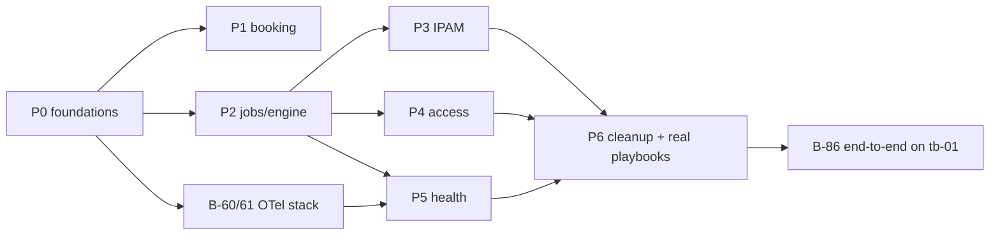

# Backend tasksheet

Part of the daolab implementation plan — see [README.md](README.md) for the doc map.

These are the backend tasks that implement [09-backend-system-design.md](09-backend-system-design.md);
the dashboard is out of scope. The phases follow the design's prototype plan (P1–P6). Every
task up to P5 can be built and demonstrated with `DAOLAB_RUNNER=mock` and the test users, so the
testbed is needed only in P6.

**What already exists:** `service/api.py` (auth, `/usecases`, `/reservations` CRUD,
`/internal/vm-ip`), `scheduler.py` (FCFS + slot-shift), `catalog.py`, `cli.py`, `models.py`,
`schema.sql` (7 tables), and tests for the api, catalog and scheduler.

**What's missing:** `engine.py`, `runner.py`, `playbooks/`, the jobs model, IP leasing, access
control, OTel, health and cleanup verification.

Status values: `todo` · `doing` · `review` · `done` · `blocked`.

---

## Ownership

| Owner | Focus | Tasks |
|---|---|---|
| **Akshay** | The complex core: scheduling algorithm, engine and runner, concurrency and race safety, IPAM allocator, access logic, health evaluator, cleanup/reconcile flow, `deploy.yml` + DPU app roles, end-to-end | 25 |
| **Rama** | Everything around the core: config and seeding, inventory and use-case YAMLs, schema for leases/audit/availability, API endpoints over Akshay's modules, OTel stack + SDK, mock telemetry, `cleanup.yml`, OTel agent role, testbed bring-up, docs | 36 |

**Handoffs, where one person waits on the other.** Land these early so nobody is blocked:

| Akshay delivers → | unblocks Rama's |
|---|---|
| B-03 schema migration (do first) | B-18, B-40, B-55 |
| B-13 `NoFit` alternatives | B-14 booking endpoint, B-16 availability |
| B-20/B-21 jobs + states | B-27, B-28, B-29 endpoints |
| B-41 `ipam.py` | B-42 lease endpoints |
| B-50 `access.py` | B-51 → B-52 `daolab-keys` |
| B-65 `health.py` | B-66 health endpoints |
| B-71 cleanup flow | B-74 force-clean |

| Rama delivers → | unblocks Akshay's |
|---|---|
| B-40 lease schema | B-41 allocator |
| B-18 availability flag | B-71 quarantine |
| B-61 OTel SDK | B-62 trace per job |
| B-64 YAML `health:` schema | B-65 evaluator |
| B-42 + B-52 lease endpoints, `daolab-keys` | B-80 `deploy.yml` |
| B-85 testbed bring-up | B-81 DPU roles, B-86 end-to-end |

**Suggested start:**
- **Akshay:** B-03 → B-10…B-13 → B-20…B-23.
- **Rama:** B-01, B-02, B-04–B-06 → B-60/B-61 (OTel stack, no dependencies) → B-40 → endpoints
  as Akshay's modules land. Start B-85 (testbed bring-up) early, because hardware surprises are
  the biggest schedule risk.

---

## P0 — Foundations

| ID | Task | Files | Depends | Done when | Owner | Status |
|---|---|---|---|---|---|---|
| B-01 | Add config vars: `DAOLAB_RUNNER`, `DAOLAB_SLOT_MIN`, `DAOLAB_CLEANUP_MIN`, `DAOLAB_DEFAULT_HOURS`, `DAOLAB_IP_POOL`, `DAOLAB_EARLY_ACCESS`, `DAOLAB_HEALTH_STALE_SEC`, `DAOLAB_OTEL_ENDPOINT`, user quota caps | `config.py`, `.env.example` | — | settings load with defaults; listed in `.env.example` | Rama | todo |
| B-02 | Seed test users `alice`, `bob`, `dev-admin` with tokens printed at start | `scripts/run/dev.sh`, `cli.py` | — | `dev.sh --fresh` prints 3 tokens; all 3 pass `/whoami` | Rama | todo |
| B-03 | Schema migration path: idempotent `daolab init` that adds the new tables/columns without wiping data | `schema.sql`, `models.py`, `cli.py` | — | running `init` twice on an existing DB is a no-op | Akshay | review |
| B-04 | Collapse the inventory to one testbed: `tb-01-xcp` + `dpu-01`; rewrite `setups/setup-01.yml` → `tb-01` with the Y-cable links (p0, p1 → DPU) | `inventory/hosts.yml`, `setups/` | — | `daolab sync` shows `tb-01` with capabilities `[e810, octeon-cn106, sdp, wire]` | Rama | todo |
| B-05 | Use-case YAMLs for `vpp` and `smartnic` (roles, requires, hw_class, verify) | `usecases/` | B-04 | `GET /usecases` lists all three as `active` | Rama | todo |
| B-06 | Shared test fixtures: frozen clock, temp DB, seeded users/setups | `tests/conftest.py` | B-02 | used by every new test module | Rama | todo |

## P1 — Booking: asap vs. `at`, conflict blocking

| ID | Task | Files | Depends | Done when | Owner | Status |
|---|---|---|---|---|---|---|
| B-10 | Add `mode` (`asap` default \| `at`) to `PlacementRequest`; `at` = single overlap test, never shifted | `scheduler.py` | — | unit tests: `at` on a busy window → conflict result; `asap` → earliest fit | Akshay | review |
| B-11 | Turnaround buffer: block `end_at + cleanup_min (+ reflash lead if the next hw_class differs)` | `scheduler.py` | B-10 | test: back-to-back bookings start no earlier than the buffer allows | Akshay | review |
| B-12 | Slot grid: snap starts to `DAOLAB_SLOT_MIN`; when starts tie, prefer the one next to the same hw_class | `scheduler.py` | B-10 | test: starts are grid-aligned; the same-class neighbour is chosen without breaking FCFS | Akshay | review |
| B-13 | `NoFit` result carrying the next 3 free alternative starts for the same duration | `scheduler.py` | B-10 | test: alternatives are free, sorted, the right length | Akshay | review |
| B-14 | `POST /reservations` accepts `mode`/`start_at`/`hours`; `409 slot_conflict` with `detail.alternatives` | `api.py` | B-13 | api test: alice books 09:00, bob's 10:00 `at` → 409 with alternatives | Rama | todo |
| B-15 | Per-user quota: 1 live + 2 future reservations → `409 quota_exceeded` | `api.py`, `models.py` | B-14 | api test covering both caps; admins exempt | Rama | todo |
| B-16 | `GET /availability?usecase=&from=&to=`: free/busy windows; owners visible to admins only | `api.py`, `scheduler.py` | B-11 | non-admin responses contain no usernames | Rama | todo |
| B-17 | Concurrency test: N threads booking the same `at` window → exactly one 201 | `tests/test_concurrency.py` | B-14 | passes 50 runs in a row | Akshay | todo |
| B-18 | Setup availability flag (`available`/`quarantined`/`maintenance`): placement still books, but the engine won't start provisioning on a non-available setup | `schema.sql`, `scheduler.py`, `models.py` | B-03 | test: queued reservation stays queued while quarantined | Rama | todo |

## P2 — Jobs, engine, runner (mock), cleanup endpoint

| ID | Task | Files | Depends | Done when | Owner | Status |
|---|---|---|---|---|---|---|
| B-20 | Jobs entity: kind (`deploy`/`cleanup`/`health_probe`/`reconcile`), state, attempt, trace_id, steps, log path | `migrations.py` (v5; `schema.sql` is the frozen baseline), `models.py`, `tests/test_jobs.py` | B-03 | model helpers + unit tests | Akshay | review |
| B-21 | Reservation states: rename `tearing_down` → `cleaning`; add `quarantined`; CAS-style transition helper | `migrations.py` (v6 rewrites the state CHECK), `models.py`, `api.py`, `dashboard/*.html`, `tests/test_reservation_states.py` | B-20 | invalid transitions raise; existing tests updated | Akshay | review |
| B-22 | `runner.py` interface: `deploy(res)`, `cleanup(res)`, `probe(res)`, `verify_clean(res)`; `ansible` and `mock` backends chosen by `DAOLAB_RUNNER` | `runner.py` | B-20 | mock runs step by step with sleeps, records steps on the job; `DAOLAB_MOCK_FAIL=deploy\|cleanup` injects failures | Akshay | todo |
| B-23 | `engine.py` tick: queued→provisioning (start − lead, setup free & available), ready→active, active→cleaning at end_at, run pending jobs | `engine.py` | B-21, B-22 | `python -m service.engine` runs one tick; `--loop` ticks every interval | Akshay | todo |
| B-24 | Single-flight per setup: at most one running deploy/cleanup/reconcile job per setup (probes exempt) | `engine.py`, `models.py` | B-23 | test: two pending mutating jobs → only one runs | Akshay | todo |
| B-25 | Retry policy: deploy retried to `MAX_RETRIES` → `failed` + automatic cleanup job | `engine.py` | B-23 | test with `MOCK_FAIL=deploy` | Rama | todo |
| B-26 | Crash recovery: on start, `running` jobs older than a timeout go back to `pending` (playbooks are idempotent) | `engine.py` | B-23 | test: kill mid-job → next tick resumes | Akshay | todo |
| B-27 | `POST /reservations/{id}/cleanup` (owner; `ready`/`active` → `cleaning` + job, `202`) | `api.py` | B-21 | api test incl. 403 for another user | Rama | todo |
| B-28 | `POST /reservations/{id}/redeploy` (owner, inside the slot only) | `api.py` | B-20 | 409 outside the slot; new deploy job inside it | Rama | todo |
| B-29 | `GET /jobs/{id}` and `GET /reservations/{id}/events` (SSE of job steps + state changes) | `api.py` | B-20 | curl `-N` shows step events during a mock deploy | Rama | todo |
| B-30 | `make engine` / `dev.sh` start the engine alongside the API | `Makefile`, `scripts/run/dev.sh` | B-23 | one command starts both; Ctrl-C stops both | Rama | todo |

## P3 — IP leasing (IPAM)

| ID | Task | Files | Depends | Done when | Owner | Status |
|---|---|---|---|---|---|---|
| B-40 | IP pool + lease entities; `(pool, ip)` unique among live leases; `(reservation, role)` unique | `schema.sql`, `models.py` | B-03 | constraint test: a duplicate live IP insert fails | Rama | todo |
| B-41 | `ipam.py`: `lease(res, role)` (idempotent, lowest free), `release(res)`, `quarantine(ip)`, `mark_conflict(ip)` | `ipam.py` | B-40 | unit tests: idempotency, exhaustion error, a quarantined IP is never re-issued | Akshay | todo |
| B-42 | `POST /internal/leases {reservation_id, role}` (`X-Daolab-Secret`); `POST /internal/leases/conflict {ip}` → mark it and return a new IP | `api.py` | B-41 | api tests; rejects unknown or terminal reservations | Rama | todo |
| B-43 | Pool loaded from `DAOLAB_IP_POOL` on `daolab sync` (later per-setup YAML) | `catalog.py` | B-40 | sync is idempotent; shrinking the pool never drops live leases | Rama | todo |
| B-44 | Mock runner calls the real lease + vm-ip endpoints | `runner.py` | B-22, B-42 | mock deploy shows leased IPs on the reservation | Rama | todo |
| B-45 | Concurrency test: parallel deploys never share an IP | `tests/test_ipam.py` | B-41 | passes under 20 threads | Akshay | todo |

## P4 — Access control (VMs + DPU)

| ID | Task | Files | Depends | Done when | Owner | Status |
|---|---|---|---|---|---|---|
| B-50 | `access.py`: `keys_for(host, login, now)` → owner key iff a `ready`/`active` reservation on the setup holding `host` has `start ≤ now < end` (`EARLY_ACCESS` flag aware) | `access.py` | B-21 | unit tests: before, during, after the slot; other setup; disabled user | Akshay | todo |
| B-51 | `GET /internal/authz/keys?host=&login=` returning plain-text `authorized_keys`; empty on any error | `api.py` | B-50 | curl output usable directly by sshd | Rama | todo |
| B-52 | `daolab-keys` script for sshd `AuthorizedKeysCommand` (fail-closed, 2 s timeout) + sshd drop-in config | `playbooks/files/daolab-keys`, `playbooks/files/sshd-daolab.conf` | B-51 | on a test VM acting as "DPU": alice can log in only during her slot | Rama | todo |
| B-53 | Session kill at slot end: engine schedules a `terminate-user` step for the DPU in the cleanup job | `engine.py`, `runner.py` | B-23 | mock records the step; real role in B-82 | Rama | todo |
| B-54 | Owner-only credential exposure: ssh lines + DPU line only in owner/admin reservation views | `api.py` | — | api test: bob cannot see alice's IPs | Rama | todo |
| B-55 | Audit events: deploy, cleanup, redeploy, force-clean, admin overrides | `schema.sql`, `models.py`, `api.py` | B-03 | rows written; `GET /admin/audit` (admin) | Rama | todo |

## P5 — OpenTelemetry + health

| ID | Task | Files | Depends | Done when | Owner | Status |
|---|---|---|---|---|---|---|
| B-60 | Telemetry stack: `otelcol-contrib` + Prometheus + Jaeger in docker compose; collector config (otlp, httpcheck, tcpcheck, prometheus receivers; resource processor; prom remote-write + otlp→jaeger) | `deploy/otel/` | — | `docker compose up` → Jaeger UI + Prometheus up | Rama | todo |
| B-61 | OTel SDK in the API + engine (FastAPI auto-instrumentation); no-op when `DAOLAB_OTEL_ENDPOINT` is unset | `service/otel.py`, `api.py`, `engine.py`, `pyproject.toml` | B-60 | request spans visible in Jaeger | Rama | todo |
| B-62 | One trace per job: engine opens the job span, stores `trace_id`, passes `TRACEPARENT` to the runner | `engine.py`, `runner.py` | B-61, B-22 | the job's `trace_id` opens in Jaeger with child steps | Akshay | todo |
| B-63 | Ansible `community.general.opentelemetry` callback enabled in runner env | `runner.py`, `playbooks/ansible.cfg` | B-62 | each Ansible task appears as a child span (verified in P6) | Rama | todo |
| B-64 | `health:` block in the use-case YAML schema (name, promql with `$RID`, expect, severity); validated by `daolab sync` | `catalog.py`, `usecases/*.yml` | B-05 | sync rejects a malformed rule with file + rule name | Rama | todo |
| B-65 | `health.py`: run the rules via the Prometheus HTTP API → `healthy`/`degraded`/`down`/`unknown` (stale > `HEALTH_STALE_SEC`) | `health.py` | B-64 | unit tests with a stubbed Prometheus | Akshay | todo |
| B-66 | `GET /reservations/{id}/health` (owner, 15 s cache) + `POST …/health/probe` → probe job | `api.py` | B-65, B-20 | api tests; the probe result is recorded on the job | Rama | todo |
| B-67 | Engine evaluates health for `active` reservations each tick, stores the latest snapshot, fires the webhook on → `down` | `engine.py`, `models.py` | B-65 | test: a flip to down fires once, not every tick | Akshay | todo |
| B-68 | Mock telemetry: the mock runner starts a fake exporter per reservation with `daolab_reservation` labels; `MOCK_FAIL=health` drops it | `runner.py`, `deploy/otel/` | B-22, B-60 | badge data goes healthy → unknown/down when the mock stops | Rama | todo |

## P6 — Cleanup verification, reconciler, real playbooks

| ID | Task | Files | Depends | Done when | Owner | Status |
|---|---|---|---|---|---|---|
| B-70 | `verify_clean(res)`: no `daolab-r<id>-*` VMs, VFs back to assignable, no DPU sessions + app stopped, leased IPs silent | `runner.py`, `playbooks/verify_clean.yml` | B-22 | returns a structured residue list (empty = clean) | Akshay | todo |
| B-71 | Cleanup flow: teardown → verify → (clean: release leases + setup free) / (residue: reconcile ×N → quarantine setup + IPs) | `engine.py` | B-70, B-41, B-18 | mock test with `MOCK_FAIL=cleanup` ends in `quarantined` | Akshay | todo |
| B-72 | Reconcile actions: `xe vm-uninstall` tagged VMs, stop DPU app, unbind VFs, kill sessions | `playbooks/reconcile.yml` | B-70 | removes residue left by an interrupted deploy | Akshay | todo |
| B-73 | Orphan sweep every tick: tagged VMs / live leases whose reservation is terminal | `engine.py` | B-72 | test: a manual VM tagged `daolab-r999` gets cleaned | Rama | todo |
| B-74 | `POST /admin/setups/{name}/force-clean` (reconcile + clear quarantine, audit-logged) | `api.py` | B-71, B-55 | admin-only; 403 for users | Rama | todo |
| B-80 | `playbooks/deploy.yml` entry + roles: `lease_ip`, `ebf_set` (stub), `dpu_app`, `host_vm` (clone, VF passthrough, cloud-init static IP + owner key + otel agent), `verify` | `playbooks/` | B-42, B-52 | idempotent: a second run is all `ok`/`skipped` | Akshay | todo |
| B-81 | Per-use-case DPU app roles: `vpp`, `tls_proxy_nginx`, `smartnic` | `playbooks/roles/` | B-80 | each passes its YAML `verify` on tb-01 | Akshay | todo |
| B-82 | `playbooks/cleanup.yml`: best-effort teardown (VMs, VFs, DPU app stop, session kill; hw_class kept) | `playbooks/` | B-80 | safe to run on an already-clean testbed | Rama | todo |
| B-83 | OTel agent install (VMs via cloud-init, DPU via role) with `daolab.*` resource attributes | `playbooks/roles/otel_agent` | B-60 | metrics labelled by reservation in Prometheus | Rama | todo |
| B-84 | `runner.py` ansible backend via `ansible-runner` (extravars, TRACEPARENT, per-job artifact dir) | `runner.py` | B-22, B-80 | real job logs linked from `GET /jobs/{id}` | Akshay | todo |
| B-85 | Testbed bring-up: dom0 pciback for E810 VFs, template `tpl-ubuntu2204-dao`, DPU sshd drop-in, host_vars BDFs | `inventory/host_vars/` | B-04 | manual checklist in [05-provisioning.md](05-provisioning.md) ticked | Rama | todo |
| B-86 | End-to-end on tb-01: alice one-click VPP → ready → healthy → slot end → released; bob blocked from the DPU throughout | — | all P6 | demo recorded; trace in Jaeger | Akshay | todo |

## Docs follow-up

| ID | Task | Files | Depends | Done when | Owner | Status |
|---|---|---|---|---|---|---|
| B-90 | Fold the design changes back into 02–05 (mode/409, cleaning/quarantined, single deploy.yml, leased IPs, one-host inventory) | `plan/02–05` | P1–P3 | no doc contradicts 09 | Rama | todo |
| B-91 | Ops runbook: quarantine handling, force-clean, OTel stack ops, rotating the internal secret | `plan/08-cli-config-ops.md` | P6 | reviewed by whoever is on lab duty | Rama | todo |

---

## Critical path and totals

- **Critical path:** P0 → P2 → (P3, P4, P5) → P6.
- **Can run in parallel:** P1 alongside P2; B-60/B-61 (OTel stack) from the start; B-85
  (testbed bring-up) any time.
- **Mock-demo milestone (end of P5):** the whole flow works on a laptop with test users.
