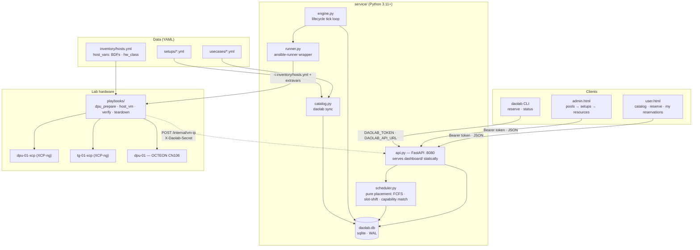

# daolab plan — index and system overview

Part of the daolab implementation plan — see [README.md](README.md) for the doc map.

## Purpose and scope of this plan folder

The repo-root [`README.md`](../README.md) is the **product spec and source of truth**: it defines
the domain model, the use-case catalog, the repo layout, the phased pipeline, and the six design
invariants. It stays that way. The nine documents in `plan/` turn that spec into an
implementation blueprint — exact schemas, function signatures, endpoint tables, wireframes, and
ordered task lists — so a competent engineer builds each component without guessing.

Rules of the folder:

- **Precedence**: root `README.md` > these plan docs. A plan doc never contradicts the spec; it
  refines it.
- **Ownership**: each doc owns one area and its decisions (see the document map below). Sibling
  docs reference each other by relative filename with one-line pointers — never by duplicating
  content in depth.
- **No invented scope**: nothing here adds product capabilities, services, or technologies beyond
  the spec. No Kubernetes, no message queues, no React, no build pipelines, no microservices.

## System overview

daolab lets a user reserve a **setup** — a wired group of lab nodes — pre-provisioned for a
Marvell [DAO](https://marvellembeddedprocessors.github.io/dao/) use case. Scheduling is **FCFS**
(placed in `created_at` order) with **slot-shift** on conflict: an overlapping request is never
rejected, it is moved to the earliest free slot. A reservation moves through
`queued → provisioning → ready → active → tearing_down → released` (plus terminal `failed`),
driven by an engine that runs idempotent Ansible playbooks against XCP-ng hosts and the OCTEON.

**Today: exactly one setup**, `setup-01` in pool `lab-1`:

| Member | `kind` | `capabilities` | XCP-ng host | Notes |
|---|---|---|---|---|
| `dpu-01` | `dpu` | `[octeon-cn106, sdp]` | `dpu-01-xcp` | OCTEON CN106 DPU; runs DAO apps directly; carries the current `hw_class` (e.g. `sdp-pf1-vf8`) |
| `tg-01` | `nic` | `[e810]` | `tg-01-xcp` | Intel E810 traffic-generator NIC; client VMs get E810 VFs via passthrough |

One link — `{a: dpu-01.eth0, b: tg-01.e810p0, capability: wire}` — a 25G wire. The setup's
capability union is `[e810, octeon-cn106, sdp, wire]`.

**Tomorrow: N heterogeneous setups** mixing DPUs, GPUs, NICs, and pure compute
(`kind ∈ dpu | gpu | nic | compute`). Everything that describes hardware or a use case is
**data** (YAML): a new setup is one `setups/*.yml` file plus inventory entries; a new use case is
one `usecases/*.yml` file. The scheduler matches `usecase.requires ⊆ setup.capabilities` and
nothing else couples them — so scale-out is more files, zero code changes. `diy` is a built-in
pseudo-use-case: pick a setup and a base VM template per host, get bare wired VMs, no DAO app.

## Architecture

One Python package (`service/`), one sqlite file, two HTML pages, four playbooks. The API and
engine are separate processes sharing the DB in WAL mode.

Data flow in one paragraph: `daolab sync` mirrors `usecases/` and `setups/` YAML into the DB.
A dashboard or the CLI hits `POST /reservations`; `api.py` calls `scheduler.py`, which fixes
`setup_id`, `start_at`, `end_at` (slot-shifting if needed) and writes the row as `queued`. The
engine tick picks it up at `start_at − lead`, drives `runner.py` through
`dpu_prepare → host_vm → verify`, playbooks post VM IPs back via `POST /internal/vm-ip`, and the
reservation becomes `ready`, then `active`, then is torn down at `end_at`.

## Document map

Nine files. Each owns its decisions; everything else points at it.

| File | Scope (one line) | Key decisions owned |
|---|---|---|
| [README.md](README.md) | This index and system overview. | Tech-stack rationale; roadmap → doc mapping; glossary; plan-honesty rule. |
| [01-domain-model.md](01-domain-model.md) | Domain model and data layer. | `service/schema.sql` DDL (7 tables); `models.py` helpers; `catalog.py` sync/upsert semantics; `usecases/*.yml` and `setups/*.yml` schemas; capability union rule. |
| [02-backend-api.md](02-backend-api.md) | Backend API service. | Full endpoint table; reservation object shape; error model (`code`/`message`/`detail`); auth (token hashing, `X-Daolab-Secret`). |
| [03-scheduler.md](03-scheduler.md) | Scheduler — pure placement logic. | FCFS ordering; slot-shift algorithm; `hw_class` lead-time rule; busy-window definition; `DAOLAB_SCHED_HORIZON_HOURS`; pure-function signature and test matrix. |
| [04-lifecycle-engine.md](04-lifecycle-engine.md) | Lifecycle engine and runner. | State machine transition table; tick processing order; single-flight per setup; retry policy (`DAOLAB_MAX_RETRIES`); `runner.py` functions and extravars; webhook on `ready`. |
| [05-provisioning.md](05-provisioning.md) | Provisioning and XCP-ng automation. | The four playbooks and `roles/ebf_set`; inventory and `host_vars` layout (BDFs, `hw_class`); one-time dom0 pciback prep; `tpl-ubuntu2204-dao` template build; VM naming `daolab-r<id>-<role>`. |
| [06-frontend.md](06-frontend.md) | Frontend — user and admin dashboards. | `user.html` / `admin.html` wireframes; mermaid rendering of setup diagrams verbatim; token in `localStorage`; `GET /whoami` admin gate. |
| [07-usecase-tls-proxy.md](07-usecase-tls-proxy.md) | First use case — NGINX TLS proxy (separate backend). | `usecases/tls-proxy-nginx.yml` contents; roles `proxy`/`backend`/`client`; CPT offload path; `verify` block; `hw_class: sdp-pf1-vf8`. |
| [08-cli-config-ops.md](08-cli-config-ops.md) | CLI, configuration, and operations. | `daolab init \| sync \| add-user \| reserve \| status` verbs and flags; `.env.example` variables; `Makefile` targets; systemd timer; ops runbook (incl. `failed` teardown recovery). |
| [09-backend-system-design.md](09-backend-system-design.md) | Backend system design: one-click deploy, cleanup, OTel health. | asap vs. `at` booking with `409 slot_conflict`; turnaround buffer; IP leasing; DPU access via `AuthorizedKeysCommand`; job model; teardown→verify→reconcile→quarantine; OTel health rules in use-case YAML; mock runner + test users. |
| [10-backend-tasksheet.md](10-backend-tasksheet.md) | Backend tasksheet for 09. | Task IDs B-01…B-91 by phase P0–P6; dependencies; done-when criteria; estimates; critical path. |

## Tech stack

| Component | Choice | Rationale |
|---|---|---|
| Language | Python 3.11+ | Floor for all service code; modern stdlib (`tomllib`, `zoneinfo`, typing) and speed, no compatibility shims. |
| API | FastAPI | Typed request/response models with automatic validation for a small, well-defined API surface. |
| Database | sqlite via stdlib `sqlite3`, WAL mode | Zero-ops single-file DB; WAL lets the `api` and `engine` processes share it safely; move to Postgres only if >1 API worker (Phase 4). |
| Automation | ansible-runner | Programmatic playbook invocation with structured status/events — one runner function per lifecycle transition. |
| Frontend | Single-file vanilla-JS dashboards + mermaid | Dumb views over the API, no build step; mermaid renders the topology diagrams shipped inside setup YAML. |
| Tests | pytest | Scheduler unit tests run against an in-memory sqlite handle, no hardware. |
| Entry points | make | The four workflows — `setup`, `test`, `api`, `engine` — as one-word commands. |

Packaging: one `pyproject.toml` at repo root declares the dependencies (`fastapi`, `uvicorn`,
`pyyaml`, `ansible-runner`, `httpx`, `python-dotenv`, `pytest`) and the console script
`daolab = "service.cli:main"`. There is no `requirements.txt`. The mermaid library is the only
external asset, loaded via a CDN `<script>` tag in the two dashboard pages; all other JS/CSS is
inline in each single HTML file.

## Implementation roadmap

Phases from the root README. Each phase is independently useful; do not start phase N+1 until
phase N's checkpoint passes.

| Phase | Goal | Checkpoint | Plan docs |
|---|---|---|---|
| **0 — bootstrap** | `python -m venv .venv`, `make setup`, `cp .env.example .env`, `daolab init && make test`. | Scheduler tests pass with no hardware. | [01](01-domain-model.md), [03](03-scheduler.md), [08](08-cli-config-ops.md) |
| **1 — hardware truth** (the only risky phase) | Collect BDFs into `inventory/host_vars/`; one-time dom0 pciback prep; build `tpl-ubuntu2204-dao`; prepare the OCTEON (CPT firmware, vfio-pci, DAO NGINX); run `dpu_prepare.yml`, `host_vm.yml`, `verify.yml`, `teardown.yml` by hand with `-e reservation_id=0`. | From the client VM, `h2load -n1000 https://<proxy_ip>/` returns 1000×200 and the backend VM's access log shows plain-HTTP hits. | [05](05-provisioning.md), [07](07-usecase-tls-proxy.md) |
| **2 — scheduling without hardware** | `daolab sync`, `daolab add-user`, `make api`, `daolab reserve tls-proxy-nginx 2026-09-01T10:00 --hours 2`, `daolab status`. | Two overlapping reserves → second slot-shifted; unmet `requires` → rejected naming the missing capability; `user.html` shows the catalog with correct availability; `admin.html` renders setup-01's diagram. | [02](02-backend-api.md), [03](03-scheduler.md), [06](06-frontend.md), [08](08-cli-config-ops.md) |
| **3 — automation loop** | `make engine`, or a systemd timer running `python -m service.engine` every minute. | A reservation created for "now" goes `queued → provisioning → ready` on its own; `admin.html` shows setup-01 held; at `end_at` it goes back to free. | [04](04-lifecycle-engine.md), [08](08-cli-config-ops.md) |
| **4 — harden and scale out** | Remaining use-case YAMLs; a second setup YAML to prove N-setup matching; `verify.yml` driven by each YAML's `verify` block; webhook on `ready` (`DAOLAB_WEBHOOK_URL`); Postgres only if >1 API worker. | Second setup participates in capability matching; per-use-case smoke passes from YAML alone. | [01](01-domain-model.md), [04](04-lifecycle-engine.md), [05](05-provisioning.md), [07](07-usecase-tls-proxy.md) |

## Glossary

| Term | Definition |
|---|---|
| **DPU** | Data Processing Unit — here the Marvell OCTEON CN106 card; runs DAO apps directly (not inside a VM). |
| **TG** | Traffic generator — the client side of a setup; the node/host that sources test traffic (`tg-01`). |
| **OCTEON CN106** | Marvell OCTEON 10 family DPU (CN106XX). Hosts the DAO application (e.g. NGINX TLS proxy), the CPT crypto block, and the SDP PCIe endpoint. |
| **E810** | Intel Ethernet 800-series NIC on the TG host. Client VMs receive E810 VFs via PCI passthrough. |
| **SDP** | The OCTEON's PCIe endpoint packet interface: presents NIC-like/virtio devices across PCIe to the DPU's XCP-ng host. Carries the decrypted proxy→backend path. |
| **CPT** | The OCTEON's cryptographic accelerator block. CPT VFs are bound to vfio-pci and consumed by the DPDK OpenSSL engine for RSA/ECDSA offload. |
| **EBF** | OCTEON early-boot firmware. Its configuration sets the board personality (PF/VF layout). `playbooks/roles/ebf_set` flashes it (stub until implemented per board). |
| **hw_class** | The DPU personality string produced by an EBF configuration, e.g. `sdp-pf1-vf8` (SDP, 1 PF, 8 VFs). Stored per DPU resource; declared per use case. |
| **BDF** | PCI Bus:Device.Function address, e.g. `0000:03:00.0` (`lspci -D`). Collected into `inventory/host_vars/`. |
| **VF** | SR-IOV Virtual Function — the passthrough unit for E810, SDP, and CPT devices. |
| **pciback** | Xen driver that claims PCI devices in dom0 for guest passthrough. Configured once in `/etc/modprobe.d/pciback.conf`; never per reservation. |
| **dom0** | The XCP-ng control domain that owns hardware and runs the Xen toolstack. |
| **pool** | An XCP-ng resource pool; admin-level grouping of hosts (e.g. `lab-1`). |
| **setup** | The unit users reserve: member resources + `links` (wiring) + a mermaid diagram (e.g. `setup-01`). |
| **resource** | One reservable piece of hardware with a `kind` (`dpu` \| `gpu` \| `nic` \| `compute`) and a `capabilities` list; lives on an XCP-ng host that can spin up VM templates next to it. |
| **use case** | One YAML per DAO application variant: `requires` (capabilities a setup must offer) + `roles` (what to provision where) + `verify`. |
| **DIY** | Pseudo-use-case `diy`: user picks a setup and a base VM template per host, gets bare wired VMs, no DAO app. |
| **FCFS** | First-come-first-served: reservations are placed in `created_at` order. |
| **slot-shift** | On slot conflict the scheduler shifts the requested slot to the earliest free slot instead of rejecting. |

## Keeping the plan honest

**The rule: a code change that contradicts a plan doc must update that doc in the same PR.**
A plan that drifts from the code is worse than no plan — reviewers reject PRs that change
behavior owned by a plan doc (a schema column, an endpoint shape, a state transition, a flag, an
env var, a playbook contract) without a matching edit to the owning doc from the map above.

The six design invariants from the root README are the review checklist; every doc keeps them
true:

| # | Invariant | Guarded primarily by |
|---|---|---|
| 1 | Use cases and setups are data, never code. New app = one YAML; new setup = one YAML + inventory. | [01](01-domain-model.md) |
| 2 | Scheduler matches capabilities, never hostnames, and has no I/O other than the DB handle it is given → always unit-testable. | [03](03-scheduler.md) |
| 3 | Every playbook is idempotent → engine retry = run again. | [04](04-lifecycle-engine.md), [05](05-provisioning.md) |
| 4 | Passthrough setup (pciback) is one-time in dom0, never per reservation. | [05](05-provisioning.md) |
| 5 | DPU keeps its last hw_class after teardown; only a differing next use case triggers an EBF change. | [03](03-scheduler.md), [04](04-lifecycle-engine.md) |
| 6 | Dashboards are views over the API only; diagrams live in setup YAML, so no topology in frontend code. | [06](06-frontend.md) |
